# Informe de instalación y configuración del servidor Apache HTTP en máquina virtual Debian 12

## 1. Objetivo y alcance

El objetivo de este documento es documentar, de forma reproducible y con evidencias, la instalación y puesta en servicio del servidor web **Apache HTTP Server (httpd) 2.4** sobre una máquina virtual con **Debian 12 (Bookworm) 64 bits**, creada con **VMware Workstation**, así como los pasos necesarios para arrancarlo y para permitir el acceso a sus páginas desde el ordenador anfitrión.

Alcance del informe:

- Descarga y verificación de la imagen de instalación de Debian.
- Creación y configuración de la máquina virtual en VMware.
- Instalación mínima de Debian 12 (sin entorno gráfico) y del servidor SSH.
- Instalación, arranque y habilitación de Apache2.
- Verificación local del servicio y de los puertos en escucha.
- Configuración del VirtualHost por defecto y del DocumentRoot.
- Apertura de la accesibilidad desde el anfitrión (red y cortafuegos).
- Comandos de referencia y resolución de incidencias frecuentes.

## 2. Entorno de trabajo

| Elemento | Detalle |
| --- | --- |
| Hospedador | Windows (VMware Workstation Pro / Player) |
| Invitado | Debian GNU/Linux 12 (bookworm) amd64 |
| Imagen de instalación | `debian-12.x.x-amd64-netinst.iso` (instalación por red) |
| Usuario estándar | `alumno` (con privilegios `sudo`) |
| Hostname del invitado | `debian-apache` |
| Recursos VM | 2 vCPU, 2048 MB RAM, disco 20 GB (Thin), red NAT o Puente |
| Versión de Apache | 2.4.x (paquete `apache2` de Debian) |

Notas previas:

- Trabajar con un usuario estándar y usar `sudo` para las tareas de sistema.
- Comprobar la fecha y zona horaria tras la instalación (`timedatectl`) si se van a usar certificados.
- Los comandos se ejecutan en una terminal del invitado, salvo que se indique que son del anfitrión.

## 3. Descarga de la imagen de instalación de Debian

Se descarga la imagen `netinst` (pequeña, instala el sistema base y el resto por red):

```bash
cd ~/Descargas
wget https://cdimage.debian.org/debian-cd/current/amd64/iso-cd/debian-12.12.0-amd64-netinst.iso
wget https://cdimage.debian.org/debian-cd/current/amd64/iso-cd/SHA256SUMS
sha256sum -c SHA256SUMS 2>/dev/null | grep netinst
```

Se verifica que la línea resultante termine en `OK`. Conservar la ISO para la creación de la VM.

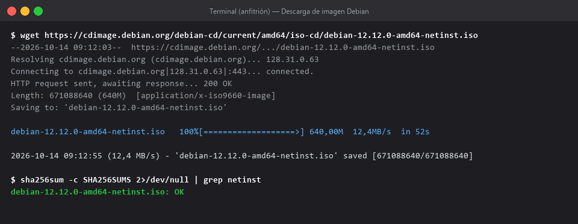

## 4. Creación de la máquina virtual en VMware

Pasos en el asistente de VMware Workstation:

1. `Archivo > Nueva máquina virtual > Típica (recomendada)`.
2. Origen de la instalación: imagen ISO de disco → seleccionar `debian-12.x.x-amd64-netinst.iso`.
3. Sistema operativo invitado: `Linux`, versión `Debian 12.x 64-bit`.
4. Nombre de la máquina virtual: `debian-apache`. Ubicación: carpeta dedicada (p. ej. `C:\VMs\debian-apache`).
5. Configuración del disco: 20 GB, `Thin provisioned` (thin) o `Split in multiple files`.
6. Personalizar hardware antes de finalizar y ajustar:
   - Procesadores: 2 núcleos.
   - Memoria: 2048 MB.
   - Red: `NAT (VMnet8)` para el laboratorio o `Bridged (Puente)` si se va a acceder cómodamente desde la LAN.
   - CD/DVD: conectar la ISO y marcar `Conectar al encender`.
7. Finalizar y arrancar la VM.

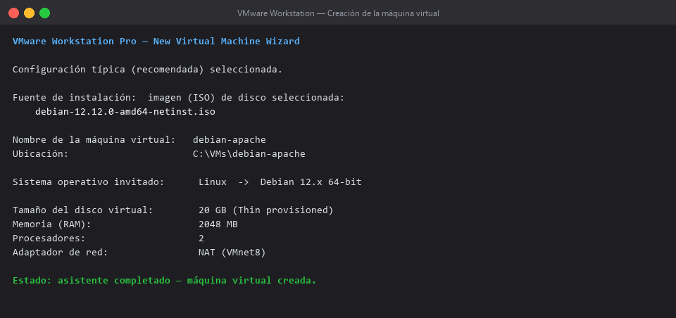

Recomendación de red:

- **Puente (Bridged)**: el invitado obtiene IP de la misma red que el anfitrión; el acceso es directo por `http://<IP-guest>/`.
- **NAT**: el invitado sale a Internet, pero para entrar desde el anfitrión hay que configurar reenvío de puertos (se explica en el apartado 11) o cambiar la red a Puente.

## 5. Instalación mínima de Debian 12

En el instalador (modo texto) seguir las opciones:

1. Idioma: `Español`; país: `España`; teclado: `Español`.
2. Nombre de host: `debian-apache`; dominio: vacío.
3. Contraseña de `root` establecida.
4. Usuario estándar: `alumno` con su contraseña.
5. Reloj: `Europa/Madrid` (zona horaria peninsular).
6. Particionado: `Guiado - utilizar todo el disco` → confirmar y escribir cambios.
7. Selección de software: desmarcar entorno de escritorio; marcar `Servidor SSH` y `Utilidades estándar del sistema`. (Apache se instalará después manualmente.)
8. Instalar el cargador de arranque GRUB en `/dev/sda` y reiniciar.

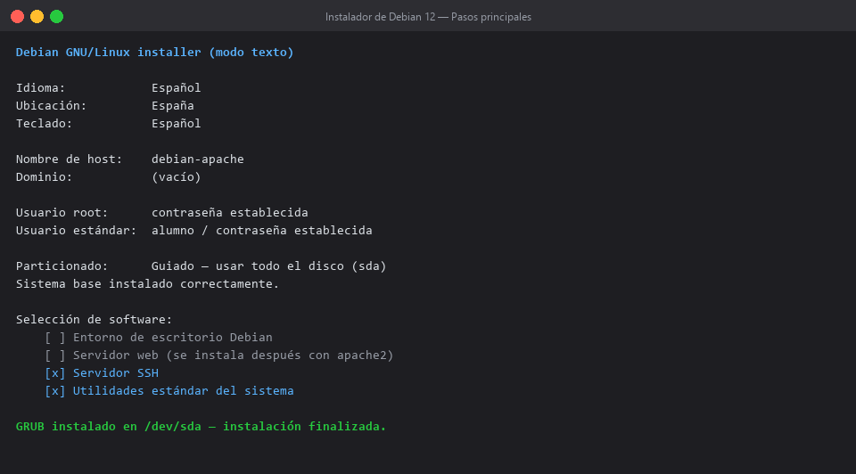

Tras el reinicio, iniciar sesión con `alumno` y comprobar el sistema:

```bash
hostnamectl
ip addr show
timedatectl
```

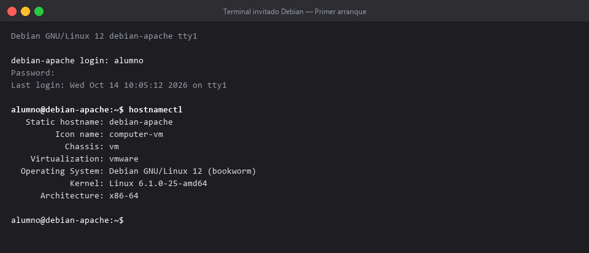

## 6. Preparación del sistema invitado

Actualizar repositorios y sistema (recomendado antes de instalar cualquier servicio):

```bash
sudo apt update
sudo apt full-upgrade -y
```

Instalar utilidades útiles para el diagnóstico:

```bash
sudo apt install -y curl wget ca-certificates gnupg lsb-release apt-transport-https
```

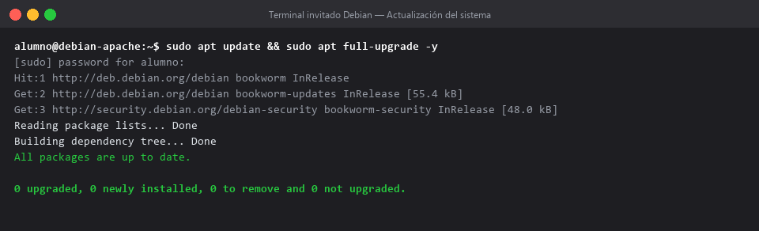

Comprobar que el usuario tiene `sudo` y que el SSH responde (opcional, permite trabajar desde el anfitrión con un terminal):

```bash
sudo whoami
systemctl status ssh --no-pager
```

## 7. Instalación del servidor Apache2

Instalar el paquete `apache2` (arrastra dependencias: `apache2-bin`, `apache2-data`, `apache2-utils`, APR, etc.):

```bash
sudo apt install -y apache2
```

Al finalizar, el servicio queda **instalado, arrancado y habilitado** automáticamente.

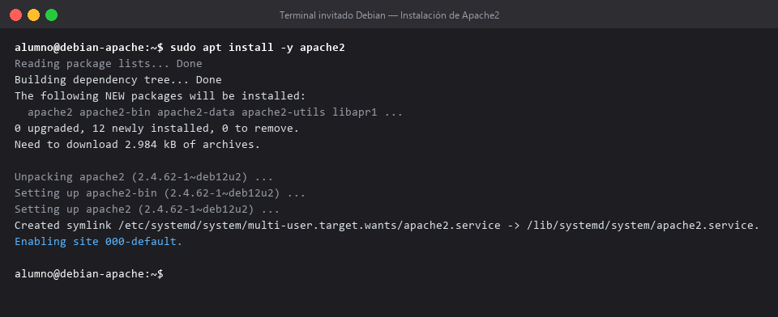

Rutas relevantes tras la instalación:

| Ruta | Contenido |
| --- | --- |
| `/etc/apache2/apache2.conf` | Configuración global principal |
| `/etc/apache2/ports.conf` | Puertos en escucha (80, 443) |
| `/etc/apache2/sites-available/` | VirtualHosts disponibles |
| `/etc/apache2/sites-enabled/` | VirtualHosts activos (enlaces) |
| `/etc/apache2/mods-enabled/` | Módulos activos |
| `/var/www/html/` | DocumentRoot por defecto |
| `/var/log/apache2/` | Logs `access.log` y `error.log` |

## 8. Arranque y gestión del servicio Apache

Comandos (requieren privilegios de administrador). Se ejecutan sobre el servicio `apache2` gestionado por `systemd`:

| Acción | Comando | Efecto |
| --- | --- | --- |
| Iniciar | `sudo systemctl start apache2` | Arranca el daemon si está parado. |
| Parar | `sudo systemctl stop apache2` | Detiene todas las instancias. |
| Reiniciar | `sudo systemctl restart apache2` | Parada + arranque (corta conexiones). |
| Recargar | `sudo systemctl reload apache2` | Relee configuración sin cortar conexiones. |
| Estado | `sudo systemctl status apache2 --no-pager` | Muestra si está `active (running)` y el PID principal. |
| Habilitar al arranque | `sudo systemctl enable apache2` | Crea el enlace en `multi-user.target`. |
| Deshabilitar arranque | `sudo systemctl disable apache2` | No arranca automáticamente. |
| Verificar si está activo | `sudo systemctl is-active apache2` | Devuelve `active` / `inactive`. |
| Verificar si está habilitado | `sudo systemctl is-enabled apache2` | Devuelve `enabled` / `disabled`. |

Secuencia recomendada tras instalar (o tras cambiar configuración):

```bash
sudo apache2ctl configtest          # valida la sintaxis ("Syntax OK")
sudo systemctl reload apache2       # aplica cambios sin cortar servicio
sudo systemctl is-active apache2    # confirma el estado
sudo systemctl is-enabled apache2   # confirma el arranque automático
```

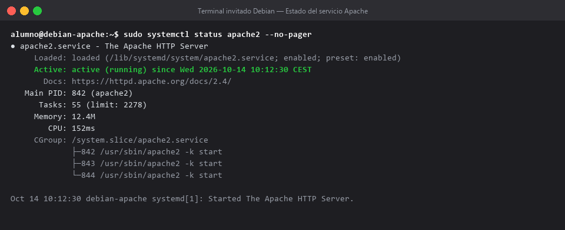

Comprobación de puertos y proceso (escucha en todas las interfaces):

```bash
sudo ss -tulpn | grep ':80'
# o, de forma equivalente:
sudo netstat -tulpn 2>/dev/null | grep ':80'
```

Prueba local con `curl` (cabeceras y cuerpo):

```bash
curl -I http://localhost            # 200 OK, Server: Apache/2.4.62 (Debian)
curl -s http://localhost | head     # devuelve el index.html por defecto ("It works!")
```

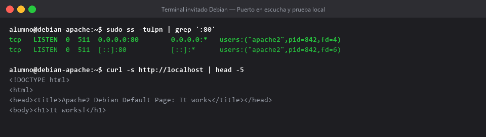

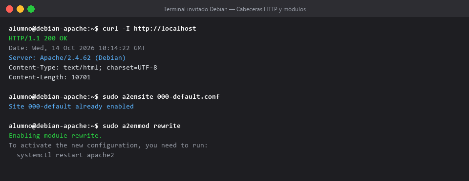

Módulos útiles (se activan con `a2enmod` y se desactivan con `a2dismod`):

```bash
sudo a2enmod rewrite       # reescritura de URLs
sudo a2enmod headers       # cabeceras HTTP
sudo a2enmod ssl           # HTTPS (requiere configuración adicional)
sudo a2dismod autoindex    # desactiva el listado de directorios
# tras activar/desactivar módulos:
sudo systemctl reload apache2
```

Sitios disponibles/activos (entran en juego con `a2ensite` / `a2dissite`):

```bash
sudo a2ensite 000-default.conf
sudo a2dissite 000-default.conf
ls -l /etc/apache2/sites-enabled/
```

## 9. Configuración del VirtualHost por defecto y del DocumentRoot

Archivo por defecto `/etc/apache2/sites-available/000-default.conf`:

```apache
<VirtualHost *:80>
    ServerAdmin webmaster@localhost
    DocumentRoot /var/www/html

    <Directory /var/www/html>
        Options -Indexes +FollowSymLinks
        AllowOverride All
        Require all granted
    </Directory>

    ErrorLog ${APACHE_LOG_DIR}/error.log
    CustomLog ${APACHE_LOG_DIR}/access.log combined
</VirtualHost>
```

Pasos para publicar una página propia:

1. Crear o copiar los archivos en `/var/www/html` (o en otro DocumentRoot configurado).
2. Ajustar permisos (propietario recomendado: `www-data`):

   ```bash
   sudo chown -R www-data:www-data /var/www/html
   sudo find /var/www/html -type d -exec chmod 755 {} \;
   sudo find /var/www/html -type f -exec chmod 644 {} \;
   ```

3. Validar sintaxis y recargar:

   ```bash
   sudo apache2ctl configtest
   sudo systemctl reload apache2
   ```

Ejemplo rápido de página de prueba:

```bash
echo "<h1>Servidor Apache en Debian 12 (VM)</h1>" | sudo tee /var/www/html/index.html
```

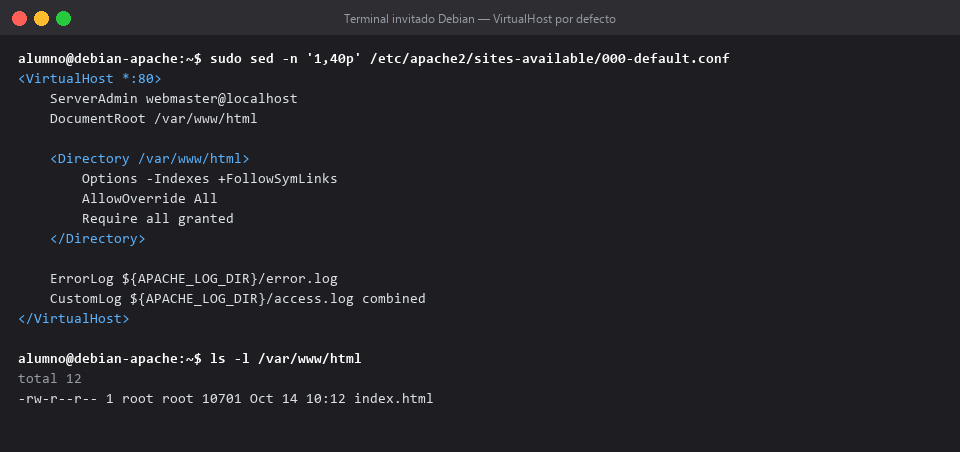

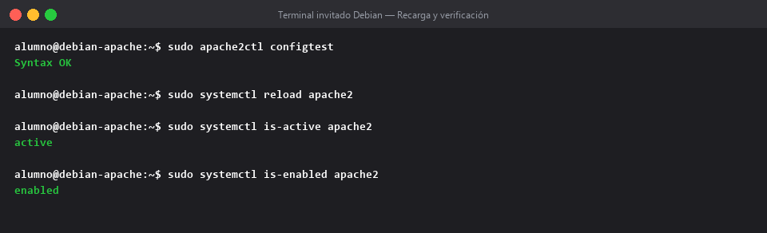

## 10. Accesibilidad a las páginas desde el anfitrión

Para que el anfitrión pueda abrir las páginas servidas por el invitado:

1. Obtener la IP del invitado:

   ```bash
   ip -4 addr show | grep inet
   # o
   hostname -I
   ```

2. Configurar la red de VMware:
   - **Puente (Bridged)**: el invitado aparece como un host más en la LAN. Acceso directo mediante `http://<IP-guest>/`.
   - **NAT**: por defecto no hay entrada directa desde el anfitrión. Opciones:
     - Cambiar el adaptador a Puente.
     - Configurar reenvío de puertos en `VMware > Edit > Virtual Network Editor > NAT Settings`: host port `8080` → guest `80`. Entonces se accede por `http://localhost:8080/`.
3. Cortafuegos del invitado (si se activa UFW):

   ```bash
   sudo ufw allow 'Apache'     # perfil equivalente a 80/tcp + 443/tcp
   sudo ufw allow 80/tcp
   sudo ufw allow 443/tcp
   sudo ufw enable
   sudo ufw status
   ```

4. Cortafuegos del anfitrión Windows: asegurarse de que el tráfico saliente hacia la IP/puerto del invitado no esté bloqueado (regla saliente por defecto suele permitirlo).

5. Abrir el navegador del anfitrión con `http://<IP-guest>/` o `http://localhost:8080/`.

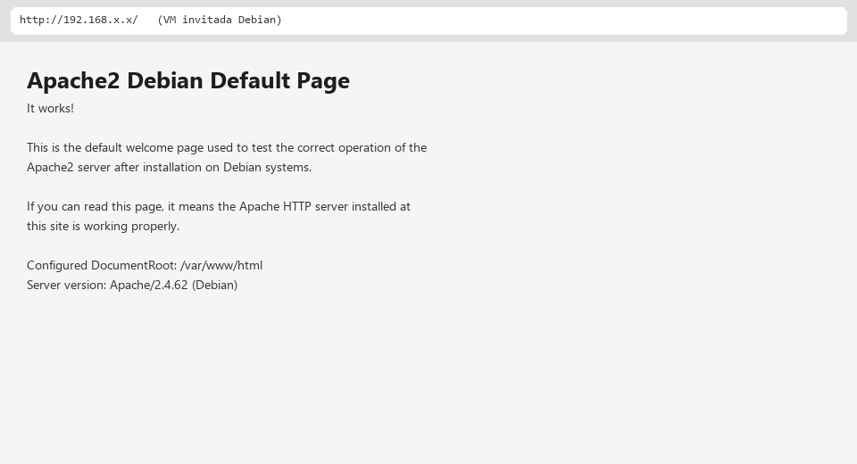

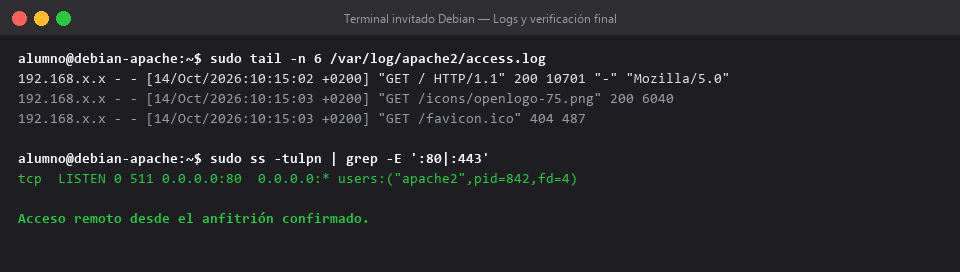

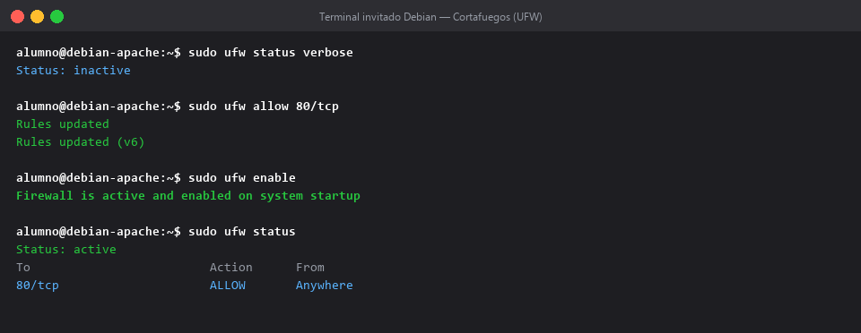

Verificación final (desde el invitado, comprobando que los accesos del anfitrión quedan registrados):

```bash
sudo tail -n 20 /var/log/apache2/access.log
sudo tail -n 20 /var/log/apache2/error.log
```

Los comandos siguientes se agrupan por categoría para consulta rápida durante la administración del servidor.

## 11. Comandos de referencia rápida

```bash
# Instalación
sudo apt update && sudo apt full-upgrade -y
sudo apt install -y apache2

# Servicio
sudo systemctl start|stop|restart|reload apache2
sudo systemctl status apache2 --no-pager
sudo systemctl enable|disable apache2
sudo systemctl is-active apache2
sudo systemctl is-enabled apache2

# Configuración
sudo apache2ctl configtest
sudo apache2ctl -S          # lista los VirtualHosts activos
sudo a2ensite 000-default.conf
sudo a2dissite 000-default.conf
sudo a2enmod rewrite
sudo a2dismod autoindex

# Red y puertos
ip -4 addr show
sudo ss -tulpn | grep ':80'
curl -I http://localhost
curl -s http://localhost | head
```

## 12. Incidencias frecuentes y solución

| Incidencia | Causa probable | Solución |
| --- | --- | --- |
| `Job for apache2.service failed` | Error de sintaxis en la configuración | `sudo apache2ctl configtest` y revisar el archivo indicado. |
| Puerto 80 ya en uso | Otro proceso ocupa el puerto | `sudo ss -tulpn | grep ':80'`; detener el proceso o cambiar de puerto en `ports.conf`. |
| No se puede acceder desde el anfitrión | Red en NAT sin reenvío o cortafuegos | Cambiar a Puente o configurar port forwarding; abrir `80/tcp` en UFW. |
| Página 403 Forbidden | Permisos insuficientes en DocumentRoot | `chown www-data:www-data` y permisos 755/644; revisar `Require all granted`. |
| Cambios no se reflejan | Falta recargar | `sudo systemctl reload apache2` (o `restart`). |
| Apache no arranca tras reinicio de la VM | Servicio deshabilitado | `sudo systemctl enable apache2`. |

## 13. Conclusiones

Se ha documentado la instalación completa del servidor Apache HTTP 2.4 sobre Debian 12 en una máquina virtual VMware: desde la descarga y verificación de la imagen ISO, la creación de la VM, la instalación mínima del sistema y el despliegue del servicio Apache, hasta su configuración, arranque automático y accesibilidad desde el anfitrión. El servidor queda operativo en el puerto 80, se inicia automáticamente con la VM y sirve las páginas del DocumentRoot `/var/www/html`, cumpliendo los requisitos de la tarea.