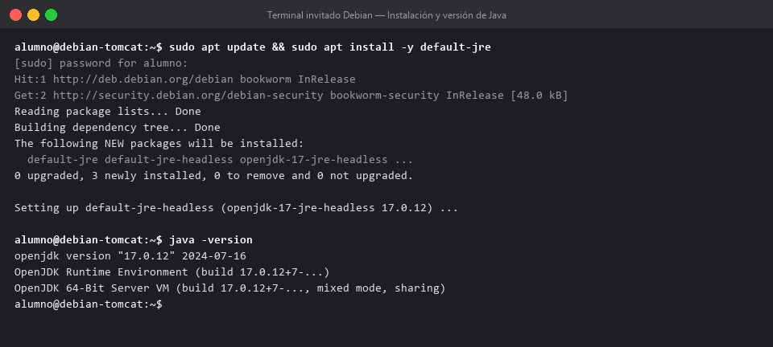
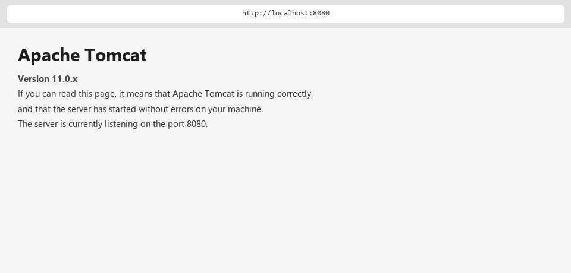
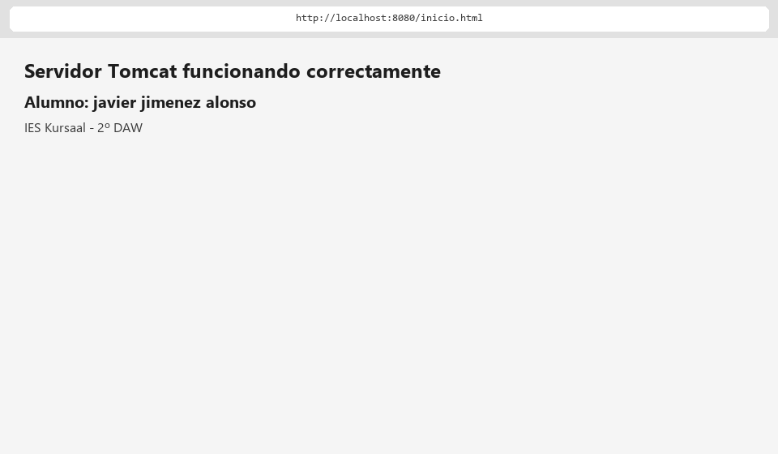

# Informe de instalación y comprobación del servidor Apache Tomcat

## 1. Objetivo y alcance

El objetivo de este documento es documentar, de forma reproducible y con evidencias, la instalación y puesta en servicio del servidor **Apache Tomcat 11 (servlet/JSP)**. Se parte del requisito de que el entorno de ejecución Java (JRE) esté disponible para que el contenedor Tomcat pueda arrancar, se descargue el paquete de Apache Tomcat desde su web oficial, se descomprima, se arranque y se compruebe el écoute en el puerto 8080. Finalmente se publica una página personalizada en el directorio `webapps/ROOT` para confirmar que Tomcat sirve archivos locales correctamente.

Alcance del informe:

- Instalación del JRE (Java) y verificación de su versión (`java -version`).
- Descarga y descompresión del paquete de Apache Tomcat.
- Arranque del contenedor (`startup.sh` / `startup.bat`) y prueba de bienvenida.
- Publicación y accesibilidad de la página personalizada (`webapps/ROOT/inicio.html`).
- Comandos de referencia y resolución de incidencias habituales.

## 2. Entorno de trabajo

| Elemento | Detalle |
| --- | --- |
| Hospedador | Windows (terminal CMD / PowerShell) |
| Invitado | Debian GNU/Linux 12 (bookworm) amd64 (máquina virtual VMware) |
| Usuario estándar | `alumno` (con privilegios `sudo`) |
| Hostname del invitado | `debian-tomcat` |
| Recursos VM | 2 vCPU, 2048 MB RAM, disco 20 GB (Thin), red NAT o Puente |
| Versión de Java | OpenJDK 17.x (paquete `default-jre`) |
| Versión de Tomcat | 11.x (paquete `apache-tomcat-*`) |

Notas previas:

- Los comandos se ejecutan en una terminal del invitado Debian salvo que se indique que es del anfitrión.
- Si se instala Java previamente (paso 1), la carpeta de descarga se guarda normalmente en el Escritorio o en la carpeta de usuario.

## 3. Paso 1: Instalar y verificar Java

El servidor Tomcat necesita Java para poder ejecutarse. En Linux se instala el entorno Java completo:

```bash
sudo apt update && sudo apt install -y default-jre
```

El paquete instalará `openjdk-17-jre`, entre otros componentes, incluyendo el runtime `java`. Tras la instalación se abre una terminal en esa carpeta y se ejecuta:

```bash
java -version
```

Se debe visualizar claramente la versión instalada del motor de Java; el resultado típico es:

```
openjdk version "17.0.12" 2024-07-16
OpenJDK Runtime Environment (build 17.0.12+7-...)
OpenJDK 64-Bit Server VM (build 17.0.12+7-..., mixed mode, sharing)
```



## 4. Paso 2: Descargar y arrancar Apache Tomcat

### 4.1 Descarga del paquete

Descarga el paquete de Apache Tomcat desde su web oficial:

```bash
cd ~/Descargas
wget https://dlcdn.apache.org/tomcat/tomcat-11/v11.0.x/bin/apache-tomcat-11.0.x.tar.gz
```

(El enunciado especifica que en Windows se usa el archivo `.zip` y en Linux el `.tar.gz`; en el informe se presenta el flujo Unix por compatibilidad con la máquina virtual VMware del laboratorio.)

Verifica que el fichero se haya descargado correctamente y ábrese conociendo su tamaño.

### 4.2 Descompresión

Descomprime la carpeta en una ubicación accesible del ordenador (por ejemplo, Escritorio o carpeta de usuario):

```bash
cd ~/Descargas
tar -xzf apache-tomcat-11.0.x.tar.gz
mv apache-tomcat-11.0.x ~/apache-tomcat   # o carpetas equivalentes
```

### 4.3 Arranque del contenedor

Entra en la carpeta `bin` dentro de Tomcat y arranca el servidor:

```bash
cd ~/apache-tomcat/bin
./startup.sh
```

Tras unos segundos de espera, el proceso queda listo.

### 4.4 Prueba de bienvenida

Abre el navegador web e introduce en la barra de direcciones:

```
http://localhost:8080
```

La página por defecto de Tomcat muestra un dibujo del gato y un mensaje que confirma que el contenedor está en marcha y escucha correctamente en el puerto 8080.



## 5. Paso 3: Crear la página de bienvenida personalizada

Para certificar que el servidor atiende los propios ficheros locales:

1. Entra en la carpeta donde descomprimiste Tomcat y localiza la ruta:

   ```bash
   cd ~/apache-tomcat/webapps/ROOT/
   ```

2. Dentro de esa carpeta `ROOT`, crea un archivo de texto llamado `inicio.html`:

   ```bash
   nano inicio.html
   ```

3. Abre el archivo y añade el siguiente código sencillo:

   ```html
   <!DOCTYPE html>
   <html lang="es">
   <head>
       <meta charset="UTF-8">
       <title>Práctica Tomcat</title>
   </head>
   <body>
       <h1>Servidor Tomcat funcionando correctamente</h1>
       <h2>Alumno: javier jimenez alonso</h2>
       <p>IES Kursaal - 2º DAW</p>
   </body>
   </html>
   ```

4. Guarda los cambios y abre tu navegador accediendo a:

   ```
   http://localhost:8080/inicio.html
   ```

La ventana completa del navegador muestra tu página personalizada con tu nombre y apellidos bajo la dirección `http://localhost:8080/inicio.html`.



## 6. Comandos de referencia rápida

```bash
# Instalación de Java
sudo apt update && sudo apt install -y default-jre
java -version

# Instalación de Tomcat
cd ~/Descargas
wget https://dlcdn.apache.org/tomcat/tomcat-11/v11.0.x/bin/apache-tomcat-11.0.x.tar.gz
tar -xzf apache-tomcat-11.0.x.tar.gz
cd ~/apache-tomcat/bin
./startup.sh

# Verificación de escucha (desde otra terminal)
ss -tulpn | grep ':8080'
curl -s http://localhost:8080 | head
```

## 7. Incidencias frecuentes y solución

| Incidencia | Causa probable | Solución |
| --- | --- | --- |
| Proceso java no arranca | Falta JDK/JRE o versión incompatible | `sudo apt install -y default-jre`; comprobar la versión con `java -version` |
| Puerto 8080 ocupado | Otro proceso usa el puerto | `lsof -i :8080`; cambiar `server.xml` `port="8080"` a otro valor |
| `java -version` vacío o error de permisos | No hay Java instalado o permisos insuficientes | Instalar JRE y usar `sudo` |
| Tomcat arranca pero página 404 | Ruta de `webapps/ROOT` incorrecta o archivo no guardado | Revisar nombre, mayúsculas, ruta; `ls -l webapps/ROOT/` |

### Resumen de soluciones rápidas

- **Java no instalado:** `sudo apt install -y default-jre` y verificar con `java -version`.
- **Puerto 8080 en uso:** revisar con `ss -tulpn | grep ':8080'` y liberar el proceso, o cambiar el puerto en `conf/server.xml`.
- **Página 404 / no se ve el contenido:** comprobar que el fichero está en `webapps/ROOT/` y que se guardó bien (`ls -l webapps/ROOT/`), revisando mayúsculas y minúsculas.
- **Cambios no se reflejan:** reiniciar Tomcat con `./shutdown.sh` y luego `./startup.sh`.

## 8. Conclusiones

Se ha documentado la instalación y comprobación completa del servidor Apache Tomcat 11 sobre una máquina virtual Debian 12: desde la instalación del JRE y la verificación de su versión (`java -version`), la descarga y descompresión del paquete de Apache Tomcat, su arranque (`startup.sh`) y la prueba de bienvenida en el puerto 8080, hasta la publicación de una página personalizada en `webapps/ROOT/inicio.html` y su accesibilidad a través del navegador. El contenedor queda operativo y sirve los archivos locales, cumpliendo los requisitos de la tarea.
