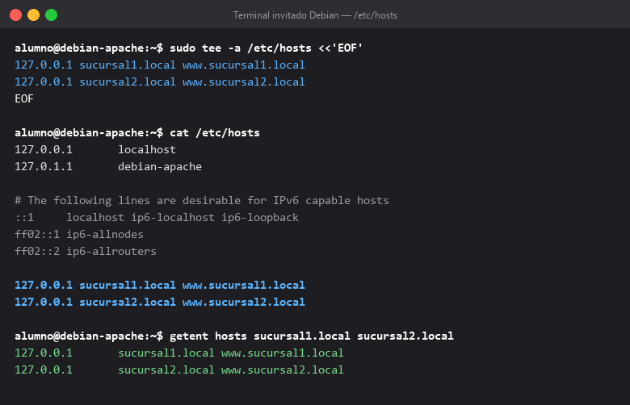
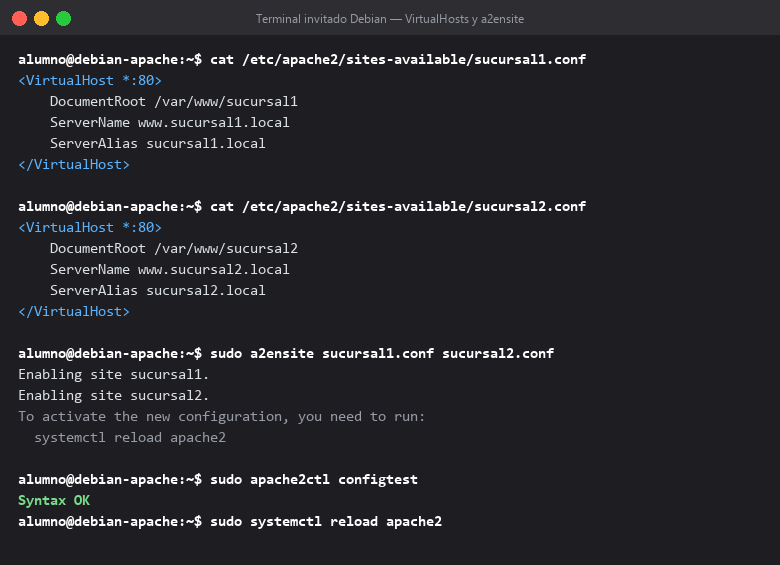
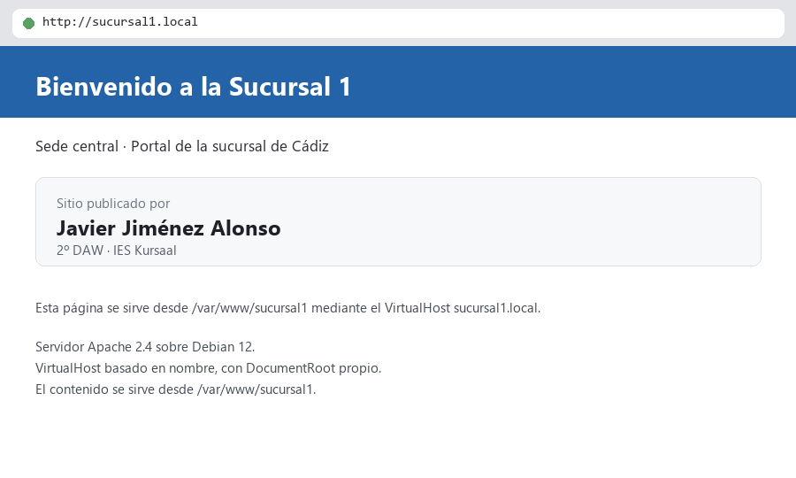
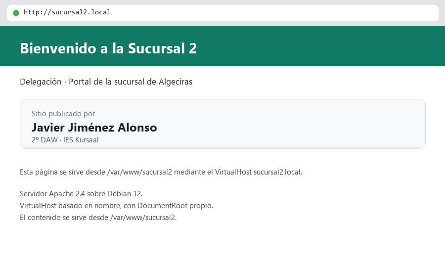
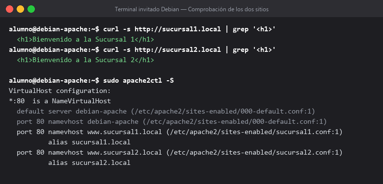

# Hosts virtuales en Apache: dos sucursales en un mismo servidor

## 1. Qué pide la práctica

La práctica pide configurar un único Apache para que sirva dos sitios distintos,
`sucursal1.local` y `sucursal2.local`, usando VirtualHosts basados en nombre. Cada
dominio tiene que enseñar una página propia con mi nombre y apellidos, y hay que
demostrarlo con cuatro capturas: el archivo `hosts`, los dos bloques
`<VirtualHost>`, y el navegador en cada uno de los dos dominios.

## 2. Punto de partida

Sigo con la máquina virtual Debian 12 de la tarea de Apache de la Unidad 1. Allí
quedó Apache 2.4 instalado, habilitado y escuchando en el puerto 80, así que no
vuelvo a instalarlo. Antes de tocar nada compruebo que sigue en marcha:

```bash
sudo systemctl is-active apache2
```

La respuesta es `active`. El equipo se llama `debian-apache` y en `/etc/hosts` ya
tenía la línea `127.0.1.1 debian-apache` que pone el instalador de Debian.

## 3. Dos carpetas con dos páginas

Creo las dos carpetas dentro de `/var/www`, que es donde Apache publica por
defecto, y en cada una dejo un `index.html` con un título distinto:

```bash
sudo mkdir -p /var/www/sucursal1 /var/www/sucursal2
sudo nano /var/www/sucursal1/index.html
sudo nano /var/www/sucursal2/index.html
```

El contenido del primero es este. El segundo es igual, cambiando el título, el
color de cabecera y el párrafo:

```html
<!DOCTYPE html>
<html lang="es">
<head>
  <meta charset="UTF-8">
  <title>Sucursal 1</title>
</head>
<body>
  <h1>Bienvenido a la Sucursal 1</h1>
  <p>Sitio servido por Apache mediante un VirtualHost
  basado en nombre.</p>
  <p><strong>Javier Jiménez Alonso</strong></p>
  <p>2º DAW · IES Kursaal</p>
</body>
</html>
```

No hace falta tocar los permisos: las carpetas se crean con `sudo` y el usuario
`www-data` solo necesita permiso de lectura, que ya tiene. El nombre va dentro
de la página porque el enunciado lo pide expresamente en las dos evidencias del
navegador.

## 4. Resolver los dominios en local

`sucursal1.local` y `sucursal2.local` no existen en Internet, así que el
navegador no sabría a qué dirección conectarse. Se lo digo en el archivo
`/etc/hosts`, que se consulta antes que el DNS. Añado las dos líneas al final:

```bash
sudo tee -a /etc/hosts <<'EOF'
127.0.0.1 sucursal1.local www.sucursal1.local
127.0.0.1 sucursal2.local www.sucursal2.local
EOF
```

Compruebo que el sistema las resuelve con `getent`, que es la misma consulta que
hace el navegador pero sin abrirlo:

```bash
getent hosts sucursal1.local sucursal2.local
```

Devuelve `127.0.0.1` para los dos nombres y sus alias con `www.`. La captura
enseña el archivo completo con las líneas al final y el resultado de `getent`.



## 5. Los dos VirtualHost

Cada sitio lleva su propio archivo en `/etc/apache2/sites-available/`. El de la
sucursal 1 queda así:

```apache
<VirtualHost *:80>
    DocumentRoot /var/www/sucursal1
    ServerName www.sucursal1.local
    ServerAlias sucursal1.local
</VirtualHost>
```

El de la sucursal 2 es idéntico cambiando `sucursal1` por `sucursal2` en las tres
directivas. `DocumentRoot` dice de qué carpeta salen los archivos, `ServerName`
es el nombre principal con el que responde ese sitio y `ServerAlias` añade el
nombre sin `www.`, para que funcionen las dos formas.

Con los archivos creados, habilito los dos sitios y recargo Apache:

```bash
sudo a2ensite sucursal1.conf sucursal2.conf
sudo apache2ctl configtest
sudo systemctl reload apache2
```

`a2ensite` crea los enlaces en `sites-enabled`, `configtest` tiene que contestar
`Syntax OK` y el `reload` aplica los cambios sin cortar las conexiones que ya
hubiera. La captura recoge los dos bloques completos y la ejecución de
`a2ensite` con la comprobación de sintaxis.



## 6. Comprobación en el navegador

Abro el navegador del invitado y escribo `http://sucursal1.local`. La barra de
direcciones tiene que enseñar el dominio, nunca una ruta `file://`, y la página
tiene que ser la de la sucursal 1:



Repito con `http://sucursal2.local`. El contenido es distinto, con otro título y
otro color de cabecera, aunque las dos peticiones llegan al mismo Apache y al
mismo puerto 80:



Lo mismo se puede ver sin navegador, pidiendo el `<h1>` de cada sitio con `curl`.
Así queda claro que el que decide qué carpeta se sirve es el nombre del host y no
el puerto:

```bash
curl -s http://sucursal1.local | grep '<h1>'
curl -s http://sucursal2.local | grep '<h1>'
sudo apache2ctl -S
```

`apache2ctl -S` lista los tres VirtualHost del puerto 80: el `000-default` que
trae Debian y los dos nuevos con sus alias. El `000-default` sigue activo, pero
como los otros dos tienen `ServerName` propio, solo responde cuando el nombre
pedido no coincide con ninguno.



## 7. Incidencias que me he encontrado

Si el navegador sigue enseñando la página por defecto de Apache, lo primero es
mirar si el sitio está habilitado: `ls -l /etc/apache2/sites-enabled/` tiene que
mostrar los enlaces de `sucursal1.conf` y `sucursal2.conf`.

Un `403 Forbidden` suele ser de permisos o de que falta el `index.html` dentro de
la carpeta. Se comprueba con `ls -l /var/www/sucursal1` y, si hace falta, se
ajusta el dueño con `sudo chown -R www-data:www-data /var/www/sucursal1`.

Si `configtest` falla, el mensaje indica el archivo y la línea. Casi siempre es
una etiqueta `<VirtualHost>` sin cerrar o una ruta que no existe.

Y si el dominio no resuelve, el problema está en `/etc/hosts` o en la caché del
navegador. `getent hosts sucursal1.local` lo aclara en un segundo, sin depender
del navegador.

Con los dos sitios habilitados, el archivo `hosts` apuntando a `127.0.0.1` y el
navegador enseñando contenidos distintos, la práctica queda comprobada de
principio a fin.
