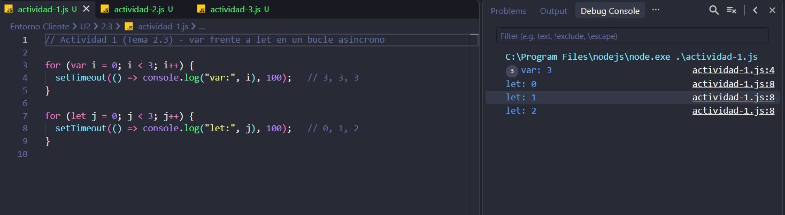
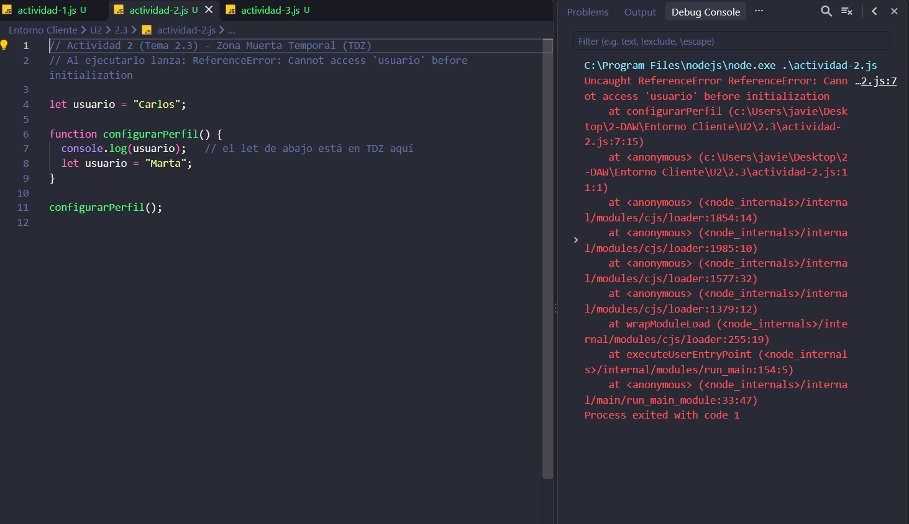
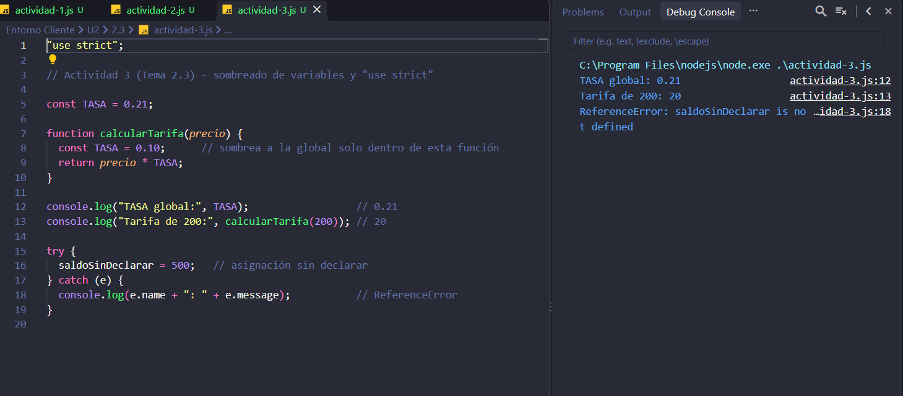

### 1. Bucle asíncrono con `var` frente a `let`

```js
for (var i = 0; i < 3; i++) {
  setTimeout(() => console.log("var:", i), 100);   // 3, 3, 3
}
for (let j = 0; j < 3; j++) {
  setTimeout(() => console.log("let:", j), 100);   // 0, 1, 2
}
```

`var` tiene ámbito de función: las tres funciones comparten la misma `i`, que ya vale 3 cuando por fin se ejecutan. `let` tiene ámbito de bloque: cada vuelta del bucle crea su propia `j`, así que cada función recuerda el valor de su iteración.



### 2. Zona Muerta Temporal (TDZ)

```js
let usuario = "Carlos";

function configurarPerfil() {
  console.log(usuario);   // ReferenceError
  let usuario = "Marta";
}
configurarPerfil();
```

Salida: `ReferenceError: Cannot access 'usuario' before initialization`.

El `let` de dentro ensombrece al global desde el primer byte de la función, pero está en su Zona Muerta Temporal hasta la línea en que se declara: leerlo antes lanza el error. Se arregla usando otro nombre (`usuarioInterno`) o leyendo el global con un identificador distinto.



### 3. Sombreado y `"use strict"`

```js
"use strict";

const TASA = 0.21;

function calcularTarifa(precio) {
  const TASA = 0.10;   // sombrea a la global solo dentro de esta función
  return precio * TASA;
}

console.log(TASA);                // 0.21
console.log(calcularTarifa(200)); // 20
```

La `TASA` local solo existe dentro de la función; al salir, la global sigue valiendo 0.21: son dos posiciones de memoria distintas.

Con `"use strict"`, asignar a una variable no declarada lanza `ReferenceError` en lugar de crear una global oculta:

```js
try {
  saldoSinDeclarar = 500;
} catch (e) {
  console.log(e.name);   // ReferenceError
}
```

Sin la directiva, esa misma línea crearía `window.saldoSinDeclarar = 500` sin avisar.


