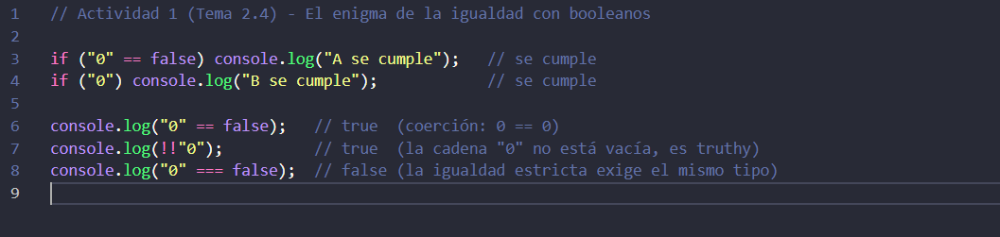
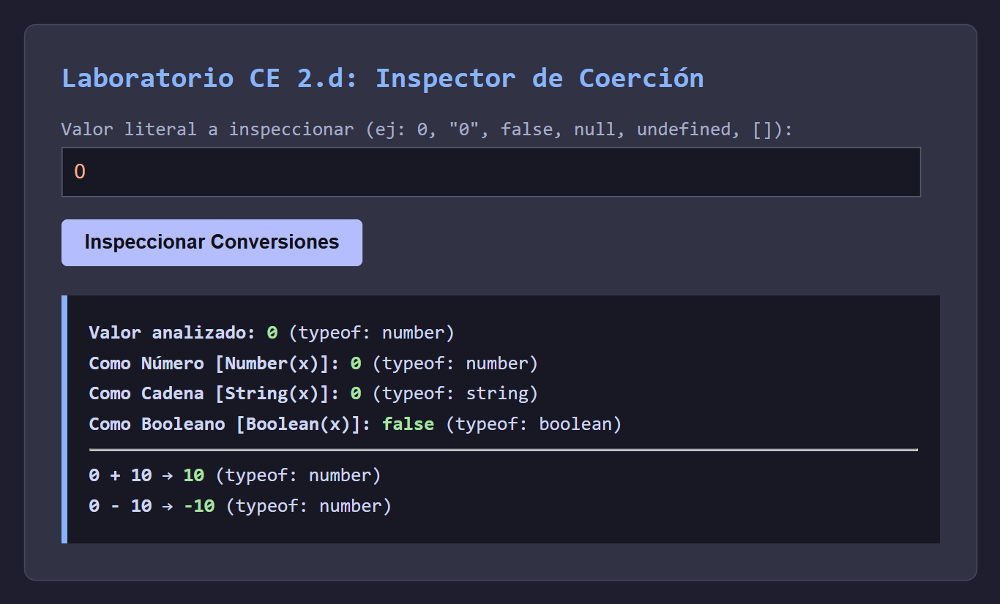
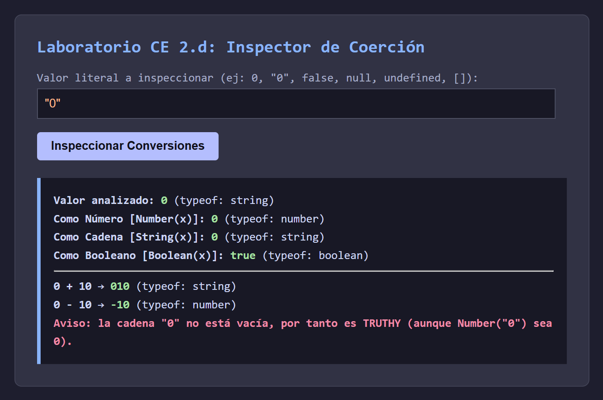
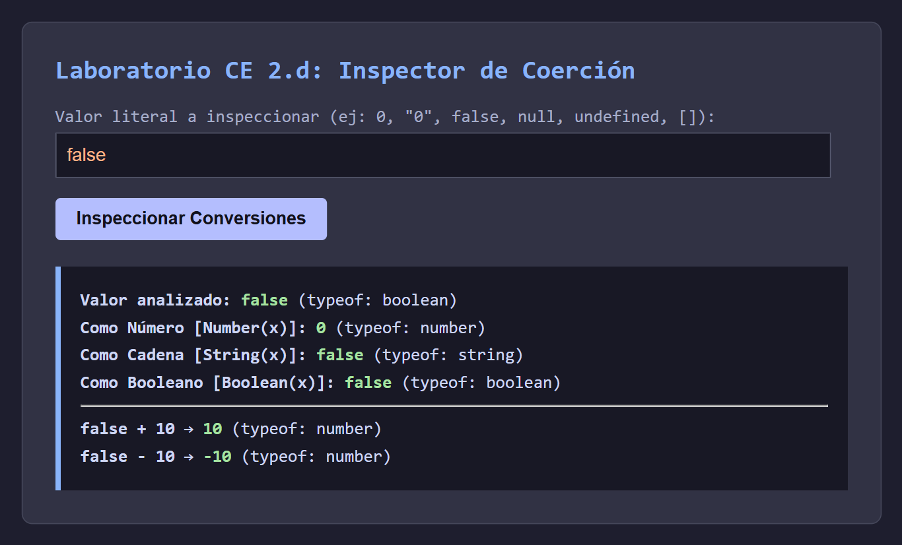
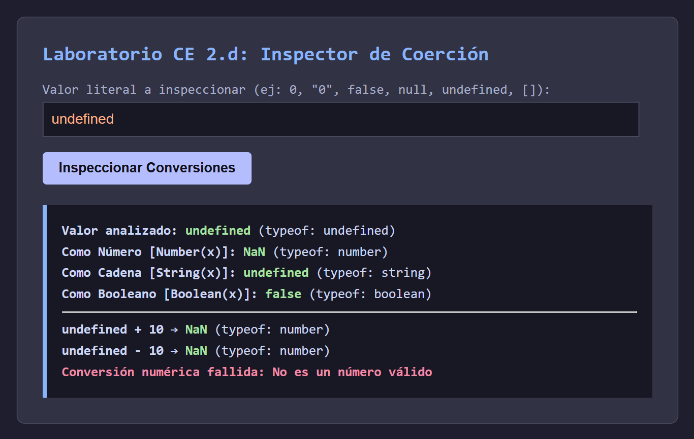
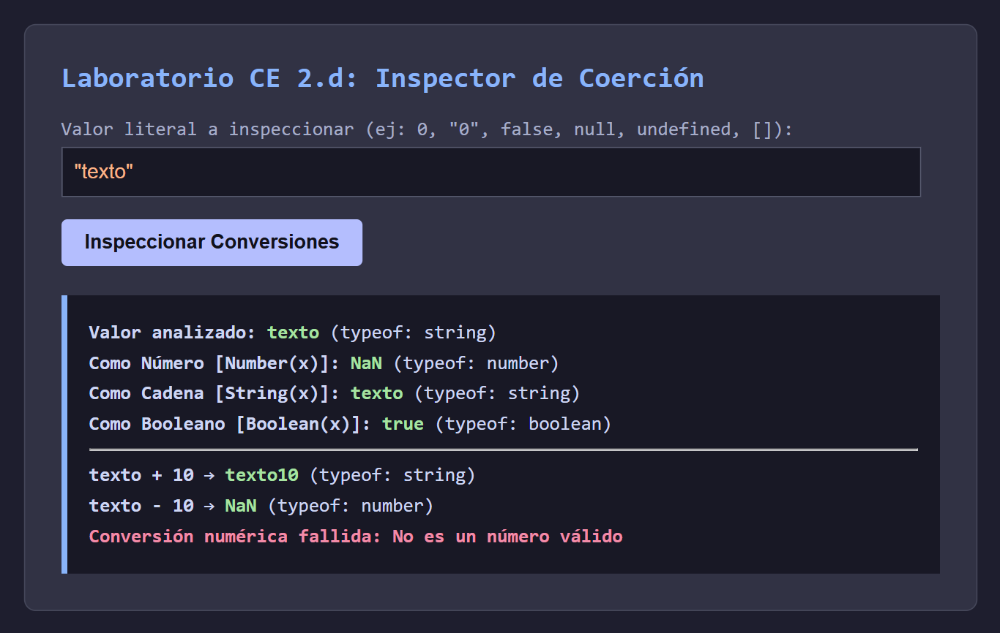

### 1. El enigma de la igualdad con booleanos

Parece una contradicción, pero no lo es: cada línea pregunta algo distinto. `"0" == false` compara con coerción, y el `==` convierte los dos operandos a número, así que da verdadero (`0 == 0`). `if ("0")` no compara, solo mira si el valor cuenta como verdadero, y como la cadena `"0"` no está vacía, es truthy. Con `===` el resultado sería `false`, porque además exige el mismo tipo; por eso conviene usar siempre `===`.

### 2. Inspector de conversiones y tipado débil

La práctica consiste en escribir la lógica de `laboratorio_conversiones.js`; el HTML y el CSS los da el enunciado. El script toma lo que se escribe en el campo, lo convierte a un valor real con `JSON.parse` (el input siempre llega como texto, y `undefined` y `NaN` se resuelven a mano) y muestra en pantalla las conversiones con `Number`, `String` y `Boolean` junto a su tipo. También avisa de las trampas: que `"0"` es truthy, que `[]` acaba valiendo 0 y que un texto no numérico da `NaN` (comprobado con `Number.isNaN`). Y contrasta `+ 10`, que concatena si hay texto, con `- 10`, que siempre resta.

### Resultados de la prueba

![Caso 6 (entrada []): Number 0, Boolean true, "10" / -10, aviso matriz coerciona a 0](capturas/Ejercicio2_06_matriz.png)

