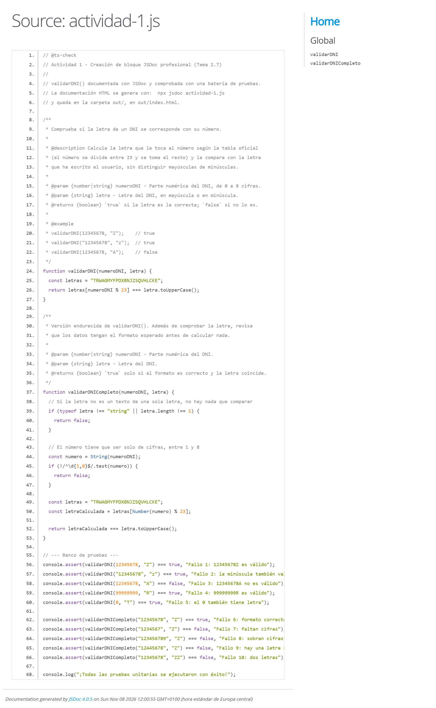
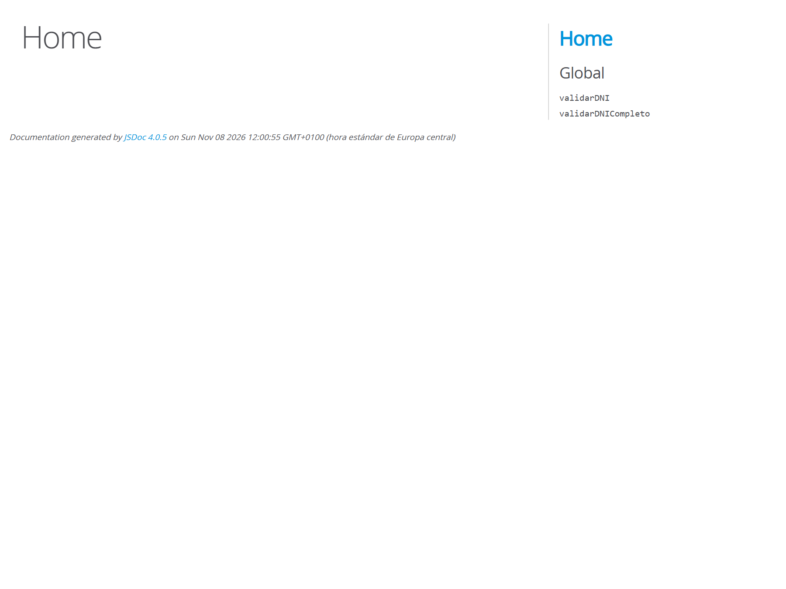

### 1. Creación de bloque JSDoc profesional

El enunciado da esta función y pide documentarla con JSDoc y generar la
documentación:

```js
function validarDNI(numeroDNI, letra) {
  const letras = "TRWAGMYFPDXBNJZSQVHLCKE";
  return letras[numeroDNI % 23] === letra.toUpperCase();
}
```

#### Bloque JSDoc completo

```js
/**
 * Comprueba si la letra de un DNI se corresponde con su número.
 *
 * @description Calcula la letra que le toca al número según la tabla oficial
 * (el número se divide entre 23 y se toma el resto) y la compara con la letra
 * que ha escrito el usuario, sin distinguir mayúsculas de minúsculas.
 *
 * @param {number|string} numeroDNI - Parte numérica del DNI, de 0 a 8 cifras.
 * @param {string} letra - Letra del DNI, en mayúscula o en minúscula.
 * @returns {boolean} `true` si la letra es la correcta; `false` si no lo es.
 *
 * @example
 * validarDNI(12345678, "Z");    // true
 * validarDNI("12345678", "z");  // true
 * validarDNI(12345678, "A");    // false
 */
function validarDNI(numeroDNI, letra) {
  const letras = "TRWAGMYFPDXBNJZSQVHLCKE";
  return letras[numeroDNI % 23] === letra.toUpperCase();
}
```

Qué hace cada etiqueta:

| Etiqueta | Para qué sirve en esta función |
|---|---|
| `@description` | Explica el algoritmo en una frase: por qué se usa el módulo 23. Sin esto, la etiqueta `@param` no cuenta de dónde sale la tabla de letras. |
| `@param {number\|string} numeroDNI` | Acepta número o texto porque el DNI se puede escribir de las dos formas y el operador `%` convierte el texto en número. |
| `@param {string} letra` | La letra es texto obligatoriamente; si se pasa otra cosa, `toUpperCase()` falla. |
| `@returns {boolean}` | La función no escribe nada ni devuelve un mensaje: solo dice verdadero o falso, y quien la llama decide qué hacer. |
| `@example` | Enseña a usarla en el editor y sirve como primer caso de prueba. |

#### Cómo se genera la documentación

```powershell
npx jsdoc actividad-1.js
```

JSDoc crea una carpeta `out/` con `out/index.html`, que es un portal navegable
con la ficha de la función: parámetros, tipo de retorno, descripción y ejemplo.
Esa página es la que se entrega como prueba de que la documentación se genera.
La captura está hecha con la función de `actividad-1.js`:



La portada del portal (`out/index.html`) lista las dos funciones documentadas y
las agrupa por archivo, que es lo que se ve en la segunda captura:



#### Lo que conviene saber de la función

- **La tabla de letras** es fija y oficial: `TRWAGMYFPDXBNJZSQVHLCKE`, 23 letras.
  Al dividir el número entre 23, el **resto** siempre cae entre 0 y 22, que son
  justo las 23 posiciones de la tabla. Por eso no hay que usar un `if` por cada
  letra.
- **`numeroDNI % 23` con un texto** como `"12345678"` no da error: JavaScript
  convierte el texto a número para poder hacer la operación. Funciona, pero es
  una conversión implícita, y en cuanto el valor no sea numérico el resto sale
  `NaN`, la posición de la tabla no existe y la comparación devuelve `false`
  sin avisar. No distingue «DNI mal escrito» de «letra incorrecta».
- **La función original no valida el formato**: acepta `"123"`, `"123456789"`,
  un número negativo o una letra de dos caracteres. Comprueba bien la letra, pero
  no comprueba que los datos tengan forma de DNI.
- **Si `letra` no es un texto**, `letra.toUpperCase` no existe y salta un
  `TypeError`. El JSDoc lo deja claro al tipar el parámetro como `string`; el
  editor avisa antes de ejecutar si se le pasa otra cosa.

#### Versión endurecida

```js
/**
 * Versión endurecida de validarDNI(). Además de comprobar la letra, revisa
 * que los datos tengan el formato esperado antes de calcular nada.
 *
 * @param {number|string} numeroDNI - Parte numérica del DNI.
 * @param {string} letra - Letra del DNI.
 * @returns {boolean} `true` solo si el formato es correcto y la letra coincide.
 */
function validarDNICompleto(numeroDNI, letra) {
  if (typeof letra !== "string" || letra.length !== 1) {
    return false;
  }

  const numero = String(numeroDNI);
  if (!/^\d{1,8}$/.test(numero)) {
    return false;
  }

  const letras = "TRWAGMYFPDXBNJZSQVHLCKE";
  const letraCalculada = letras[Number(numero) % 23];

  return letraCalculada === letra.toUpperCase();
}
```

Las dos primeras comprobaciones van al principio y salen en cuanto el dato no
sirve. Así, si llega hasta abajo, ya se sabe que el formato es bueno y solo
queda comparar la letra. Es la misma idea de las comprobaciones tempranas que
se usó en el tema 2.5.

#### Banco de pruebas

```js
console.assert(validarDNI(12345678, "Z") === true, "Fallo 1: 12345678Z es válido");
console.assert(validarDNI("12345678", "z") === true, "Fallo 2: la minúscula también vale");
console.assert(validarDNI(12345678, "A") === false, "Fallo 3: 12345678A no es válido");
console.assert(validarDNI(99999999, "R") === true, "Fallo 4: 99999999R es válido");
console.assert(validarDNI(0, "T") === true, "Fallo 5: el 0 también tiene letra");

console.assert(validarDNICompleto("12345678", "Z") === true, "Fallo 6: formato correcto");
console.assert(validarDNICompleto("1234567", "Z") === false, "Fallo 7: faltan cifras");
console.assert(validarDNICompleto("123456789", "Z") === false, "Fallo 8: sobran cifras");
console.assert(validarDNICompleto("12A45678", "Z") === false, "Fallo 9: hay una letra suelta");
console.assert(validarDNICompleto("12345678", "ZZ") === false, "Fallo 10: dos letras");
```

Las cinco primeras pruebas van contra la función tal como la da el enunciado: el
número funciona como número y como texto, la letra vale en minúscula y el cero
también tiene su letra (`T`, porque `0 % 23` es `0`). Las cinco siguientes van
contra la versión endurecida y comprueban solo el formato, que es lo que la
original no mira.

Si alguna condición falla, `console.assert` la marca en rojo en la consola pero
el script sigue; si no falla ninguna, aparece el mensaje final. En
`actividad-1.js` están las dos funciones y este banco de pruebas completo.

#### Por qué JSDoc no es ruido visual

Un `// Comprueba el DNI` dentro de la función sobra, porque el nombre ya lo dice.
El bloque `/** ... */` es distinto: no explica línea por línea, define los tipos
de los parámetros y del retorno. Con `// @ts-check` en la primera línea, VS Code
usa esa información para autocompletar y para marcar en rojo una llamada con el
tipo equivocado, sin necesidad de pasar el archivo a TypeScript. Eso es
documentación que trabaja, no relleno.
