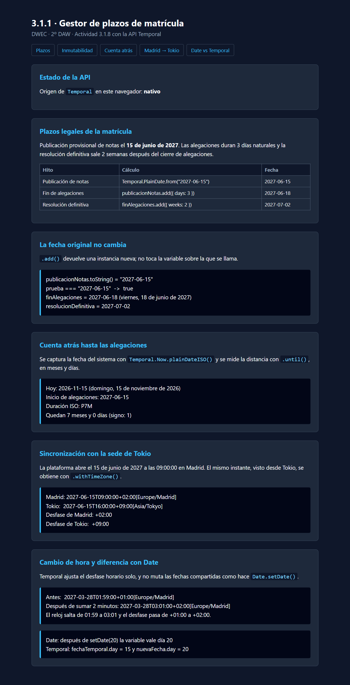
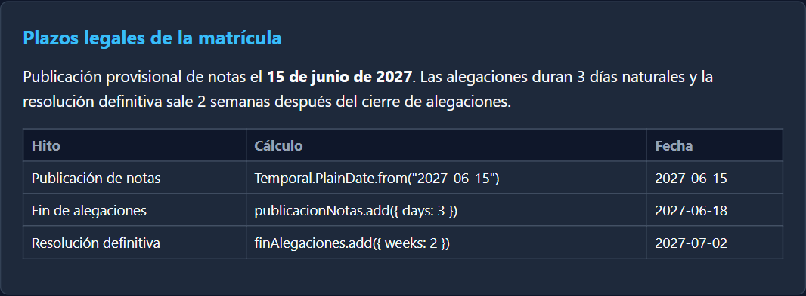

# Tema 3.1.1 · El Objeto Global Temporal

**Módulo:** Desarrollo Web en Entorno Cliente (DWEC) · 2º DAW
**Unidad:** 3 · Objetos predefinidos del lenguaje
**Tarea:** 3.1.1 El Objeto Global Temporal (RA3 · CE 3.a)
**Entrega:** 19/11/2026
**Archivos:** `index.html`, `css/estilos.css`, `js/plazos.js`,
`vendor/temporal-polyfill.global.min.js`, `capturas/`

---

## 1. Qué es Temporal y por qué sustituye a `Date`

`Temporal` es la API de fechas de ES2026. No es un objeto que lo controle todo
como `Date`, sino una familia de tipos, cada uno para lo que realmente
representa:

| Tipo | Para qué sirve |
|---|---|
| `Temporal.PlainDate` | Solo fecha (año, mes, día): calendario escolar, festivos, cumpleaños |
| `Temporal.PlainTime` | Solo hora: horarios de apertura, alarmas |
| `Temporal.ZonedDateTime` | Fecha y hora con zona horaria: vuelos, citas internacionales |
| `Temporal.Duration` | Un lapso de tiempo («2 horas y 15 minutos»), que `Date` no tenía |
| `Temporal.Now` | El instante actual, sin crear objetos a mano |
| `Temporal.PlainMonthDay` / `PlainYearMonth` | Fechas parciales: cumpleaños anuales, caducidad de una tarjeta |

Los tres cambios que arreglan los problemas de `Date`:

1. **Los meses empiezan en 1.** Enero es `1`, no `0`. Se acaba el `new Date(2026, 9, 25)` que creaba octubre.
2. **Todo es inmutable.** `add()`, `subtract()` y `with()` devuelven una instancia nueva; la original no se toca.
3. **Las zonas horarias son nativas.** `ZonedDateTime` guarda la zona y el desfase (`+02:00`), y el cambio de hora se aplica solo.

> En 2026 `Temporal` es nativo en Chrome/Edge y Firefox. Safari solo lo tiene en
> Technical Preview, así que para producción se sigue recomendando un polyfill
> (apartado 4).

---

## 2. Actividad 3.1.8 · Gestor de plazos de matrícula

Enunciado resumido: fijar la publicación de notas el **15 de junio de 2027**,
calcular el fin de alegaciones (**+3 días**), la resolución definitiva
(**+2 semanas**), demostrar que la fecha original no mutó, medir cuánto queda
desde hoy en meses y días, y proyectar la apertura de Madrid a Tokio.

### 2.1 Fechas base y cálculo de plazos

```js
// calcularPlazos()
// Crea las tres fechas del calendario de matrícula y comprueba que la fecha
// de publicación no ha cambiado. Devuelve un objeto con las fechas y la prueba.
function calcularPlazos() {
  // 1. Fecha base: PlainDate no tiene hora ni zona, que es lo que necesita un
  // calendario escolar. El mes de Temporal empieza en 1 (junio es 6)
  const publicacionNotas = Temporal.PlainDate.from("2027-06-15");

  // 2. Alegaciones: 3 días naturales. add() devuelve una fecha nueva
  const finAlegaciones = publicacionNotas.add({ days: 3 });

  // La resolución sale dos semanas después del cierre: 14 días
  const resolucionDefinitiva = finAlegaciones.add({ weeks: 2 });

  // La fecha de partida tiene que seguir siendo la misma
  const sigueIgual = publicacionNotas.toString() === "2027-06-15";

  return { publicacionNotas, finAlegaciones, resolucionDefinitiva, sigueIgual };
}
```

Resultado en la página:

| Hito | Cálculo | Fecha |
|---|---|---|
| Publicación de notas | `Temporal.PlainDate.from("2027-06-15")` | `2027-06-15` |
| Fin de alegaciones | `publicacionNotas.add({ days: 3 })` | `2027-06-18` |
| Resolución definitiva | `finAlegaciones.add({ weeks: 2 })` | `2027-07-02` |

`add()` acepta objetos de duración con la unidad que convenga: `{ days: 3 }` o
`{ weeks: 2 }`. Las dos formas son válidas y no hace falta convertir nada a
milisegundos, que es lo que obligaba `Date`.

### 2.2 La fecha original no muta

La comprobación que pide el enunciado se imprime tal cual:

```
publicacionNotas.toString() = "2027-06-15"
prueba === "2027-06-15"  ->  true
finAlegaciones = 2027-06-18 (viernes, 18 de junio de 2027)
resolucionDefinitiva = 2027-07-02
```

Lo importante es que `finAlegaciones` y `resolucionDefinitiva` son **variables
distintas**: `publicacionNotas` sigue valiendo lo mismo después de las sumas.

### 2.3 Cuenta atrás desde hoy

```js
// Fecha del dispositivo, sin hora: el "hoy" del alumno
const hoy = Temporal.Now.plainDateISO();

// largestUnit "months" hace que la duración se desglose en meses y días,
// en vez de darlo todo en días
const restante = hoy.until(publicacionNotas, { largestUnit: "months" });
```

Con la fecha de la entrega (15/11/2026) la salida es:

```
Hoy: 2026-11-15 (domingo, 15 de noviembre de 2026)
Inicio de alegaciones: 2027-06-15
Duración ISO: P7M
Quedan 7 meses y 0 días (signo: 1)
```

- **`Temporal.Now.plainDateISO()`** devuelve la fecha del sistema sin hora y sin
  zona: justo lo que se compara con un `PlainDate`.
- **`largestUnit: "months"`** agrupa los días en meses; sin esa opción la
  duración saldría toda en días (`P212D`).
- **`sign`** vale `1` si el plazo aún no ha llegado y `-1` si ya pasó. La
  función `textoDuracion()` lo usa para escribir «hace X meses» cuando toca.

### 2.4 Madrid → Tokio

```js
// ZonedDateTime guarda fecha, hora y zona: 09:00 en Madrid es un instante fijo
const aperturaMadrid = Temporal.ZonedDateTime.from({
  timeZone: "Europe/Madrid",
  year: 2027, month: 6, day: 15,
  hour: 9, minute: 0, second: 0,
});

// withTimeZone() cambia cómo se muestra ese mismo instante, no la hora
const aperturaTokio = aperturaMadrid.withTimeZone("Asia/Tokyo");
```

```
Madrid: 2027-06-15T09:00:00+02:00[Europe/Madrid]
Tokio:  2027-06-15T16:00:00+09:00[Asia/Tokyo]
Desfase de Madrid: +02:00
Desfase de Tokio:  +09:00
```

En junio Madrid está en horario de verano (`+02:00`) y Tokio siempre en
`+09:00`: hay 7 horas de diferencia, así que las 09:00 de Madrid son las 16:00
de Tokio **del mismo día**. `withTimeZone()` no suma horas a mano; cambia la
zona y deja el instante intacto.

### 2.5 Capturas





---

## 3. Dos comprobaciones extra

### 3.1 Cambio de hora (DST)

El último domingo de marzo de 2027 es el día 28. A las 02:00 el reloj salta a
las 03:00, así que esa hora no existe:

```js
const antesDelCambio = Temporal.ZonedDateTime.from({
  timeZone: "Europe/Madrid", year: 2027, month: 3, day: 28, hour: 1, minute: 59,
});
const despuesDelCambio = antesDelCambio.add({ minutes: 2 });
```

```
Antes:  2027-03-28T01:59:00+01:00[Europe/Madrid]
Después: 2027-03-28T03:01:00+02:00[Europe/Madrid]
```

Sumando dos minutos, el reloj avanza **una hora y dos minutos** y el desfase
pasa de `+01:00` a `+02:00`. Con `Date` habría que corregirlo a mano.

### 3.2 `Date` muta, `Temporal` no

```js
const fechaDate = new Date("2027-06-15T00:00:00");
fechaDate.setDate(20);          // la variable original cambia a día 20

const fechaTemporal = Temporal.PlainDate.from("2027-06-15");
const nuevaFecha = fechaTemporal.with({ day: 20 });   // fechaTemporal sigue en 15
```

```
Date: después de setDate(20) la variable vale día 20
Temporal: fechaTemporal.day = 15 y nuevaFecha.day = 20
```

Es el motivo por el que el enunciado insiste en la inmutabilidad: con `Date`,
una fecha compartida entre dos funciones se puede modificar sin querer.

---

## 4. Carga condicional del polyfill

El polyfill solo se descarga si el navegador no trae `Temporal`:

```js
// cargarTemporal()
// Comprueba si el navegador trae Temporal de serie. Si no lo trae, carga el
// polyfill local y, si tampoco está, el de la CDN.
// Devuelve un String con el origen que se ha usado.
async function cargarTemporal() {
  if ("Temporal" in globalThis) {
    return "nativo";
  }

  try {
    await cargarScript("vendor/temporal-polyfill.global.min.js");
    return "polyfill local";
  } catch (errorLocal) {
    await cargarScript("https://cdn.jsdelivr.net/npm/temporal-polyfill@1.0.8/full/global.min.js");
    return "polyfill desde la CDN";
  }
}
```

`cargarScript()` crea el `<script>` con `document.createElement`, lo añade al
`<head>` y devuelve una `Promise` que se resuelve en `onload` y se rechaza en
`onerror`. Así el código que usa `Temporal` se ejecuta **después** de que el
polyfill esté listo.

Se guarda una copia en `vendor/` para que la entrega funcione sin conexión; si
esa copia faltara, se intenta la CDN. El paquete es `temporal-polyfill@1.0.8`
(licencia MIT, 66 KB).

En Edge 157 la página informa de `Temporal` **nativo**. Forzando la ausencia de
la API (`delete globalThis.Temporal`) se comprueba que el polyfill local
funciona y da exactamente los mismos resultados.

---

## 5. Cómo probarlo

1. Abrir `index.html` (doble clic, sin servidor).
2. En «Estado de la API» debe poner **nativo** en Edge, Chrome o Firefox
   actualizados. Si pone «polyfill local», también es correcto: significa que el
   navegador no traía la API.
3. Comprobar las tres fechas de la tabla: `2027-06-15`, `2027-06-18` y
   `2027-07-02`.
4. La cuenta atrás cambia cada día: se calcula con la fecha real del equipo.
5. En Tokio deben ser las **16:00** del mismo 15 de junio.

| Comprobación | Nativo | Polyfill local |
|---|---|---|
| Fechas de los tres hitos | correcto | correcto |
| `publicacionNotas` no muta | `true` | `true` |
| Tokio a las 16:00 (+09:00) | correcto | correcto |
| Cambio de hora a las 03:01 (+02:00) | correcto | correcto |
| `Date` muta y `Temporal` no | correcto | correcto |

En los dos casos la consola queda **sin errores**.
