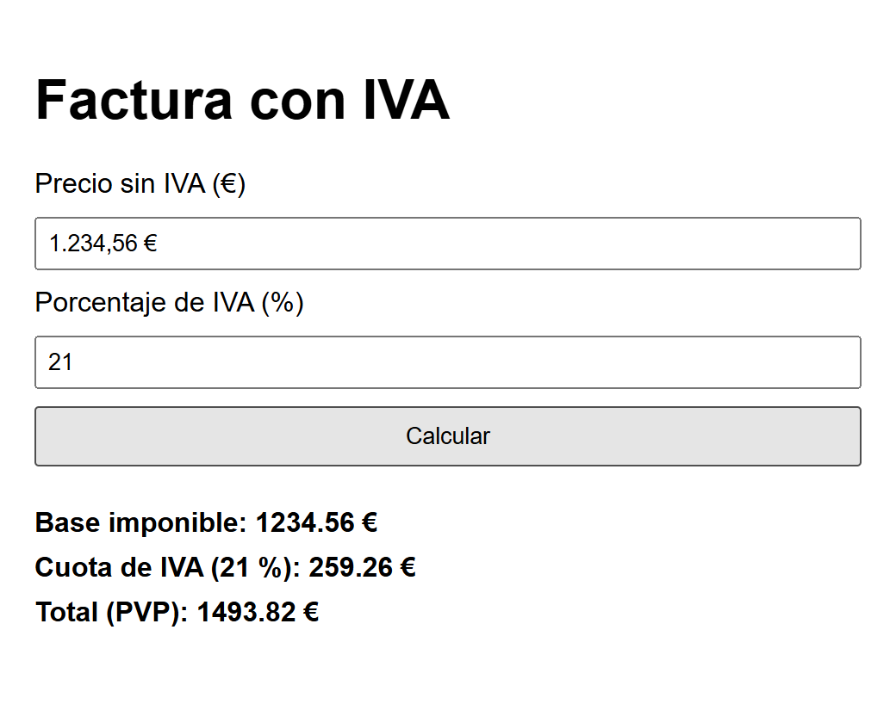
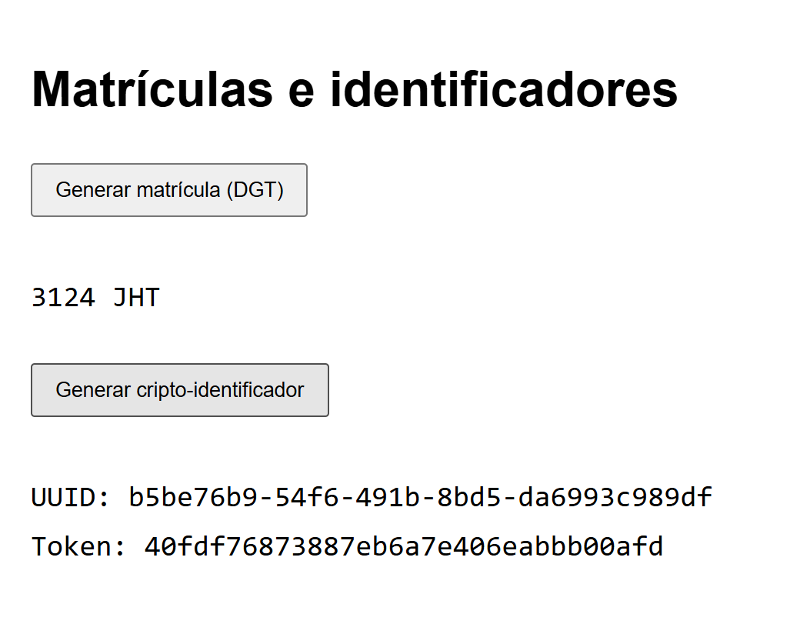

### 1. Rangos de Math.random()

`Math.random()` devuelve un decimal en `[0, 1)`. Para obtener enteros se usa `Math.floor(Math.random() * (max - min + 1)) + min`, y para decimales se sortea el entero, se divide por la escala y se fija la precisión con `toFixed()`.

`funcionA()`: rango `[10, 20]`, 0 decimales.

```js
function funcionA() {
  const amplitud = 10; // 20 - 10
  const enteroBase = Math.floor(Math.random() * (amplitud + 1)) + 10;
  return enteroBase;
}
```

`Math.random() * 11` genera 0..10 y el `+ 10` desplaza el intervalo a 10..20.

`funcionB()`: rango `[0, 1]`, 1 decimal.

```js
function funcionB() {
  const amplitud = 10;
  const enteroBase = Math.floor(Math.random() * (amplitud + 1));
  return Number((enteroBase / 10).toFixed(1));
}
```

El entero 0..10 dividido entre 10 da 0.0, 0.1, ..., 1.0. `Number()` elimina el cero final al mostrarlo, pero la precisión sigue siendo de una décima.

`funcionC()`: rango `[5, 15]`, 2 decimales.

```js
function funcionC() {
  const minEscalado = 500;
  const maxEscalado = 1500;
  const enteroBase =
    Math.floor(Math.random() * (maxEscalado - minEscalado + 1)) + minEscalado;
  return Number((enteroBase / 100).toFixed(2));
}
```

El entero 500..1500 dividido entre 100 da 5.00..15.00, con pasos de una centésima.

`funcionD()`: rango `[1, 6]`, 0 decimales.

```js
function funcionD() {
  const amplitud = 5;
  const enteroBase = Math.floor(Math.random() * (amplitud + 1)) + 1;
  return enteroBase;
}
```

`Math.random() * 6` genera 0..5 y el `+ 1` lo convierte en 1..6.

`funcionE()`: rango `[-1, 1]`, 3 decimales.

```js
function funcionE() {
  const minEscalado = -1000;
  const maxEscalado = 1000;
  const enteroBase =
    Math.floor(Math.random() * (maxEscalado - minEscalado + 1)) + minEscalado;
  return Number((enteroBase / 1000).toFixed(3));
}
```

El entero -1000..1000 dividido entre 1000 da -1.000..1.000, con pasos de una milésima.

Las funciones auxiliares del mismo bloque son más cortas:

```js
const numeroA = () => Math.floor(Math.random() * 101); // [0, 100]
const numeroB = () => Math.floor(Math.random() * 2);   // [0, 1]
```

`numeroA` genera 0..100 y `numeroB` genera 0 o 1.

`funcionF()`: rango `[0, 1]`, decimales variables.

```js
function funcionF() {
  const maxGranEntero = 9007199254740991; // 2^53 - 1
  const enteroAleatorio =
    Math.floor(Math.random() * (maxGranEntero + 1));
  return enteroAleatorio / maxGranEntero;
}
```

No usa `toFixed`, así que no tiene un número fijo de decimales: devuelve un `double` con hasta 17 cifras significativas. Además, a diferencia de `Math.random()`, sí puede devolver exactamente 1 cuando el entero sorteado es el máximo.

Resumen: A `[10, 20]` 0 decimales; B `[0, 1]` 1 decimal; C `[5, 15]` 2 decimales; D `[1, 6]` 0 decimales; E `[-1, 1]` 3 decimales; `numeroA` `[0, 100]` 0 decimales; `numeroB` `[0, 1]` 0 decimales; F `[0, 1]` decimales variables.

### 2. cryptoRandomFloat y generarAleatorio

El PDF define `cryptoRandomFloat()` con una errata: divide el `Uint32Array` completo entre 2^32, y eso da `NaN`. Hay que usar el primer elemento, `buffer[0]`.

```js
function cryptoRandomFloat() {
  const buffer = new Uint32Array(1);
  crypto.getRandomValues(buffer);
  return buffer[0] / 4294967296; // 2^32
}
```

Las funciones análogas a las del ejercicio anterior son las mismas fórmulas, cambiando `Math.random()` por `cryptoRandomFloat()`:

```js
const funcionAsegura = () => Math.floor(cryptoRandomFloat() * 11) + 10;
const funcionBsegura = () => Number((Math.floor(cryptoRandomFloat() * 11) / 10).toFixed(1));
const funcionCsegura = () =>
  Number(((Math.floor(cryptoRandomFloat() * 1001) + 500) / 100).toFixed(2));
const funcionDsegura = () => Math.floor(cryptoRandomFloat() * 6) + 1;
const funcionEsegura = () =>
  Number(((Math.floor(cryptoRandomFloat() * 2001) - 1000) / 1000).toFixed(3));
```

La función genérica queda así:

```js
/**
 * Genera un número aleatorio dentro de [min, max].
 * @param {number} [min=0] - Límite inferior.
 * @param {number} [max=100] - Límite superior.
 * @param {number} [decimales=0] - Cifras decimales del resultado.
 * @param {boolean|string} [seguro=false] - Si es true, usa cryptoRandomFloat().
 * @returns {number}
 * @throws {Error} Si min es mayor que max.
 */
function generarAleatorio(
  min = 0,
  max = 100,
  decimales = 0,
  seguro = false
) {
  if (min > max) {
    throw new Error("El mínimo no puede ser mayor que el máximo.");
  }

  const aleatorio = seguro ? cryptoRandomFloat() : Math.random();
  return Number((min + aleatorio * (max - min)).toFixed(decimales));
}
```

La fórmula `min + aleatorio * (max - min)` lleva el decimal de `[0, 1)` al intervalo pedido y `toFixed(decimales)` fija la precisión. El cuarto parámetro se evalúa como booleano, por eso la cadena `"segura"` del enunciado también activa el modo seguro.

Casos de uso del enunciado:

```js
console.log("Entero [0, 100]:", generarAleatorio(0, 100));
console.log("Coordenada GPS [0.125, 0.875] de 3 cifras:", generarAleatorio(0.125, 0.875, 3));
console.log("Coordenada GPS [0.125, 0.875] de 3 cifras (Segura):", generarAleatorio(0.125, 0.875, 3, "segura"));
```

Salida de una ejecución:

```text
Entero [0, 100]: 5
Coordenada GPS [0.125, 0.875] de 3 cifras: 0.599
Coordenada GPS [0.125, 0.875] de 3 cifras (Segura): 0.582
Error esperado: El mínimo no puede ser mayor que el máximo.
```

La última línea sale de llamar a `generarAleatorio(10, 1)` dentro de un `try...catch`.

### 3. Validador de facturación

El formulario solo necesita dos campos: el precio como texto, para poder escribir comas y el símbolo €, y el IVA como número, con 21 por defecto.

```html
<form id="formulario">
  <label for="precio">Precio sin IVA (€)</label>
  <input id="precio" type="text" placeholder="Ej.: 1.234,56 €">

  <label for="iva">Porcentaje de IVA (%)</label>
  <input id="iva" type="number" value="21" min="0" max="100" step="0.01">

  <button type="submit">Calcular</button>
</form>
<p id="resultado"></p>
```

El script limpia el texto, convierte, valida y calcula:

```js
"use strict";

const formulario = document.getElementById("formulario");
const resultado = document.getElementById("resultado");

// Quita espacios y €, cambia la coma decimal por punto y convierte a Number.
function convertirNumero(texto) {
  let limpio = texto.trim().replace("€", "").replace(/\s/g, "");
  if (limpio.includes(",")) {
    limpio = limpio.replace(/\./g, "").replace(",", ".");
  }
  return Number.parseFloat(limpio);
}

formulario.addEventListener("submit", (evento) => {
  evento.preventDefault();

  const precio = convertirNumero(document.getElementById("precio").value);
  const iva = convertirNumero(document.getElementById("iva").value || "21");

  if (Number.isNaN(precio) || !Number.isFinite(precio) || precio <= 0) {
    resultado.className = "error";
    resultado.textContent = "El precio debe ser un número positivo.";
    return;
  }

  if (Number.isNaN(iva) || !Number.isFinite(iva) || iva < 0 || iva > 100) {
    resultado.className = "error";
    resultado.textContent = "El IVA debe ser un número entre 0 y 100.";
    return;
  }

  const cuota = (precio * iva) / 100;
  const total = precio + cuota;

  resultado.className = "";
  resultado.innerHTML =
    "Base imponible: " + precio.toFixed(2) + " €<br>" +
    "Cuota de IVA (" + iva + " %): " + cuota.toFixed(2) + " €<br>" +
    "Total (PVP): " + total.toFixed(2) + " €";
});
```

`trim()` quita los espacios de los extremos, `replace("€", "")` el símbolo y `replace(",", ".")` la coma decimal. Si el texto trae coma y puntos de miles, como `1.234,56`, los puntos se quitan antes de cambiar la coma por punto para que `parseFloat` no se corte en el primer punto.

`Number.isNaN()` detecta el texto no numérico y `Number.isFinite()` descarta `Infinity`. Después se exige que el precio sea mayor que cero. La cuota es `precio * iva / 100`, el PVP es `precio + cuota`, y ambos se muestran con `toFixed(2)`.



### 4. Matrículas y cripto-identificadores

La matrícula se construye con cuatro dígitos y tres consonantes. El número sale de `Math.random() * 10000`, se convierte a texto y se rellena con `padStart(4, "0")`. Las letras se eligen de una cadena sin vocales, sin Ñ y sin Q.

```js
"use strict";

// Consonantes de la DGT: sin vocales, sin Ñ y sin Q.
const CONSONANTES = "BCDFGHJKLMNPRSTVWXYZ";

function generarMatricula() {
  const numero = Math.floor(Math.random() * 10000).toString().padStart(4, "0");

  let letras = "";
  for (let i = 0; i < 3; i++) {
    letras += CONSONANTES.charAt(Math.floor(Math.random() * CONSONANTES.length));
  }

  return numero + " " + letras;
}

// 16 bytes = 128 bits; cada byte se escribe con dos cifras hexadecimales.
function generarToken() {
  const bytes = crypto.getRandomValues(new Uint8Array(16));
  return Array.from(bytes, (byte) => byte.toString(16).padStart(2, "0")).join("");
}

document.getElementById("btnMatricula").addEventListener("click", () => {
  document.getElementById("matricula").textContent = generarMatricula();
});

document.getElementById("btnCripto").addEventListener("click", () => {
  document.getElementById("cripto").innerHTML =
    "UUID: " + crypto.randomUUID() + "<br>" +
    "Token: " + generarToken();
});
```

`padStart(4, "0")` convierte `7` en `"0007"` y deja `4821` igual. `charAt()` devuelve la consonante de la posición sorteada.

Para los cripto-identificadores se usan las dos funciones de `crypto` de la teoría: `randomUUID()` genera un UUID v4 y `getRandomValues()` llena 16 bytes (128 bits) que se escriben en hexadecimal con `toString(16)` y `padStart(2, "0")`. `randomUUID()` necesita un contexto seguro (HTTPS o localhost); en Chrome y Edge también funciona al abrir el archivo en local.


