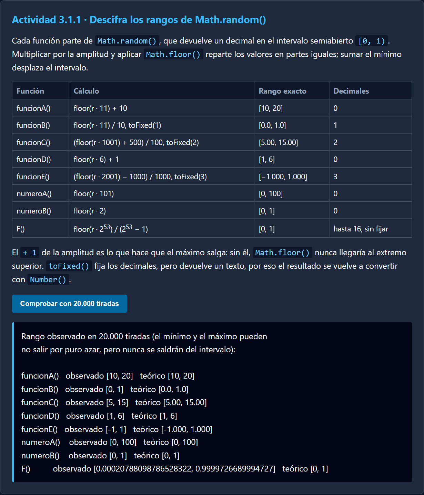
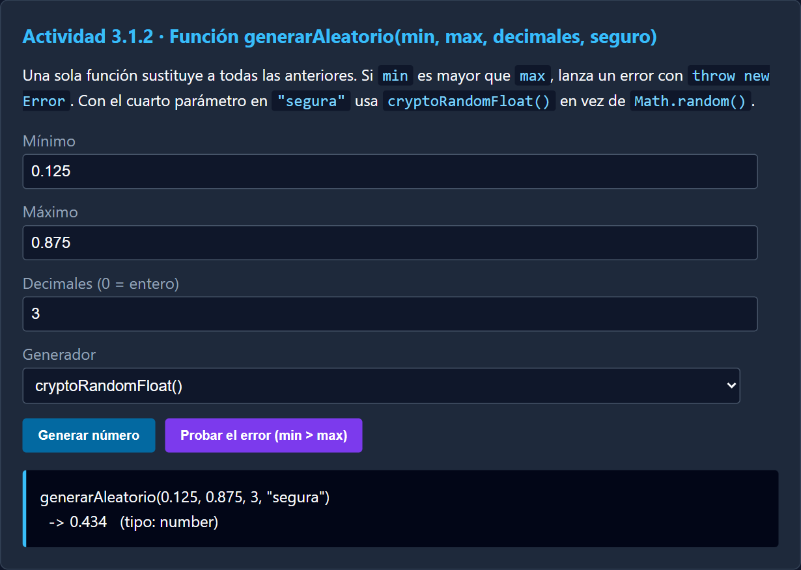
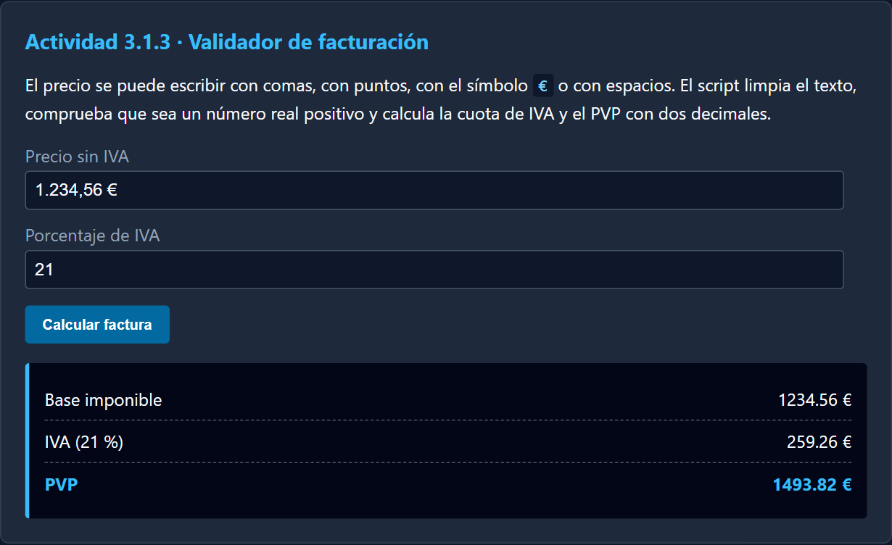
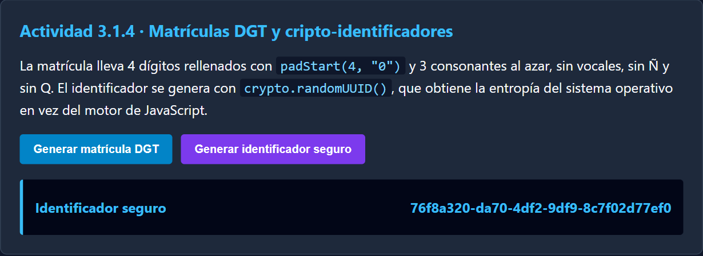

# Tema 3.1 · Objetos predefinidos del lenguaje

**Módulo:** Desarrollo Web en Entorno Cliente (DWEC) · 2º DAW
**Unidad:** 3 · Objetos predefinidos del lenguaje
**Tarea:** 3.1. OBJETOS PREDEFINIDOS DEL LENGUAJE (RA3 · CE 3.a)
**Entrega:** 18/11/2026
**Archivos:** `index.html`, `css/estilos.css`, `js/crypto-aleatorio.js`,
`js/aleatorio.js`, `js/facturacion.js`, `js/matriculas.js`

Las cuatro actividades están en una sola página con cuatro paneles. Las dos
primeras muestran el resultado en pantalla además de en la consola; la tercera
y la cuarta son formularios y botones reales. Todo se ha probado en Edge con
`file://`, sin errores de consola.

---

## Actividad 3.1.1 · Descifra los rangos de `Math.random()`

`Math.random()` devuelve un decimal en el intervalo **semiabierto** `[0, 1)`: el
0 puede salir, el 1 nunca. La fórmula de un entero en `[min, max]` es

```
Math.floor(Math.random() * (max - min + 1)) + min
```

El `+ 1` de la amplitud es la clave: hay `max - min + 1` enteros posibles y sin
ese `+ 1` el máximo no saldría nunca. Después, dividir entre 10, 100 o 1000 baja
el número de escala y `toFixed()` fija los decimales.

| Función | Cálculo | Rango exacto | Decimales |
|---|---|---|---|
| `funcionA()` | `floor(r · 11) + 10` | `[10, 20]` | 0 |
| `funcionB()` | `floor(r · 11) / 10`, `toFixed(1)` | `[0.0, 1.0]` | 1 |
| `funcionC()` | `(floor(r · 1001) + 500) / 100`, `toFixed(2)` | `[5.00, 15.00]` | 2 |
| `funcionD()` | `floor(r · 6) + 1` | `[1, 6]` | 0 |
| `funcionE()` | `(floor(r · 2001) − 1000) / 1000`, `toFixed(3)` | `[−1.000, 1.000]` | 3 |
| `numeroA()` | `floor(r · 101)` | `[0, 100]` | 0 |
| `numeroB()` | `floor(r · 2)` | `[0, 1]` | 0 |
| `F()` | `floor(r · 2⁵³) / (2⁵³ − 1)` | `[0, 1]` | hasta 16, sin fijar |

Cómo se llega a cada una:

- **A:** amplitud 10 → 11 valores (`0` a `10`) y luego `+ 10`, así que va de 10 a 20.
- **B:** los mismos 11 valores divididos entre 10 → `0.0, 0.1 … 1.0`; un decimal.
- **C:** 1001 valores (`500` a `1500`) divididos entre 100 → de 5.00 a 15.00; dos decimales.
- **D:** amplitud 5 → 6 valores (`0` a `5`) más 1 → de 1 a 6, como un dado.
- **E:** 2001 valores (`−1000` a `1000`) divididos entre 1000 → de −1.000 a 1.000; tres decimales.
- **numeroA:** `floor(r · 101)` son 101 valores, de 0 a 100 (no de 1 a 100).
- **numeroB:** dos valores, 0 o 1; sirve para lanzar una moneda.
- **F:** el entero llega hasta `2⁵³ − 1` y se divide entre ese mismo máximo, así
  que el 1 sí puede salir. No usa `toFixed()`, por eso los decimales son los que
  dé la división (hasta 16 cifras significativas).

La página comprueba la tabla midiendo 20.000 tiradas de cada función:

```
funcionA()   observado [10, 20]      teórico [10, 20]
funcionC()   observado [5, 15]       teórico [5.00, 15.00]
funcionE()   observado [-1, 1]       teórico [-1.000, 1.000]
F()          observado [0.0000514…, 0.9999694…]   teórico [0, 1]
```

En B, C y E el mínimo y el máximo observados salen sin decimales porque
`Number()` elimina los ceros finales: `5.00` es `5`. La **precisión** sigue
siendo la que fija `toFixed()`.

> **Trampa del enunciado:** las etiquetas `amplitud = 10` invitan a pensar que
> el rango es 0–10. El rango lo decide `amplitud + 1` junto con el desplazamiento
> posterior. Conviene calcularlo siempre como `max − min + 1`.



---

## Actividad 3.1.2 · Función `generarAleatorio()`

```js
// generarAleatorio(min, max, decimales, seguro)
// Devuelve un número al azar dentro de [min, max]. Con decimales = 0 es un
// entero; con decimales > 0 redondea a esa cantidad de cifras. El cuarto
// parámetro, si vale "segura", cambia Math.random() por cryptoRandomFloat().
// Lanza un Error si min > max o si decimales no es un entero válido.
function generarAleatorio(min = 0, max = 100, decimales = 0, seguro = "normal") {
  if (min > max) {
    throw new Error(`El mínimo (${min}) no puede ser mayor que el máximo (${max}).`);
  }

  if (!Number.isInteger(decimales) || decimales < 0) {
    throw new Error("Los decimales tienen que ser un entero mayor o igual que 0.");
  }

  // Elijo el generador una sola vez y el resto de la función es igual para los dos
  const aleatorio = seguro === "segura" ? cryptoRandomFloat() : Math.random();

  if (decimales === 0) {
    // Al sumar 1 a la amplitud, el máximo también puede salir
    return Math.floor(aleatorio * (max - min + 1)) + min;
  }

  // En un intervalo continuo no se suma 1: el máximo solo saldría con r = 1,
  // y Math.random() nunca llega a 1
  const valor = min + aleatorio * (max - min);

  // Number() es imprescindible porque toFixed() devuelve un String
  return Number(valor.toFixed(decimales));
}
```

Decisiones que conviene defender:

| Decisión | Por qué |
|---|---|
| Parámetros con valor por defecto | `generarAleatorio()` sin argumentos devuelve un entero de 0 a 100, como los ejemplos del tema |
| `throw new Error` en vez de devolver `null` | El enunciado pide un error explícito; quien llama decide si lo captura con `try…catch` |
| Comprobar `decimales` con `Number.isInteger` | `toFixed(1.5)` trunca a 1 sin avisar; es mejor rechazarlo |
| Devolver `Number` | `Number()` convierte el texto de `toFixed()` y garantiza el tipo que pide el enunciado |
| Dos fórmulas según los decimales | Con enteros hay que incluir el máximo (`+ 1`); con decimales el intervalo es continuo y no |
| `seguro === "segura"` | El cuarto parámetro es opcional, así que la función sigue funcionando sin él |

### El generador criptográfico

```js
// cryptoRandomFloat()
// Genera un decimal entre 0 (incluido) y 1 (excluido) con la entropía del
// sistema operativo en lugar del generador pseudoaleatorio del motor de JS.
// No recibe parámetros. Devuelve un Number.
function cryptoRandomFloat() {
  // Uint32Array(1) reserva un entero sin signo de 32 bits, de 0 a 4.294.967.295
  const buffer = new Uint32Array(1);

  // getRandomValues() rellena el array en el sitio: no devuelve nada
  crypto.getRandomValues(buffer);

  // Se divide entre 2^32 para que el resultado caiga siempre en [0, 1).
  // Hay que usar buffer[0]: dividir el array entero da NaN.
  return buffer[0] / 4294967296;
}
```

`getRandomValues()` trabaja con **arrays tipados** (`Uint32Array`, `Uint8Array`…),
no con números sueltos. Por eso se reserva un array de un solo elemento y se
rellena; después se lee `buffer[0]`.

> **Errata del material:** el PDF del tema escribe `return buffer / 4294967296;`.
> Eso divide el array, no el número, y devuelve `NaN`. Comprobado en Edge:
> `new Uint32Array(1) / 4294967296` es `NaN`. La versión correcta es `buffer[0]`.

### Casos de uso y pruebas

```js
console.log("Entero [0, 100]:", generarAleatorio(0, 100));
console.log("Coordenada GPS [0.125, 0.875] de 3 cifras:",
  generarAleatorio(0.125, 0.875, 3));
console.log("Coordenada GPS [0.125, 0.875] de 3 cifras (Segura):",
  generarAleatorio(0.125, 0.875, 3, "segura"));
```

Salidas reales:

```
Entero [0, 100]: 48
Coordenada GPS [0.125, 0.875] de 3 cifras: 0.612
Coordenada GPS [0.125, 0.875] de 3 cifras (Segura): 0.495
```

Y el caso de error, capturado en la página con `try…catch`:

```
Error capturado: El mínimo (100) no puede ser mayor que el máximo (0).
```

Se han ejecutado 5.000 llamadas a `generarAleatorio(3, 7, 0)` y otras 5.000 a
`generarAleatorio(0.125, 0.875, 3)`: todos los enteros caen en `[3, 7]`, todos
los decimales caen en `[0.125, 0.875]` y ninguno tiene más de 3 cifras.



---

## Actividad 3.1.3 · Validador de facturación

El problema no es multiplicar, es **normalizar lo que escribe el usuario**. El
campo admite `1234,56`, `1.234,56 €` o ` 12.5 `, y los tres tienen que acabar en
el mismo número.

```js
// limpiarImporte(texto)
// Deja el precio en un formato que Number() entienda: sin €, sin espacios y
// con el punto como separador decimal. Devuelve un String.
function limpiarImporte(texto) {
  // trim() quita los espacios de los extremos; el resto desaparecen con \s
  let limpio = texto.trim().replace(/€/g, "").replace(/\s/g, "");

  if (limpio.includes(",") && limpio.includes(".")) {
    // Si vienen los dos, el punto separa miles ("1.234,56") y la coma decimales
    limpio = limpio.replace(/\./g, "").replace(",", ".");
  } else {
    // Con un solo separador, la coma es la decimal ("12,50")
    limpio = limpio.replace(",", ".");
  }

  return limpio;
}
```

La validación sigue el orden que pide el enunciado:

```js
// validarFactura(base, iva)
// Comprueba que la base sea un número real positivo y el IVA un porcentaje
// razonable. Devuelve un String con el error, o un String vacío si todo va bien.
function validarFactura(base, iva) {
  // isNaN() pregunta si el valor es NaN; isFinite() descarta además Infinity
  if (Number.isNaN(base) || !Number.isFinite(base)) {
    return "El precio no es un número válido.";
  }
  if (base <= 0) {
    return "El precio tiene que ser mayor que 0.";
  }
  if (Number.isNaN(iva) || !Number.isFinite(iva)) {
    return "El porcentaje de IVA no es un número válido.";
  }
  if (iva < 0 || iva > 100) {
    return "El IVA tiene que estar entre 0 y 100.";
  }
  return "";
}
```

Detalles que se preguntan en el examen:

- **`Number("")` vale 0**, no `NaN`. Si el campo se queda vacío y no se comprueba
  aparte, la factura sale con base 0. Por eso `convertirImporte()` devuelve `NaN`
  cuando el texto limpio está vacío.
- **`Number.isNaN()` es estricto**: `Number.isNaN("abc")` es `false` (es un
  string), pero `Number("abc")` sí es `NaN`, y es lo que se le pasa.
- **`Number.isFinite()` ya descarta `NaN`**, así que la primera condición es
  redundante… y se deja porque el enunciado pide las dos comprobaciones.
- **`toFixed(2)` devuelve un String** para conservar los ceros (`12.50`, no
  `12.5`). Para seguir operando hay que volver a `Number()`.

Resultados comprobados en la página:

| Entrada | Base | IVA | Cuota | PVP |
|---|---|---|---|---|
| `1.234,56 €` | 1234.56 € | 21 % | 259.26 € | 1493.82 € |
| ` 12,5 € ` | 12.50 € | 10 % | 1.25 € | 13.75 € |
| `abc` | — | — | — | error: «El precio no es un número válido.» |
| vacío | — | — | — | error: «El precio no es un número válido.» |



---

## Actividad 3.1.4 · Matrículas DGT y cripto-identificadores

```js
// Letras válidas en una matrícula española: las 20 consonantes del abecedario
// sin la Ñ y sin la Q (que se confunden con la O y con la Ñ al leerlas).
const CONSONANTES_DGT = "BCDFGHJKLMNPRSTVWXYZ";

// generarMatricula()
// Crea una matrícula del formato "1234 BCD": cuatro dígitos con ceros a la
// izquierda y tres consonantes al azar. No recibe parámetros. Devuelve un String.
function generarMatricula() {
  // El número va de 0 a 9999; padStart() completa con ceros hasta 4 cifras
  const numero = String(generarAleatorio(0, 9999)).padStart(4, "0");

  let letras = "";

  // Tres letras: cada una es una posición al azar de la cadena de consonantes
  for (let i = 0; i < 3; i++) {
    const posicion = Math.floor(Math.random() * CONSONANTES_DGT.length);
    letras += CONSONANTES_DGT.charAt(posicion);
  }

  return numero + " " + letras;
}
```

- **`padStart(4, "0")`** rellena por la izquierda hasta 4 caracteres. Hay que
  convertir antes el número a texto con `String()`, porque un `Number` no tiene
  métodos de cadena.
- **La cadena de letras** tiene 20 caracteres y ya excluye vocales, `Ñ` y `Q`.
  Elegir una posición con `Math.floor(Math.random() * 20)` evita tener que
  repetir el sorteo si sale una letra prohibida.
- **`charAt(posicion)`** es equivalente a `cadena[posicion]`; se usa el método
  porque es el que aparece en la teoría.

### Identificador seguro

```js
// generarIdentificador()
// Devuelve un UUID v4 generado con crypto.randomUUID(). Si el navegador no lo
// tiene (contexto no seguro), arma uno equivalente con 16 bytes aleatorios.
function generarIdentificador() {
  if (typeof crypto.randomUUID === "function") {
    return crypto.randomUUID();
  }

  // Reserva: 16 bytes y cada uno en hexadecimal de dos cifras
  const bytes = new Uint8Array(16);
  crypto.getRandomValues(bytes);

  let identificador = "";
  for (const byte of bytes) {
    identificador += byte.toString(16).padStart(2, "0");
  }

  return identificador;
}
```

`crypto.randomUUID()` solo existe en **contextos seguros** (HTTPS o `localhost`;
en Edge, también `file://`). La reserva con `getRandomValues()` cubre el caso de
abrir la página desde un servidor sin HTTPS.

Ejemplos generados:

```
3322 WXZ
8933 HKN
2710 GDX
e1ca189e-7a6f-42f7-b33f-4acd9086cb91
```

Comprobado con 5.000 matrículas: todas cumplen `^\d{4} [BCDFGHJKLMNPRSTVWXYZ]{3}$`
y el UUID cumple el patrón v4 (`4` en la tercera sección y `8`, `9`, `a` o `b`
en la cuarta).



---

## Teoría del tema que no tiene actividad

El enunciado repasa también `Date`, los *wrappers* y `globalThis`. No piden
ejercicio, pero conviene tenerlo claro para la defensa:

| Objeto | Idea clave |
|---|---|
| `Date` | Guarda milisegundos desde el 1-1-1970 UTC. El mes del constructor va de 0 a 11. `toISOString()` es el formato que se intercambia con el servidor |
| `String` / `Number` | Los primitivos no son objetos: el motor los envuelve un instante (*autoboxing*) para poder llamar a `.toFixed()` o `.trim()`. Nunca usar `new String()`, `new Number()` ni `new Boolean()`: crean objetos y rompen `===` |
| `globalThis` | ES2020. Apunta a `window` en el navegador, a `self` en un *worker* y a `global` en Node.js. Es la forma de escribir una variable global que funcione en los tres entornos |
| `Math` | No se puede instanciar (`new Math()` no existe): todos sus miembros son estáticos |

Dos comprobaciones rápidas de la diferencia entre primitivo y objeto:

```js
console.log(typeof 25);                 // "number"
console.log(typeof new Number(25));     // "object"
console.log(25 == new Number(25));      // true  (coerción)
console.log(25 === new Number(25));     // false (distinto tipo)
console.log(globalThis === window);     // true  (en el navegador)
```

---

## Cómo probarlo

1. Abrir `index.html` en el navegador (doble clic; no hace falta servidor).
2. **3.1.1:** pulsar «Comprobar con 20.000 tiradas» y comparar con la tabla.
3. **3.1.2:** generar con los valores por defecto, cambiar a `0.125`–`0.875` con
   3 decimales y generador seguro, y probar el botón del error.
4. **3.1.3:** calcular con `1.234,56 €` al 21 %, y después escribir `abc` o dejar
   el campo vacío para ver los mensajes.
5. **3.1.4:** generar varias matrículas y un identificador; la consola del
   navegador debe quedar sin errores.
