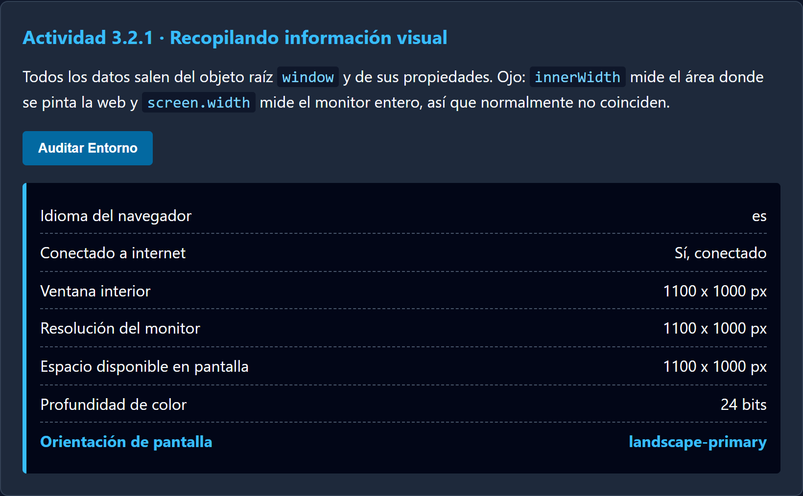
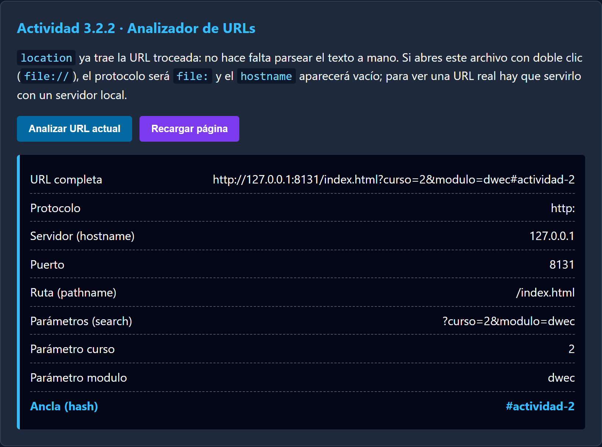
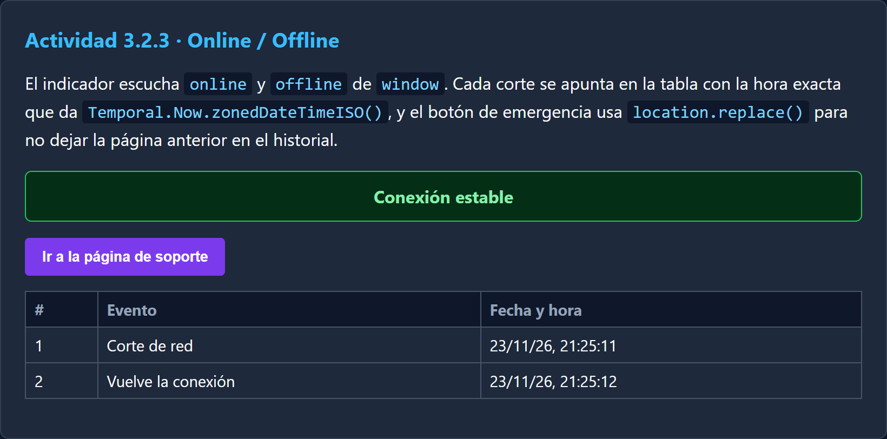
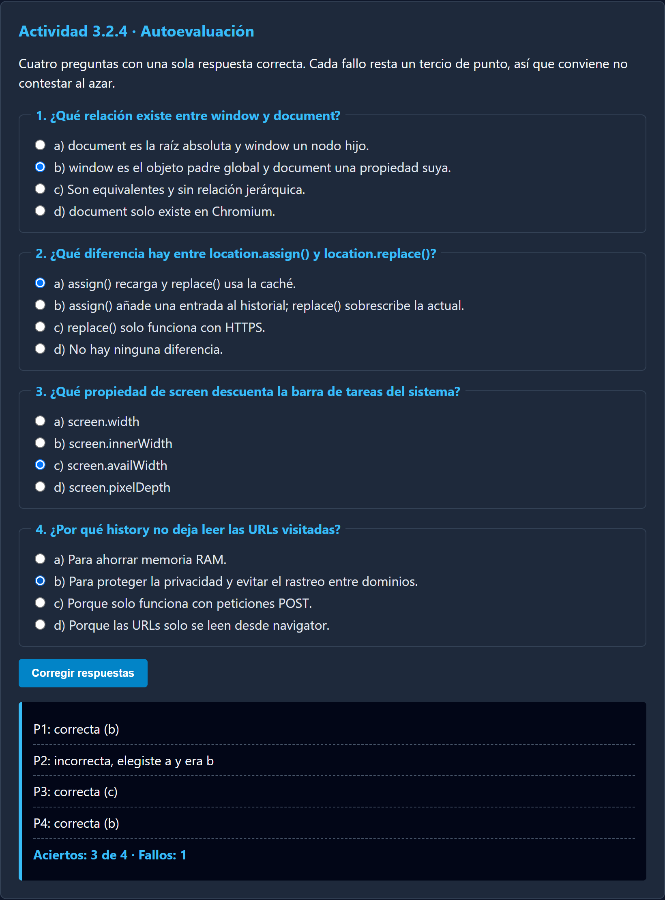
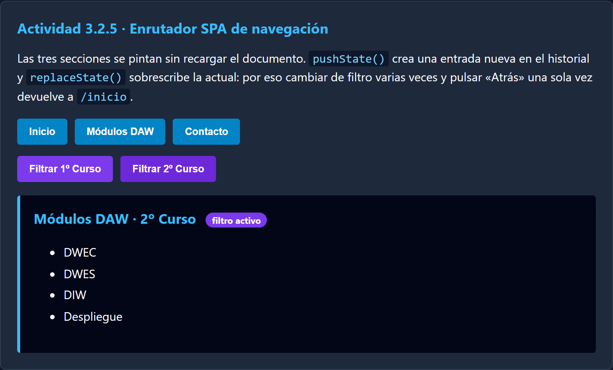

## Actividad 3.2.1 · Recopilando información visual

El botón **Auditar Entorno** lee cuatro cosas del BOM y las pinta en una tabla:
el idioma, el estado de la conexión, el tamaño de la ventana y la resolución del
monitor.

`innerWidth` e `innerHeight` miden el hueco donde se dibuja la página.
`screen.width` y `screen.height` miden el monitor entero, e incluyen la barra de
tareas. Por eso la tabla enseña también `screen.availWidth`, que sí la descuenta:
es la diferencia entre «mi pantalla es de 1920» y «mi página tiene 1920 de ancho».

Las filas se crean con `createElement` y `textContent`, no con `innerHTML`. No es
por gusto: si el texto viniera del usuario, `innerHTML` lo interpretaría como
etiquetas. Aquí los datos los da el navegador, pero el hábito ya queda.

## Actividad 3.2.2 · Analizador de URLs

La página analiza su propia dirección al cargar y cada vez que se pulsa el botón.
No hay que partir la cadena a mano porque `location` ya la trae troceada:
`protocol`, `hostname`, `port`, `pathname`, `search` y `hash`.

Para los parámetros uso `URLSearchParams`, que recorre las parejas clave-valor
sin expresiones regulares. La prueba está hecha con
`index.html?curso=2&modulo=dwec#actividad-2`, así que se ven los dos parámetros
por separado y el ancla.

El segundo botón llama a `location.reload()`. Ese no toca el historial: solo
vuelve a pedir el documento al servidor.

## Actividad 3.2.3 · Monitor de conectividad

El indicador escucha los eventos `online` y `offline` de `window` y cambia de
verde a rojo sin recargar. Cada cambio se apunta en una tabla con el número de
evento y la hora.

Para la hora uso `Temporal.Now.zonedDateTimeISO()`, que es lo que pide el
enunciado. La fecha y la hora se formatean con `toLocaleString("es-ES")`, así que
salen en el formato de aquí sin tener que montar la cadena a mano.

El botón de emergencia hace `location.replace("soporte.html")`. `replace()`
sustituye la entrada actual del historial, así que al darle a «Atrás» no se vuelve
a la página anterior. El corte lo provoqué desconectando la red del navegador
desde las herramientas de desarrollo.

## Actividad 3.2.4 · Autoevaluación

Las respuestas correctas son **b, b, c y b**.

1. **b)** `window` es el objeto global y `document` cuelga de él. El BOM tiene una
   sola raíz.
2. **b)** `assign()` añade una entrada al historial y se puede volver con
   «Atrás». `replace()` sobrescribe la entrada actual y ese retroceso se pierde.
3. **c)** `screen.availWidth` es el ancho útil, sin las barras del sistema.
   `screen.width` es la resolución nativa.
4. **b)** Por privacidad. Si un script pudiera leer las URLs visitadas, cualquier
   página podría rastrear la navegación del usuario fuera de su dominio.

El formulario corrige y dice cuál falla y cuál era la buena, en vez de dar solo la
nota.

## Actividad 3.2.5 · Enrutador SPA

Aquí la navegación no recarga el documento: cambia la URL con la API de historial
y vuelve a pintar `#contenedor-vista`. Hay un objeto `vistas` con el contenido de
cada sección y una función `actualizarVista(estado)` que decide qué mostrar.

- Los tres botones principales usan `history.pushState()`, así que cada sección
  deja una entrada nueva.
- Los dos filtros usan `history.replaceState()`: cambian el contenido y la URL
  (`/modulos?curso=1` y `/modulos?curso=2`) sin añadir pasos.
- `window.onpopstate` recoge `event.state` y se lo pasa a `actualizarVista()`.

La prueba del enunciado, en orden: Inicio (`/inicio`) → Módulos (`/modulos`) →
Filtrar 1º (`/modulos?curso=1`) → Filtrar 2º (`/modulos?curso=2`) → Atrás **una
sola vez**. El navegador vuelve a `/inicio` y el contenido es el de Inicio. Ahí se
ve que los filtros han sobrescrito la misma posición del historial en lugar de
crear dos nuevas.

`pushState` y `replaceState` van dentro de un `try/catch` porque, si alguien abre
el archivo con `file://`, el navegador lanza un error de seguridad y la página se
quedaría a medias.

## Comprobaciones

- Las cinco secciones cargan sin errores en consola.
- La auditoría muestra idioma, conexión, ventana y monitor.
- El analizador separa protocolo, host, puerto, ruta, parámetros y ancla.
- Un corte de red real pone el indicador en rojo y lo apunta en la tabla.
- El botón de soporte abre `soporte.html` sustituyendo el historial.
- Después de los dos filtros, «Atrás» vuelve a `/inicio`.
- El test corrige y explica cada respuesta.

Por eso en la captura de la auditoría la resolución del monitor sale con el mismo
tamaño que la ventana: el navegador headless no tiene una pantalla física detrás.
