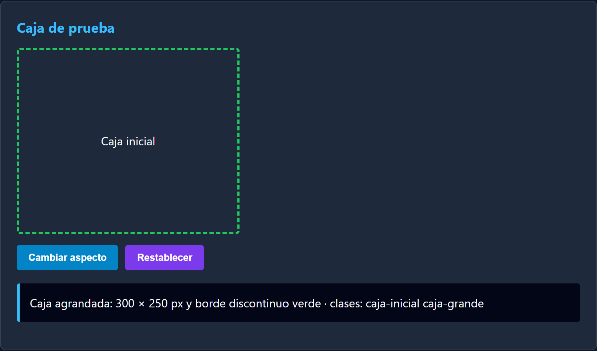
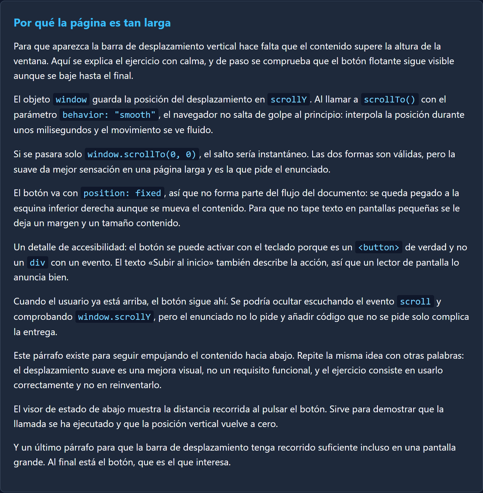
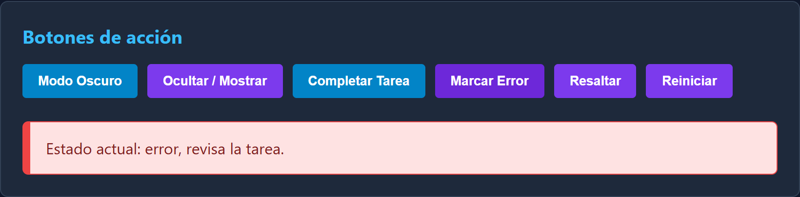
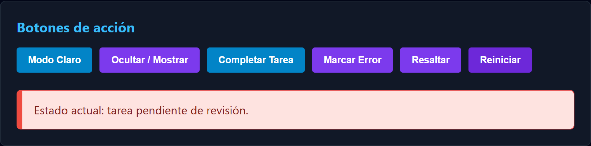
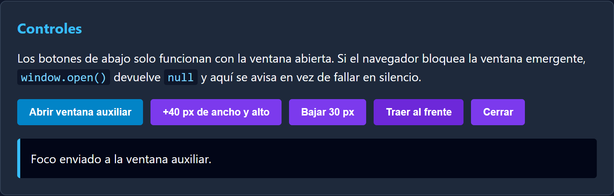

## Cómo está organizado

Las cuatro actividades van en páginas separadas, con un `index.html` que hace de
portal para no tener que recordar las rutas. No las he metido todas en una porque
la 3.3.2 necesita ser un documento largo de verdad, con su barra de
desplazamiento, y la 3.3.4 abre una ventana aparte. Juntarlas habría quedado
forzado.

```
index.html                    portal con enlaces
3.3.1-clases.html             cambio de aspecto de una caja
3.3.2-scroll.html             página larga y botón «Subir al inicio»
3.3.3-tarjeta.html            panel de control con classList
3.3.4-principal.html          ventana principal
3.3.4-auxiliar.html           la ventana que se abre con window.open()
css/estilos.css
js/clases.js  js/scroll.js  js/tarjeta.js  js/ventanas.js
```

El enunciado llama `principal.html` y `auxiliar.html` a los dos archivos de la
3.3.4. Les puse el prefijo `3.3.4-` para que se ordenen juntos en la carpeta y no
se confundan con el índice. La relación entre ellos es la misma que pide el
ejercicio.

## Actividad 3.3.1 · Cambiar el aspecto de una caja

La caja empieza con la clase `.caja-inicial`, que le da 200 × 100 px y borde rojo
sólido. **Cambiar aspecto** hace `classList.toggle("caja-grande")`: esa clase
lleva 300 × 250 px y borde discontinuo verde, así que el mismo botón vale para
poner y quitar. **Restablecer** hace `classList.remove("caja-grande")`, que no
falla aunque la clase no esté puesta.

Debajo hay un visor que imprime `caja.className`, para ver qué clases tiene el
elemento en cada momento. Es la forma más rápida de comprobar que no se acumulan
clases.



La transición de tamaño y de color está en CSS, no en JavaScript. El script solo
cambia clases.

## Actividad 3.3.2 · Subir al inicio

Son nueve párrafos explicando el ejercicio, así que el contenido pasa de largo la
altura de la ventana y aparece la barra vertical. El botón va con
`position: fixed` en la esquina inferior derecha y se queda visible aunque bajes
hasta el final.

```js
window.scrollTo({ top: 0, left: 0, behavior: "smooth" });
```

`behavior: "smooth"` es lo que hace que el navegador interpole la posición en vez
de saltar. Antes de llamar guardo `window.scrollY` para mostrar desde qué píxel
se ha subido.



La prueba automática partió de 174 px de desplazamiento y la posición volvió a 0.


## Actividad 3.3.3 · Panel de control con classList

Parto del ejemplo de clases del tema y le añado los dos apartados del enunciado.

**A) Estado de error.** Botón `#btn-error` y clase `.estado-error` en el CSS, con
fondo `#fee2e2`, borde `#ef4444` y texto `#7f1d1d`. El error tiene que salir venga
de donde venga: si la tarjeta estaba completada, un
`replace("estado-pendiente", ...)` no cambiaría nada. Por eso el manejador quita
los dos estados posibles y luego pone el de error.

```js
tarjeta.classList.remove("estado-pendiente", "estado-completado");
tarjeta.classList.add("estado-error");
```



La captura está hecha después de pulsar **Completar Tarea** y luego **Marcar
Error**, que es el caso que fallaría con un `replace` simple.

**B) Texto del botón de modo oscuro.** El botón hace
`document.body.classList.toggle("modo-oscuro")` y después mira
`classList.contains("modo-oscuro")` para decidir si pone «Modo Oscuro» o «Modo
Claro». No guardo una variable de estado: la clase del `body` ya dice cómo está
la página, así que el botón no se puede desincronizar.

**Reiniciar** devuelve la tarjeta al principio con
`className = "caja estado-pendiente"`, que es lo más corto para borrar todas las
clases de golpe.



## Actividad 3.3.4 · Ventana secundaria

El botón **Abrir ventana auxiliar** llama a `window.open()` con la URL, un nombre
y las opciones `width=500,height=400,resizable=yes,scrollbars=yes`. La referencia
se guarda en una variable `let` fuera del evento, porque los demás botones la
necesitan.

| Control | Método | Qué compruebo antes |
|---|---|---|
| Abrir a 500 × 400 | `window.open(url, nombre, opciones)` | que no devuelva `null` |
| Aumentar +40 px | `resizeBy(40, 40)` | `closed` |
| Bajar 30 px | `moveBy(0, 30)` | `closed` |
| Traer al frente | `focus()` | `closed` |
| Cerrar | `close()` | `closed` |

El bloqueador de ventanas emergentes no lanza un error: devuelve `null`. Si se
usara esa referencia sin comprobarla, el script petaría con un `TypeError` y el
usuario no sabría por qué. Por eso hay un `if` que avisa en el visor.

La segunda comprobación es `ventanaAuxiliar.closed`, porque el usuario puede
cerrar la ventana hija a mano y entonces `resizeBy` o `moveBy` darían error sobre
un objeto ya cerrado.



En la prueba se abrió con 500 × 400, se amplió, se movió, se le mandó el foco y se
cerró sin errores.

## Comprobaciones

- La caja pasa de 200 × 100 con borde rojo a 300 × 250 con borde verde discontinuo.
- Restablecer la devuelve a 200 × 100.
- El botón flotante sube la página de 174 px a 0.
- El estado de error funciona partiendo del estado completado.
- El texto del botón alterna entre «Modo Oscuro» y «Modo Claro».
- La ventana auxiliar abre a 500 × 400, se redimensiona, se mueve y se cierra.
- Ninguna página deja errores en consola.

Las capturas están tomadas con el navegador en modo headless a 1100 × 900 y
escala 2. Por eso el texto se ve tan nítido.
