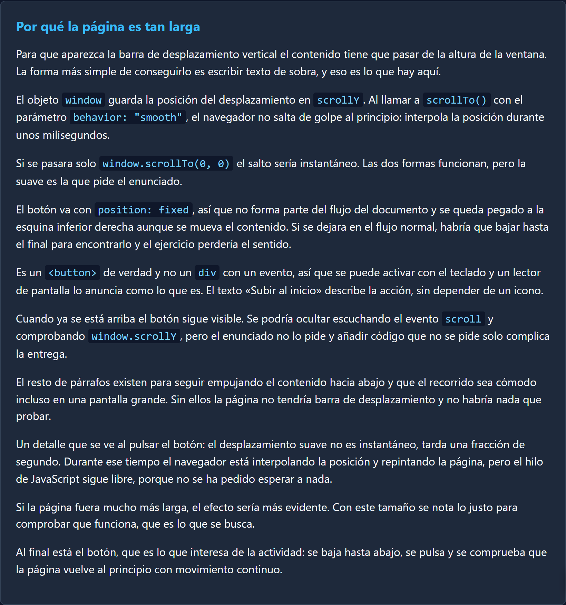

## Cómo está organizado

Cada actividad va en su propio archivo, porque la 3.3.2 necesita ser un documento
largo de verdad y la 3.3.4 abre una ventana aparte. El `index.html` es solo un
portal con los cuatro enlaces.

```
index.html                    portal con enlaces
3.3.1-clases.html             cambio de aspecto de una caja
3.3.2-scroll.html             página larga y botón «Subir al inicio»
3.3.3-tarjeta.html            panel de control con classList
3.3.4-principal.html          ventana principal
3.3.4-auxiliar.html           la ventana que se abre con window.open()
css/estilos.css
js/clases.js  js/scroll.js  js/tarjeta.js  js/ventanas.js
```

El enunciado llama `principal.html` y `auxiliar.html` a los dos archivos de la
3.3.4; les puse el prefijo para que se ordenen juntos en la carpeta.

La 3.3.4 hay que abrirla con la carpeta servida en local (`php -S` o
`python -m http.server`). Si se abre el HTML con doble clic, desde `file://` el
navegador no deja redimensionar ni mover la ventana hija y lo bloquea por
seguridad. El resto de actividades funcionan igual de las dos formas.

## Actividad 3.3.1 · Cambiar el aspecto de una caja

La caja arranca con la clase `.caja-inicial`, que le da 200 × 100 px y borde rojo
sólido. **Cambiar aspecto** hace `classList.toggle("caja-grande")`: esa clase
lleva 300 × 250 px y borde discontinuo verde, así que el mismo botón pone y quita.
**Restablecer** hace `classList.remove("caja-grande")`, que no falla aunque la
clase no esté puesta.

```js
caja.classList.toggle("caja-grande");
```

La transición de tamaño y de color está en CSS, no en JavaScript: el script solo
cambia clases.


## Actividad 3.3.2 · Subir al inicio

El contenido pasa de la altura de la ventana, así que sale la barra vertical. El
botón va con `position: fixed` en la esquina inferior derecha y se queda visible
aunque se baje hasta el final.

```js
window.scrollTo({ top: 0, left: 0, behavior: "smooth" });
```

`behavior: "smooth"` es lo que hace que el navegador interpole la posición en vez
de saltar. En la prueba se partió de 214 px de desplazamiento y la posición volvió
a 0.




## Actividad 3.3.3 · Panel de control con classList

Se parte del ejemplo de clases del tema y se añaden los dos apartados del
enunciado.

**A) Estado de error.** Botón `#btn-error` y clase `.estado-error` en el CSS, con
fondo `#fee2e2`, borde `#ef4444` y texto `#7f1d1d`. El error tiene que salir venga
de donde venga: si la tarjeta estaba completada, un
`replace("estado-pendiente", ...)` no cambiaría nada. Por eso el manejador quita
los dos estados posibles y luego pone el de error.

```js
tarjeta.classList.remove("estado-pendiente", "estado-completado");
tarjeta.classList.add("estado-error");
```


La captura está hecha después de pulsar **Completar Tarea** y luego **Marcar
Error**, que es el caso que fallaría con un `replace` simple.

**B) Texto del botón de modo oscuro.** El botón hace
`document.body.classList.toggle("modo-oscuro")` y después mira
`classList.contains("modo-oscuro")` para decidir si pone «Modo Oscuro» o «Modo
Claro». No guardo una variable de estado: la clase del `body` ya dice cómo está la
página, así que el botón no se puede desincronizar.


## Actividad 3.3.4 · Ventana secundaria

**Abrir ventana auxiliar** llama a `window.open()` con la URL, un nombre y las
medidas `width=500,height=400`. La referencia se guarda en una variable `let`
fuera del evento, porque los demás botones la necesitan.

| Control | Método | Comprobación previa |
|---|---|---|
| Abrir a 500 × 400 | `window.open(url, nombre, "width=500,height=400")` | que no devuelva `null` |
| Aumentar +40 px | `resizeBy(40, 40)` | que siga abierta |
| Bajar 30 px | `moveBy(0, 30)` | que siga abierta |
| Traer al frente | `focus()` | que siga abierta |
| Cerrar | `close()` | que siga abierta |

El bloqueador de ventanas emergentes no lanza un error: devuelve `null`. Si se
usara esa referencia sin comprobarla, el script petaría con un `TypeError` y el
usuario no sabría por qué. Por eso hay un `if` que avisa en el visor.

La segunda comprobación es `closed`, porque el usuario puede cerrar la ventana
hija a mano y entonces `resizeBy` o `moveBy` darían error sobre un objeto ya
cerrado.


## Comprobaciones

- La caja pasa de 200 × 100 con borde rojo a 300 × 250 con borde verde discontinuo.
- Restablecer la devuelve a 200 × 100.
- El botón flotante sube la página de 214 px a 0.
- El estado de error funciona partiendo del estado completado.
- El texto del botón alterna entre «Modo Oscuro» y «Modo Claro».
- La ventana auxiliar abre a 500 × 400, se redimensiona, se mueve, recibe el foco y se cierra.
- Ninguna página deja errores en consola.
