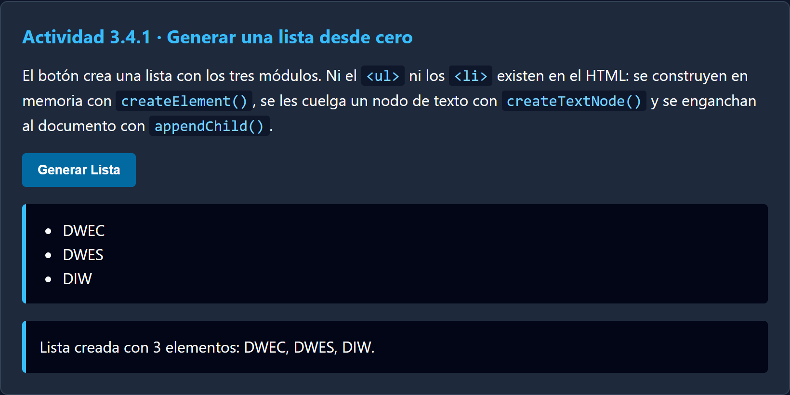
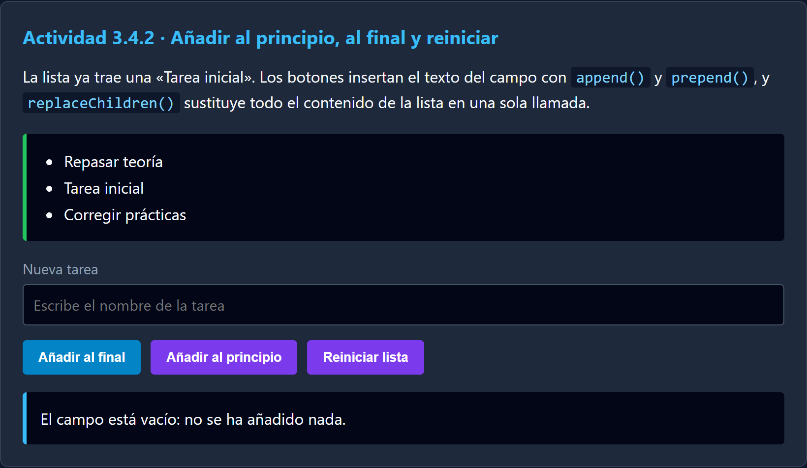
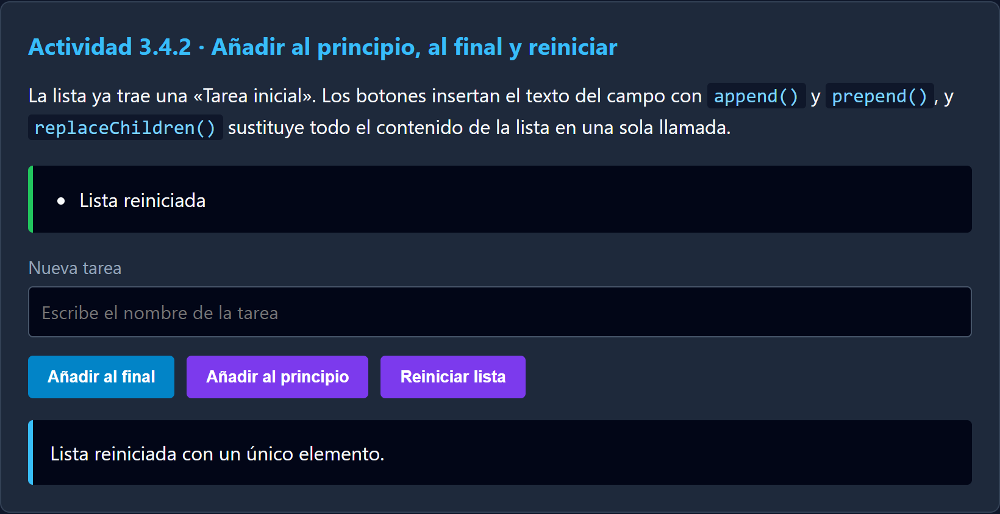
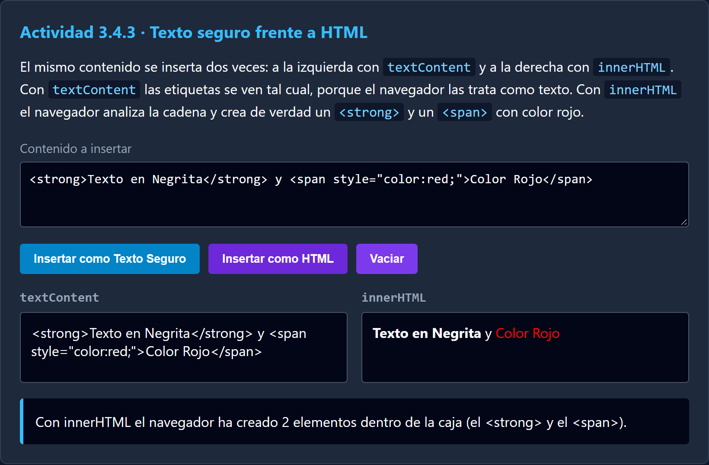

## Cómo está organizado

Una sola página `index.html` con las tres actividades en secciones y un archivo
JavaScript por actividad. Ninguna necesita ventana aparte ni un documento largo,
así que caben seguidas y con enlaces en la cabecera.

```
index.html
css/estilos.css
js/lista.js     3.4.1
js/tareas.js    3.4.2
js/texto.js     3.4.3
```

## Actividad 3.4.1 · Lista creada con createElement

En el HTML solo hay `<div id="contenedorLista"></div>`, vacío. Al pulsar
**Generar Lista** se construye todo desde cero:

```js
const elemento = document.createElement(etiqueta);
const nodoTexto = document.createTextNode(texto);
elemento.appendChild(nodoTexto);
lista.appendChild(elemento);
```

El orden importa. Primero se crea el `<li>` y su texto **en memoria**, después se
cuelga del `<ul>` y solo al final se monta el `<ul>` en el documento. Así el
navegador recalcula el diseño una vez, cuando ya está todo, y no una vez por cada
elemento.



Si se pulsa dos veces no se duplica: antes de crear nada se vacía el contenedor
con `textContent = ""`. Vaciar con `textContent` es seguro porque no interpreta la
cadena como HTML.

## Actividad 3.4.2 · append, prepend y replaceChildren

La lista arranca con un `<li>Tarea inicial</li>`. El campo y los tres botones
hacen esto:

| Botón | Método | Efecto |
|---|---|---|
| Añadir al final | `lista.append(item)` | el `<li>` nuevo queda el último |
| Añadir al principio | `lista.prepend(item)` | el `<li>` nuevo queda el primero |
| Reiniciar lista | `lista.replaceChildren(item)` | borra todo y deja un único `<li>` |

Antes de insertar compruebo `campo.value.trim() === ""`. Si el campo está vacío no
se añade nada y se avisa en el visor; sin esa comprobación se crearía un `<li>` sin
texto que no se ve pero ocupa sitio.

`append()` y `prepend()` aceptan nodos o cadenas, pero aquí les paso un `<li>` ya
montado para que se vea el proceso. Si se inserta un nodo que ya está en el
documento, el navegador lo **mueve**, no lo duplica.



`replaceChildren()` es la forma corta de decir «borra los hijos y pon estos». Sustituye
al `while (lista.firstChild) { ... }` de antes y lo hace en una sola operación.



## Actividad 3.4.3 · textContent frente a innerHTML

El campo trae la cadena que pide el enunciado:

```
<strong>Texto en Negrita</strong> y <span style="color:red;">Color Rojo</span>
```

Se inserta dos veces, cada una en su caja, para comparar:

- **Insertar como Texto Seguro** → `caja.textContent = valor`. La cadena se guarda
  como texto: las etiquetas se ven escritas y no se crea ningún elemento (0
  elementos dentro de la caja).
- **Insertar como HTML** → `caja.innerHTML = valor`. El navegador analiza la cadena,
  crea el `<strong>` y el `<span>` de verdad (2 elementos) y aplica el `color:red`.



Después lo probé con ``, que es el
ejemplo típico de XSS. Con `textContent` la etiqueta se ve como texto y la variable
no se crea. Con `innerHTML` el navegador intenta cargar la imagen, falla y ejecuta
el `onerror`, así que la variable acaba en `true`.

Por eso la regla que sigo en el resto de la unidad: `innerHTML` solo con cadenas que
escribo yo en el código, y `textContent` siempre que haya un dato del usuario de
por medio.

## Comprobaciones

- El contenedor de la 3.4.1 está vacío antes de pulsar el botón.
- La lista generada es un `<ul>` con tres `<li>`: DWEC, DWES y DIW.
- «Añadir al principio» coloca la tarea delante de «Tarea inicial»; «al final», detrás.
- Con el campo vacío no se añade ningún `<li>`.
- «Reiniciar lista» deja un único `<li>` con «Lista reiniciada».
- `textContent` deja 0 elementos dentro de la caja.
- `innerHTML` crea 2 elementos y el `<span>` sale en rojo (`rgb(255, 0, 0)`).
- La etiqueta `` no se ejecuta con `textContent` y sí con `innerHTML`.
- En consola solo aparece el 404 de la imagen de prueba, que es el esperado.

Las capturas están tomadas con el navegador en modo headless a 1100 × 1000 y
escala 2.
