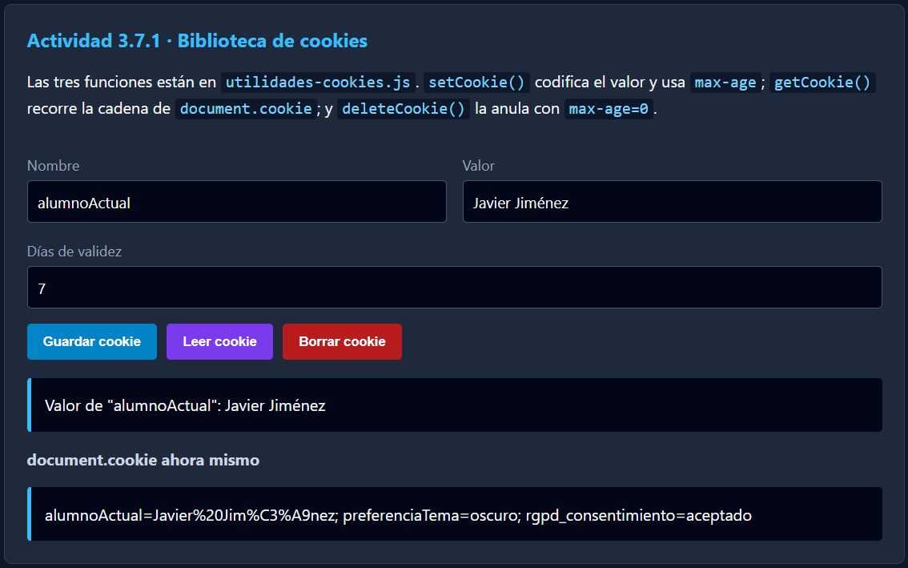
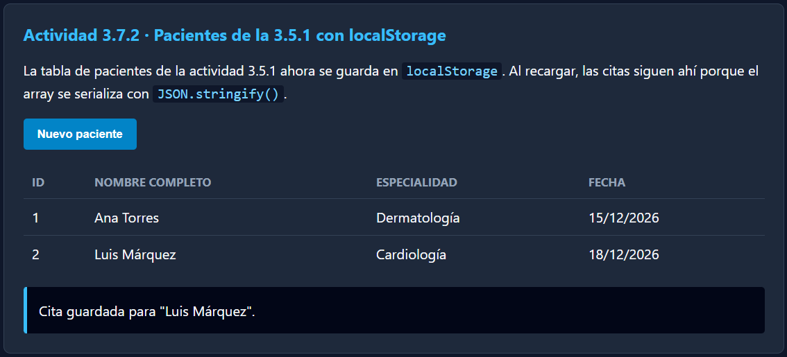
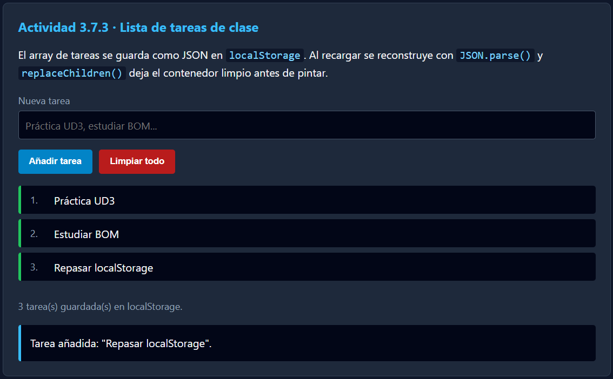
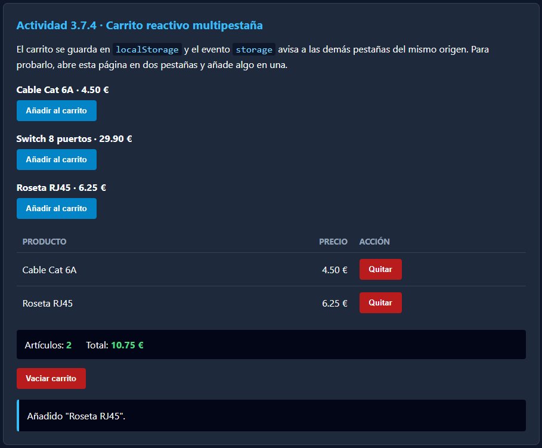
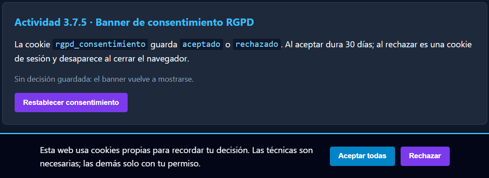
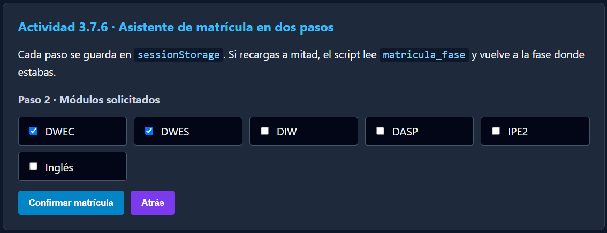

## Cómo está organizado

Una sola página `index.html` con las seis actividades en secciones, una hoja de
estilos y un archivo JavaScript por actividad. La biblioteca de cookies va
aparte porque el enunciado la pide con ese nombre exacto.

```
index.html
utilidades-cookies.js   3.7.1
css/estilos.css
js/cookies.js           3.7.1
js/pacientes.js         3.7.2
js/tareas.js            3.7.3
js/carrito.js           3.7.4
js/banner.js            3.7.5
js/matricula.js         3.7.6
capturas/
```

Para que las cookies funcionen hay que abrir la página desde un servidor, no con
doble clic. En `file://` Chrome ignora algunas cookies. Basta con
`python -m http.server` dentro de la carpeta o con el Apache de XAMPP.

## La teoría, en corto

HTTP no guarda estado entre peticiones. Si el servidor no recibe nada, no sabe
quién eres ni qué hiciste en la página anterior. Para eso existen las cookies y
el Web Storage: son memoria que vive en el navegador.

Una cookie se escribe asignando a `document.cookie`. Parece una variable, pero
funciona como un setter: cada asignación añade o actualiza una clave, no borra
las demás. Los atributos van detrás del valor, separados por `;`:

```js
document.cookie = "preferenciaTema=oscuro; max-age=86400; path=/; SameSite=Lax";
```

`max-age` cuenta segundos y es la forma recomendada hoy. `expires` hace lo mismo
con una fecha GMT. `path=/` permite que la cookie viaje por todo el sitio; sin
él se queda en la carpeta del documento. `SameSite=Lax` evita que otro sitio
lance peticiones con tu cookie; `Strict` es más restrictivo y `None` exige
`Secure`.

Para borrar no hay un `remove()`. Se vuelve a escribir la misma clave con
`max-age=0`, y el `path` tiene que coincidir con el de creación:

```js
document.cookie = "preferenciaTema=; max-age=0; path=/";
```

Leer es más incómodo de lo que parece. `document.cookie` devuelve una sola
cadena con todos los pares visibles, sin atributos:

```
"alumnoActual=Javier%20Jim%C3%A9nez; preferenciaTema=oscuro"
```

Por eso hay que recorrerla y decodificar cada valor. Una cookie `HttpOnly` no
aparece aquí: solo la ve el servidor.

El Web Storage tiene dos almacenes con los mismos métodos. `localStorage` no
caduca y se comparte entre pestañas del mismo origen; `sessionStorage` muere al
cerrar la pestaña y cada pestaña tiene el suyo. Los dos guardan solo cadenas,
así que un objeto hay que pasarlo por `JSON.stringify()` al guardar y por
`JSON.parse()` al leer. Si se guarda el objeto directamente, queda
`"[object Object]"`.

`localStorage` no avisa a la pestaña que escribe, pero sí a las demás: el evento
`storage` se dispara en las pestañas hermanas del mismo origen. Es lo que usé en
el carrito.

| | Cookies | localStorage | sessionStorage |
|---|---|---|---|
| Capacidad | unos 4 KB | varios MB | varios MB |
| Caducidad | configurable o sesión | no caduca | al cerrar la pestaña |
| Viaja al servidor | en cada petición | no | no |
| Alcance | dominio y path | origen | pestaña |

## Actividad 3.7.1 · Biblioteca de cookies

Las tres funciones están en `utilidades-cookies.js`. `setCookie()` codifica el
valor con `encodeURIComponent()` y calcula `max-age` en segundos:

```js
function setCookie(nombre, valor, diasExpiracion, ruta) {
  var valorCodificado = encodeURIComponent(valor);
  var segundos = diasExpiracion * 24 * 60 * 60;
  var rutaFinal = ruta || "/";
  document.cookie = nombre + "=" + valorCodificado +
    "; max-age=" + segundos + "; path=" + rutaFinal;
}
```

`getCookie()` parte la cadena por `;` y compara con `indexOf(...) === 0`. Esa
comparación importa: si buscara `alumno=` a secas, también encontraría
`otroAlumno=`. Al devolver, aplica `decodeURIComponent()`. Si no está, devuelve
`null`, no una cadena vacía: así se distingue "no existe" de "existe vacía".

`deleteCookie()` repite el nombre con `max-age=0` y el mismo `path`.

La página tiene un formulario con nombre, valor y días, y tres botones. Debajo
se imprime `document.cookie` tal cual para ver que los atributos no aparecen.



## Actividad 3.7.2 · Pacientes con localStorage

La actividad 3.5.1 era una tabla de pacientes con un `<dialog>` para dar de
alta. Aquí se le añade persistencia. Elegí `localStorage` y no `sessionStorage`
porque las citas tienen que seguir ahí al cerrar el navegador; con
`sessionStorage` se perderían al cerrar la pestaña.

El array se guarda entero en la clave `pacientes_clinica`. Al añadir un paciente
se calcula el ID como el máximo actual más uno, para que no se repita al borrar
filas. La tabla se reconstruye desde cero con `replaceChildren()` y
`createElement()`, sin `innerHTML`, porque el nombre lo escribe el usuario.



La notificación usa la `Notification` API. Si el navegador no la soporta o el
usuario deniega el permiso, el aviso queda en el visor de la página y no se
rompe nada.

## Actividad 3.7.3 · Lista de tareas

El array de cadenas se guarda con `JSON.stringify()` en `tareas_clase`. Al
cargar se hace el camino inverso:

```js
var datos = JSON.parse(crudo);
if (Array.isArray(datos)) {
  return datos;
}
```

El `try/catch` y la comprobación con `Array.isArray()` están porque
`localStorage` es texto que el usuario puede editar. Si alguien deja ahí un JSON
roto, la página no debe quedarse en blanco: se trata como lista vacía.

Cada tarea se pinta con `createElement()` y `textContent`. Si se usara
`innerHTML`, una tarea con `` se ejecutaría. Es el mismo
problema de XSS de la actividad 3.4.3.

El botón Limpiar Todo hace `removeItem()` y `replaceChildren()`, y la lista
vuelve al estado vacío con un `<li>` que lo dice.



## Actividad 3.7.4 · Carrito entre pestañas

El catálogo es fijo: tres productos con id, nombre y precio. El carrito se
guarda en `carrito_tienda` como array de copias, no de referencias al catálogo.
Los totales se recalculan cada vez que se pinta.

Lo interesante es el evento:

```js
window.addEventListener("storage", function (evento) {
  if (evento.key === "carrito_tienda" || evento.key === null) {
    pintarCarrito();
  }
});
```

Ese evento no salta en la pestaña que hace el cambio, solo en las demás. Por eso
se puede añadir un producto en una pestaña y ver cómo la otra actualiza la tabla
y el importe sin recargar. `evento.key === null` cubre el caso de `clear()`.



Lo probé con dos pestañas abiertas en el mismo origen: al añadir en la segunda,
la primera pasó de un artículo a dos y mostró el aviso de cambio recibido.

## Actividad 3.7.5 · Banner de consentimiento

La cookie `rgpd_consentimiento` guarda `aceptado` o `rechazado`. Al cargar, el
script la busca: si existe, oculta el banner; si no, lo muestra.

Al aceptar se escribe con 30 días y `SameSite=Lax`. Al rechazar se escribe sin
`max-age`, así que es una cookie de sesión y desaparece al cerrar el navegador.
El botón Restablecer la borra con `max-age=0` y vuelve a enseñar el banner.

Aquí no usé `setCookie()` porque esa función no añade `SameSite` y el enunciado
lo pide de forma expresa. La cookie se escribe directamente en `banner.js`.



## Actividad 3.7.6 · Matrícula en dos pasos

Cada paso se guarda en `sessionStorage` como JSON. Además hay una clave
`matricula_fase` con `"1"` o `"2"` que dice por dónde iba el usuario.

Al pulsar Siguiente se validan nombre y DNI, se guarda el paso 1 y se pasa al 2.
Cada cambio en las casillas guarda la selección, de modo que un F5 a mitad del
paso 2 no pierde nada. Atrás vuelve al paso 1 con los datos rellenados.

Al confirmar se recuperan los dos pasos, se pinta el resumen y se borran las tres
claves. Así, recargar después de confirmar no restaura una matrícula ya enviada.



## Comprobaciones

- La página se sirve con `python -m http.server` y no deja ningún error en la
  consola del navegador.
- 3.7.1: guardar, leer y borrar dejan el valor correcto y `document.cookie`
  refleja los cambios.
- 3.7.2: los pacientes siguen en la tabla después de recargar.
- 3.7.3: las tareas se reconstruyen tras un F5 y Limpiar Todo deja solo el aviso
  de lista vacía.
- 3.7.4: con dos pestañas abiertas, añadir en una actualiza la otra sin recargar.
- 3.7.5: aceptar oculta el banner 30 días; rechazar lo oculta hasta cerrar el
  navegador; restablecer lo vuelve a mostrar.
- 3.7.6: recargar en el paso 2 mantiene los módulos marcados; Atrás conserva los
  datos; confirmar vacía `sessionStorage`.
