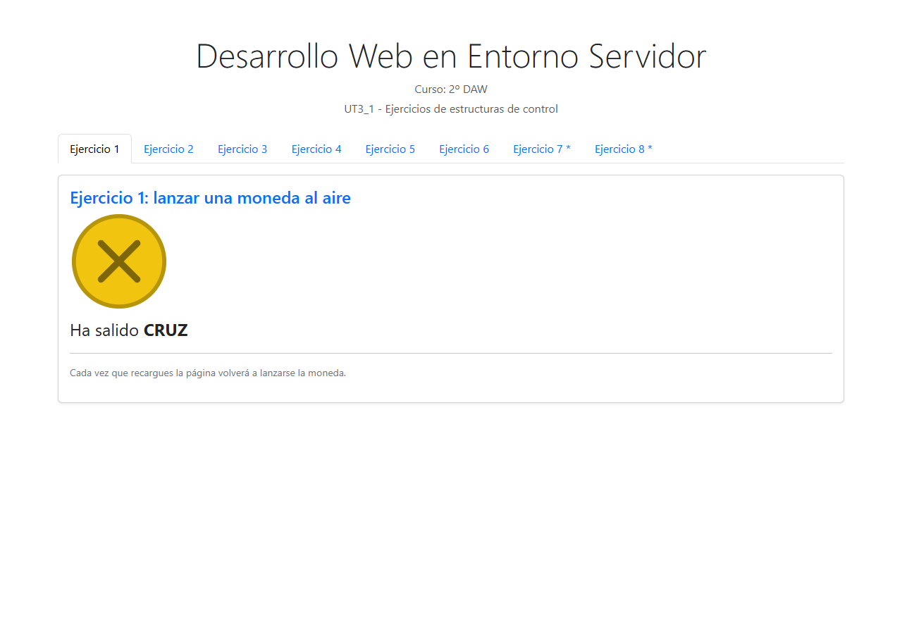
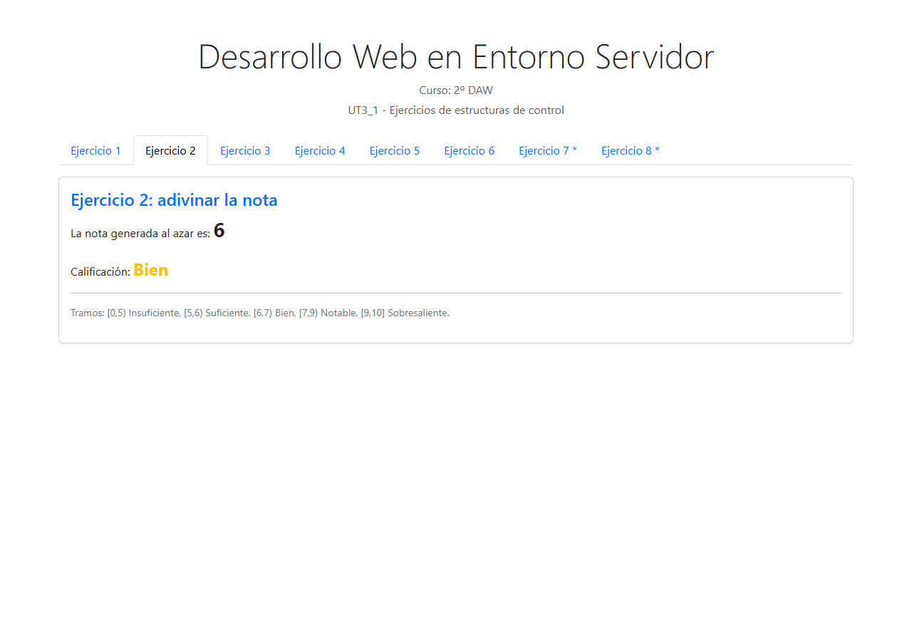
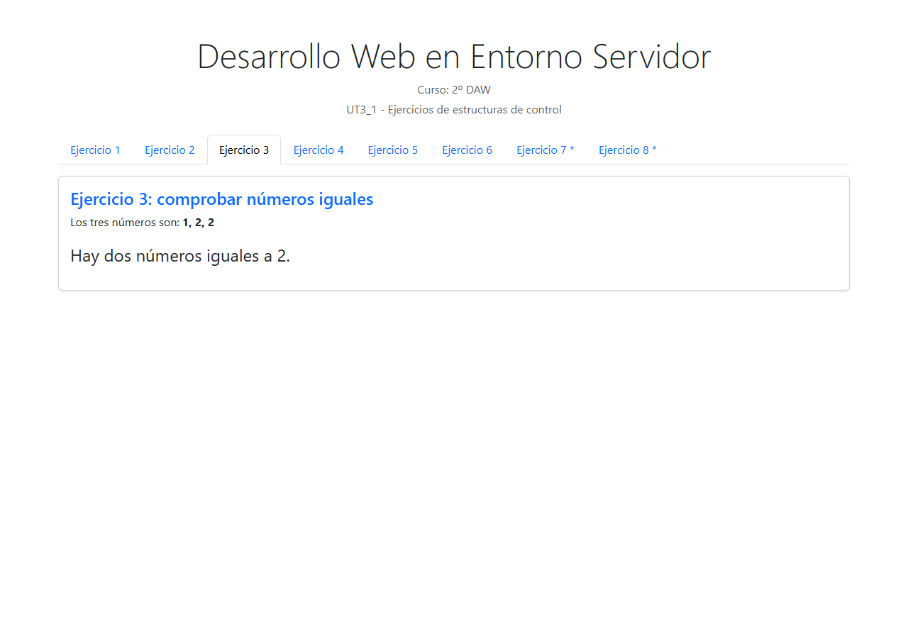
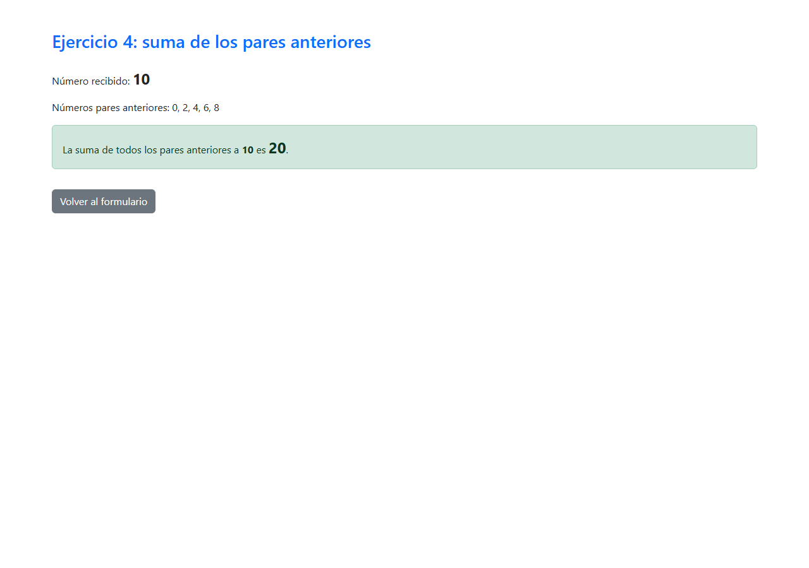
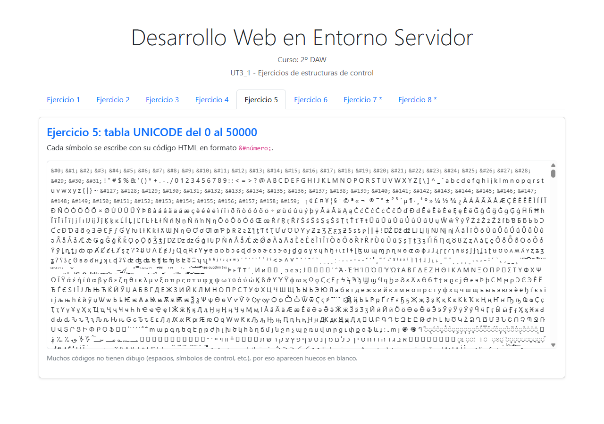
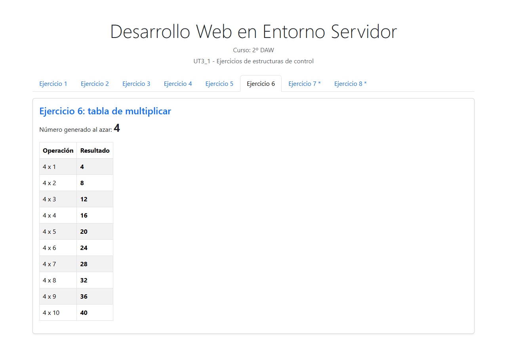
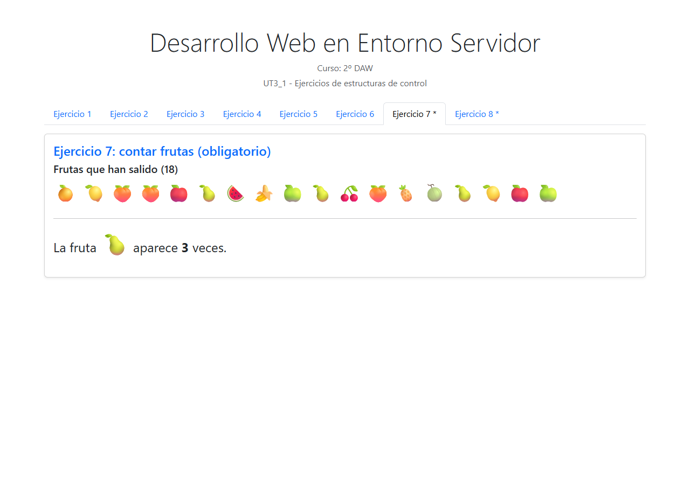
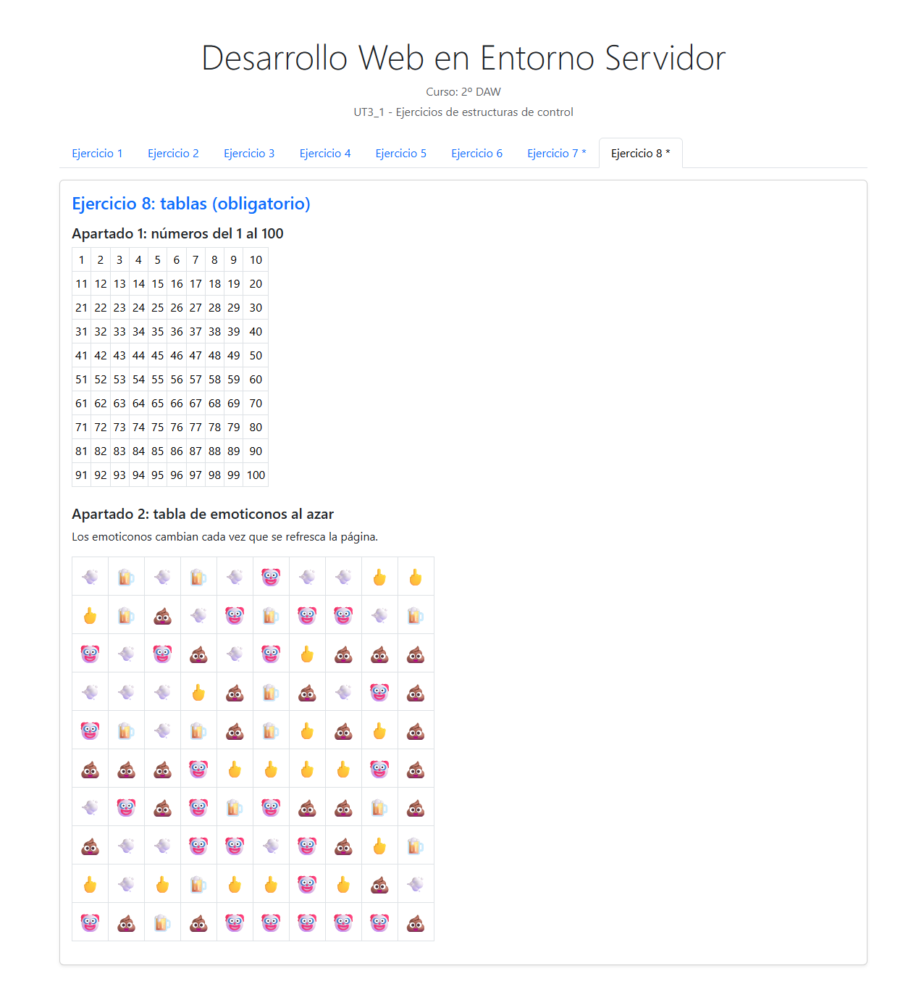
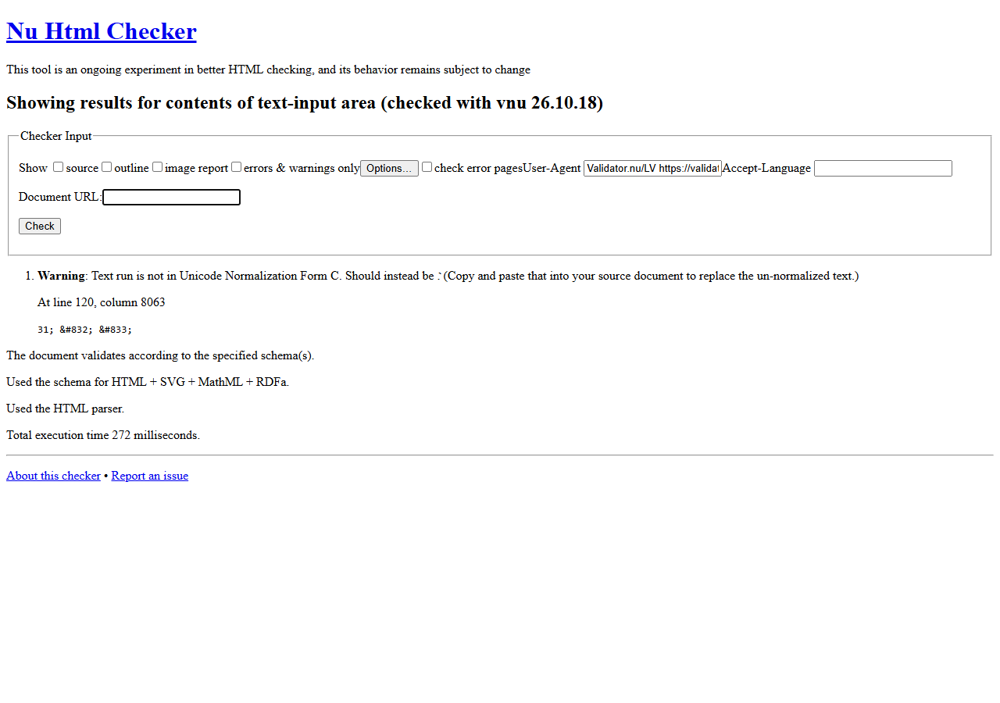

# UT3_1 - Ejercicios de estructuras de control

Proyecto de la **Entrega UT3_1 - Estructuras de control** (Desarrollo web en
entorno servidor, 2º DAW).
Fecha límite en Moodle: **24/10/2026, 12:23**.
Autor: **Javier Jiménez Alonso**.

## Estructura

```
DWESEjerciciosUT3_1/
├── index.php                  <- única página con las 8 pestañas (Bootstrap 5)
└── ejercicios/
    ├── ejercicio1.php         <- lanzar una moneda
    ├── ejercicio2.php         <- nota a partir de un número aleatorio
    ├── ejercicio3.php         <- tres números iguales
    ├── ejercicio4.php         <- formulario del ejercicio 4
    ├── sumaPares.php          <- recoge el formulario y suma los pares
    ├── ejercicio5.php         <- tabla UNICODE del 0 al 50000
    ├── ejercicio6.php         <- tabla de multiplicar de un aleatorio
    ├── ejercicio7.php         <- OBLIGATORIO: contar frutas
    └── ejercicio8.php         <- OBLIGATORIO: tabla 1-100 y tabla de emoticonos
```

## Cómo probarlo

```bash
php -S localhost:8000
```

Abrir <http://localhost:8000/index.php>.

## Relación con la teoría de la UT3

| Ejercicio | Punto de la teoría (`UT3_Estructuras de control, arrays y formularios.pdf`) |
|---|---|
| 1 | 2.1 Estructuras condicionales (`if / else`) |
| 2 | 2.1 Condicionales encadenadas (`if / elseif / else`, intervalos semiabiertos) |
| 3 | 2.1 Condicionales con operadores lógicos (`&&`, `\|\|`) |
| 4 | 6. Formularios: `method="get"`, `name` en el campo y recogida con `filter_input()` |
| 5 | 2.2.1 Bucle `for` (50001 iteraciones) + entidades HTML `&#numero;` |
| 6 | 2.2.1 Bucle `for` para construir la tabla |
| 7 | 3. Arrays (`rand`, `array_rand`) + 2.2.3 `foreach` para contar apariciones |
| 8 | 2.2.1 `for` con `%` (10 celdas por fila) + 3. Arrays (`array_rand`) |

## Decisiones de implementación

- **Una sola página `index.php`** con pestañas Bootstrap; cada ejercicio se
  incluye desde `ejercicios/` con `include`.
- **Todo el CSS es Bootstrap 5 por CDN**: no hay hoja de estilos propia. El
  único estilo en línea es el `max-height` de la caja con scroll del ejercicio
  5, porque Bootstrap no trae una clase para la altura máxima.
- El ejercicio 4 usa **dos páginas** (`ejercicio4.php` con el formulario y
  `sumaPares.php` con el resultado) porque el enunciado pide expresamente
  "en otra página se recoge".
- El valor del formulario se recoge con **`filter_input(INPUT_GET, ...)`**,
  tal y como recomienda el punto 6 de la teoría (evitar el uso directo de las
  superglobales).
- El ejercicio 1 dibuja la moneda con **SVG** para no depender de imágenes
  externas.
- La tabla UNICODE va dentro de un contenedor con scroll para que 50001
  caracteres no rompan la página.

## Pendiente para la entrega

- [x] Capturas de pantalla de cada pestaña → carpeta [`capturas/`](capturas)
- [x] Validación en <https://validator.w3.org/> del HTML generado: **0 errores**.
      Captura en [`capturas/ut3_1_validacion_w3c.png`](capturas/ut3_1_validacion_w3c.png).
      La página valida y solo emite un aviso informativo de normalización
      Unicode sobre la entidad `&#832;` de la tabla del ejercicio 5.
- [x] Exportar esta memoria a PDF → `Explicacion_DWESEjerciciosUT3_1_JimenezAlonsoJavier.pdf`
- [x] Comprimir como `DWESEjerciciosUT3_1_JimenezAlonsoJavier.zip`

## Anexo: capturas

| Captura | Descripción |
|---|---|
|  | Ejercicio 1: lanzar una moneda |
|  | Ejercicio 2: nota a partir de un número aleatorio |
|  | Ejercicio 3: tres numeros iguales |
|  | Ejercicio 4: formulario de los pares anteriores |
|  | Ejercicio 4: resultado para `?numero=10` |
|  | Ejercicio 5: tabla UNICODE del 0 al 50000 |
|  | Ejercicio 6: tabla de multiplicar de un aleatorio |
|  | Ejercicio 7: contar frutas (array aleatorio) |
|  | Ejercicio 8: números 1-100 y tabla de emoticonos |
|  | Validación del HTML generado en validator.w3.org |
