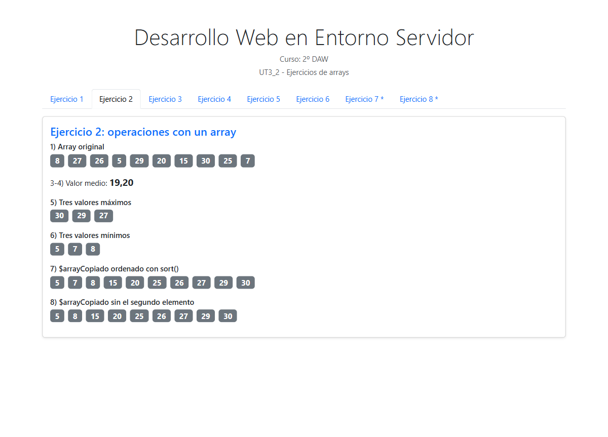
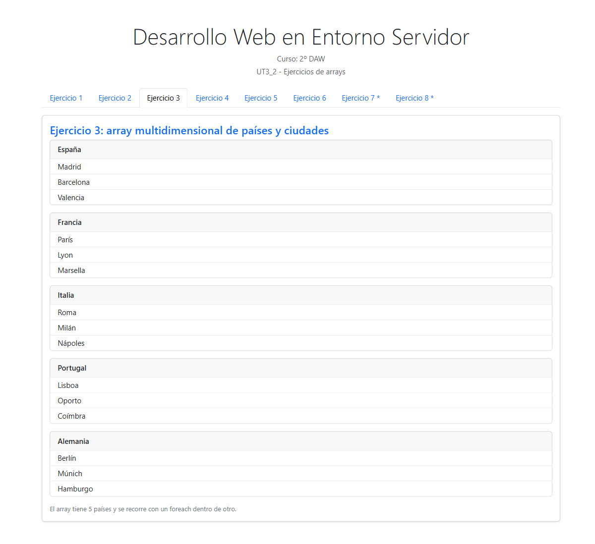
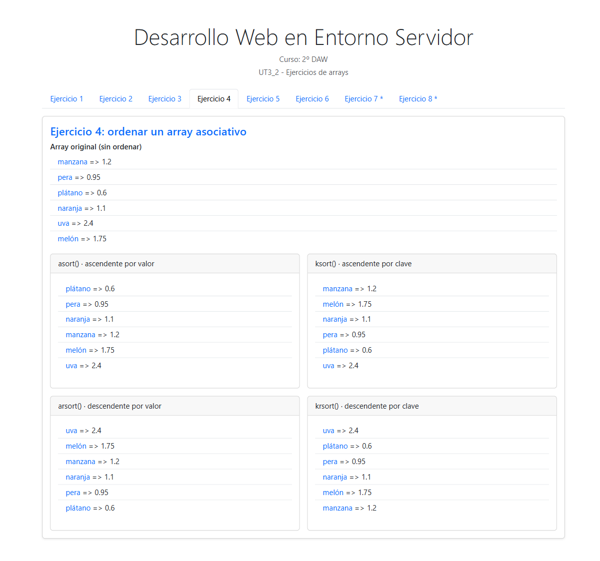
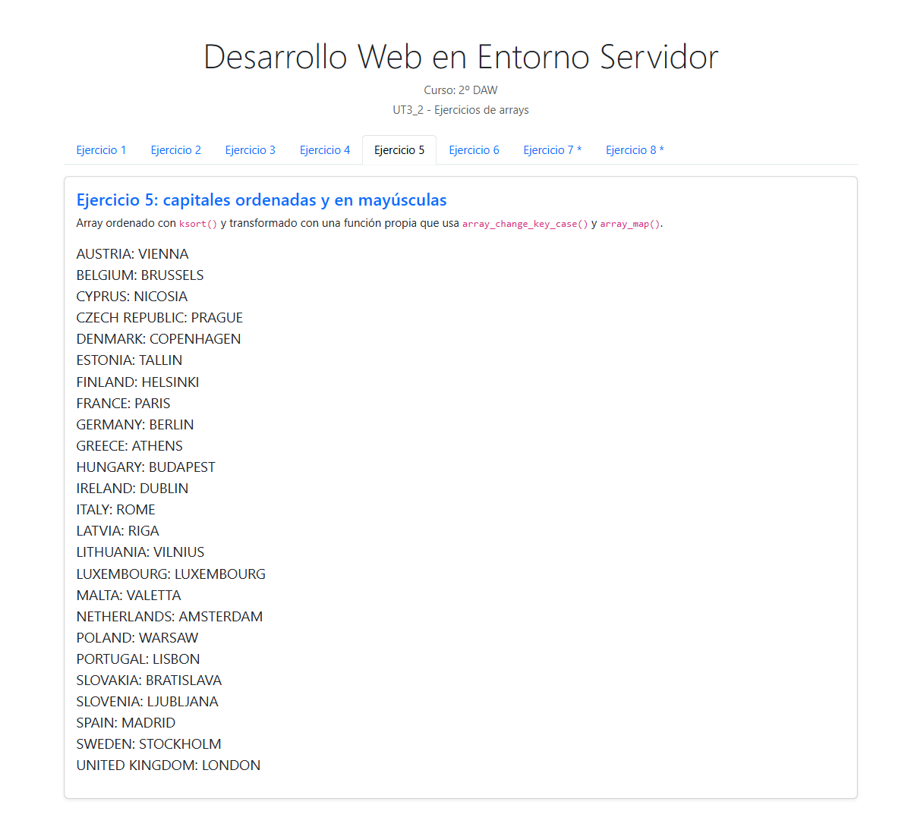
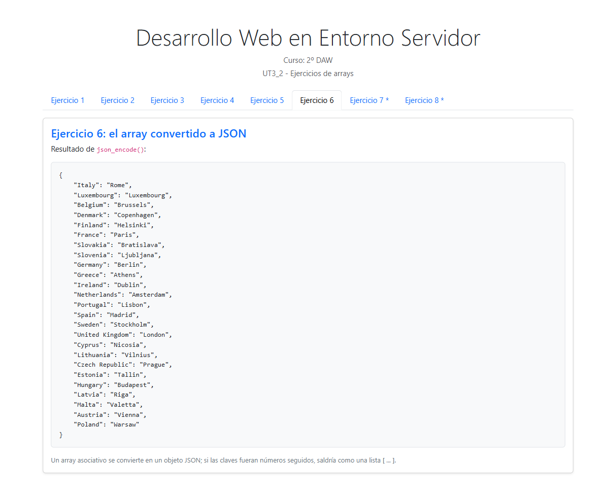
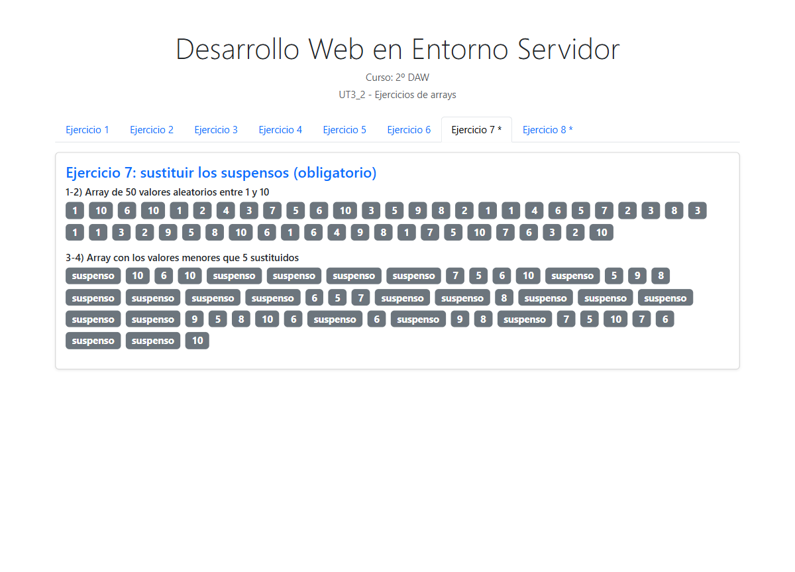
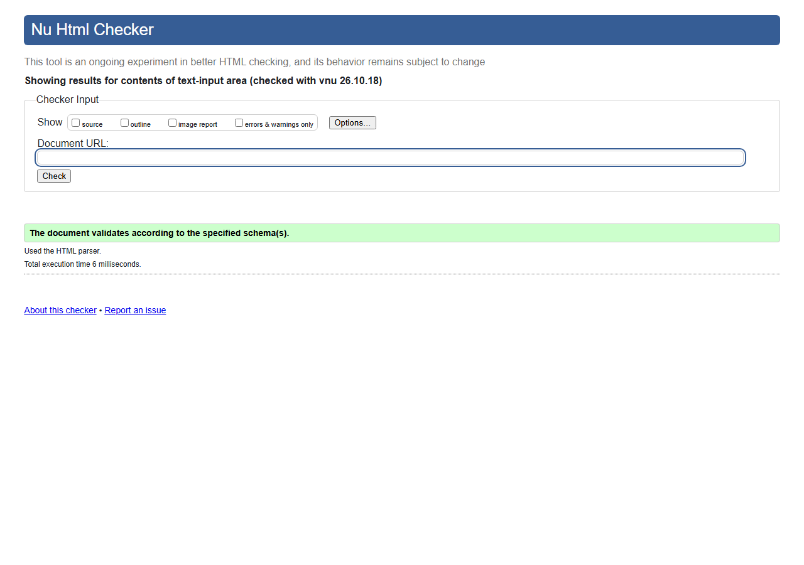

<!-- Cada apartado empieza en una página nueva: el div con class="pagebreak" lo
     convierte en salto de página al generar el PDF (ver .moodle/md2pdf.mjs). -->

# Ejercicio 1

# Ejercicio 2

# Ejercicio 3

# Ejercicio 4

# Ejercicio 5

# Ejercicio 6

# Ejercicio 7

# Ejercicio 8

# Validación del HTML generado

# ¿Cómo se ha realizado la actividad?

Para resolver esta práctica se ha creado una única página index.php con pestañas de Bootstrap 5. Cada ejercicio se ha incluido desde la carpeta ejercicios/ mediante include, lo que permite mantener el código organizado y visualizarlos todos desde una misma página.

Los arrays se han declarado con corchetes [] y se han rellenado con rand() dentro de un bucle for. Para recorrerlos se ha utilizado foreach, por valor y también por referencia en el ejercicio 7, donde el & es necesario para modificar el array mientras se recorre.

Para ordenar se han usado las funciones asort, arsort, ksort y krsort sobre una copia del array, porque estas funciones modifican el array que reciben y así se conserva el original. En el ejercicio 2 se han utilizado además count, array_sum, sort, rsort, array_slice y array_splice.

Las funciones propias (mostrarArray y mostrarAsociativo) están en auxiliar.php, que index.php carga una sola vez con require_once, para no repetir el mismo foreach en varios ejercicios. En el ejercicio 5 se ha escrito una función que recorre el array y aplica strtoupper a la clave y al valor, y en el ejercicio 6 se ha convertido el array a JSON con json_encode.

Tras levantar el servidor PHP con php -S, se han ido probando todos los ejercicios recargando la página para comprobar su correcto funcionamiento. A continuación se han realizado las capturas de cada pestaña.

Por último, se ha obtenido el HTML generado por PHP (el que realmente recibe el navegador) y se ha validado con el Nu Html Checker de W3C, comprobando que la estructura resultante es válida según HTML5.

# ¿Qué se ha aprendido?

- Arrays: crear un array vacío, llenarlo con claves automáticas y recorrerlo con foreach.
- Arrays multidimensionales: guardar un array dentro de otro y recorrerlo con un foreach dentro de otro.
- Ordenación: ordenar por valor y por clave, en los dos sentidos, con asort, arsort, ksort y krsort.
- foreach por referencia: entender que sin el & se modifica una copia y los cambios se pierden al terminar el bucle.
- Funciones propias: agrupar el código repetido en una función con parámetros y valor por defecto.
- JSON: convertir un array asociativo en un objeto JSON con json_encode.
- Validación: entender la diferencia entre validar el código PHP y validar el HTML generado, y que para HTML5 se utiliza el Nu Html Checker.
