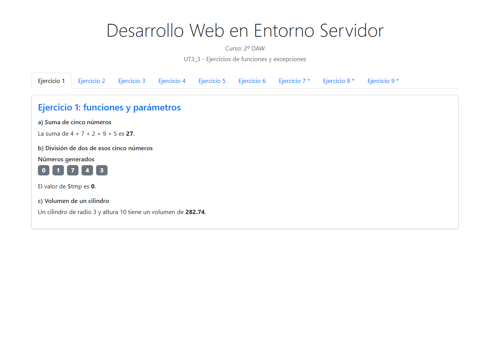
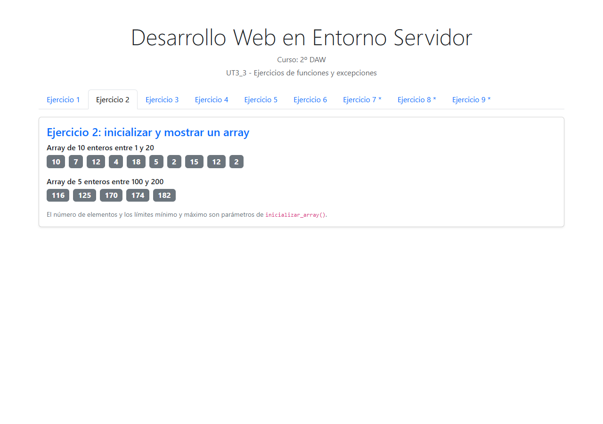
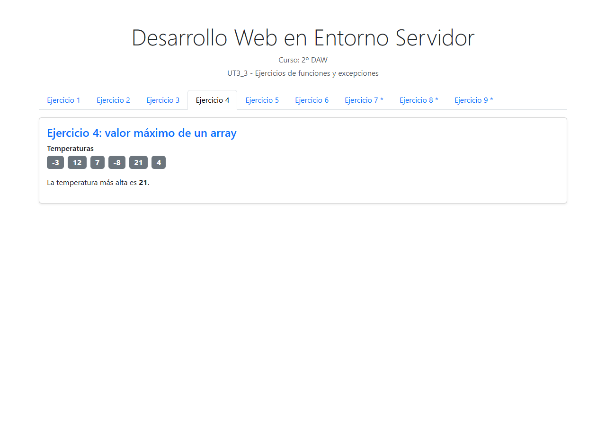
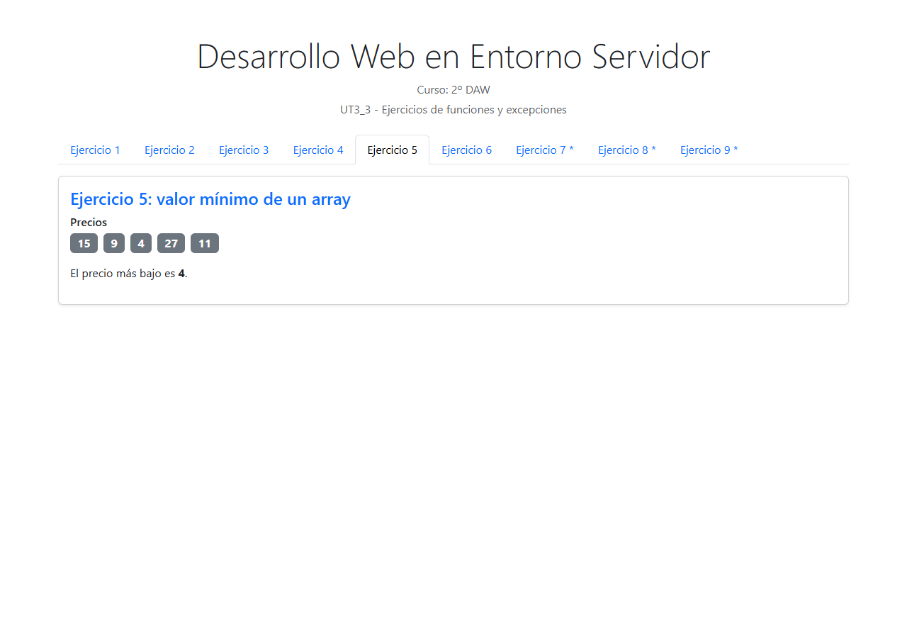
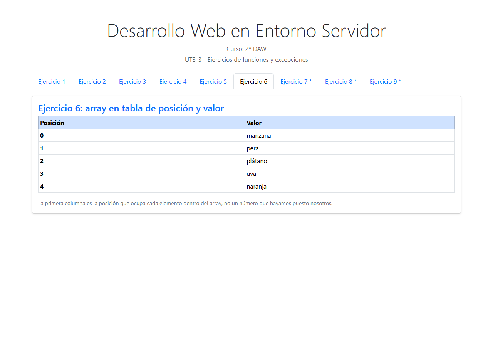
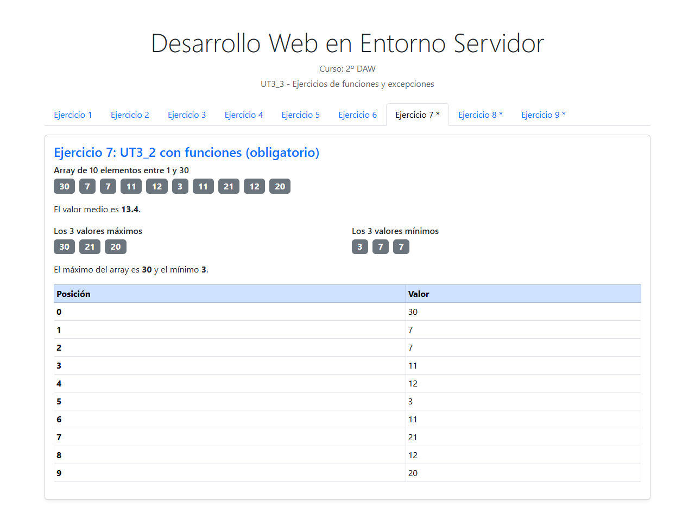
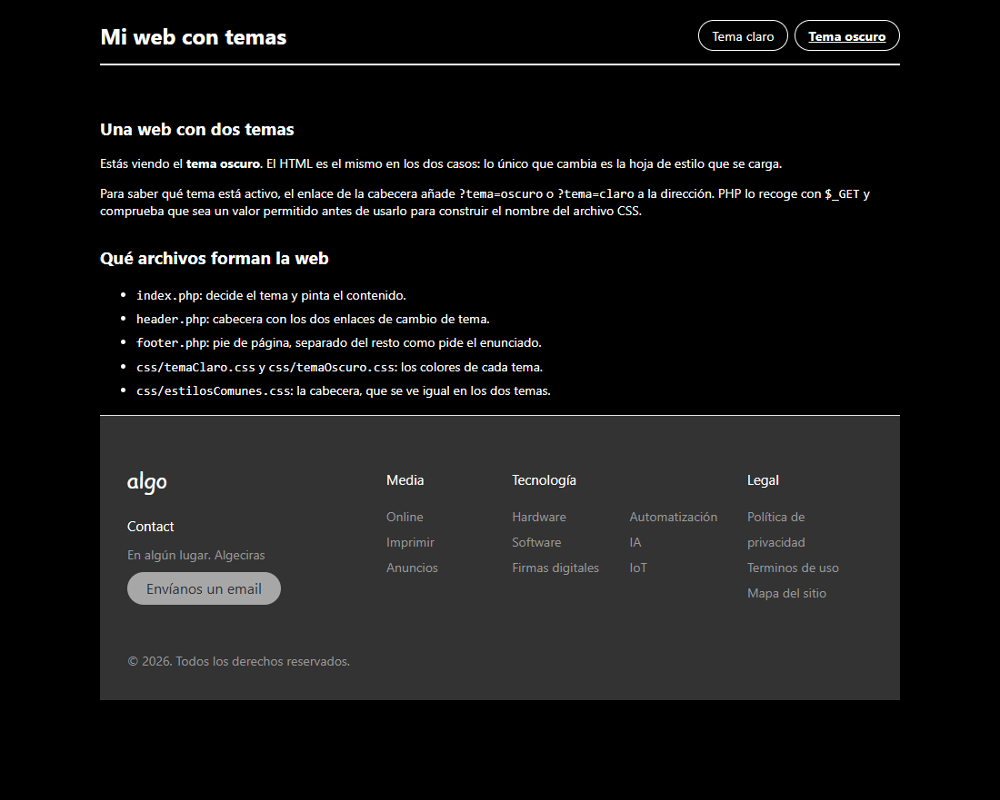
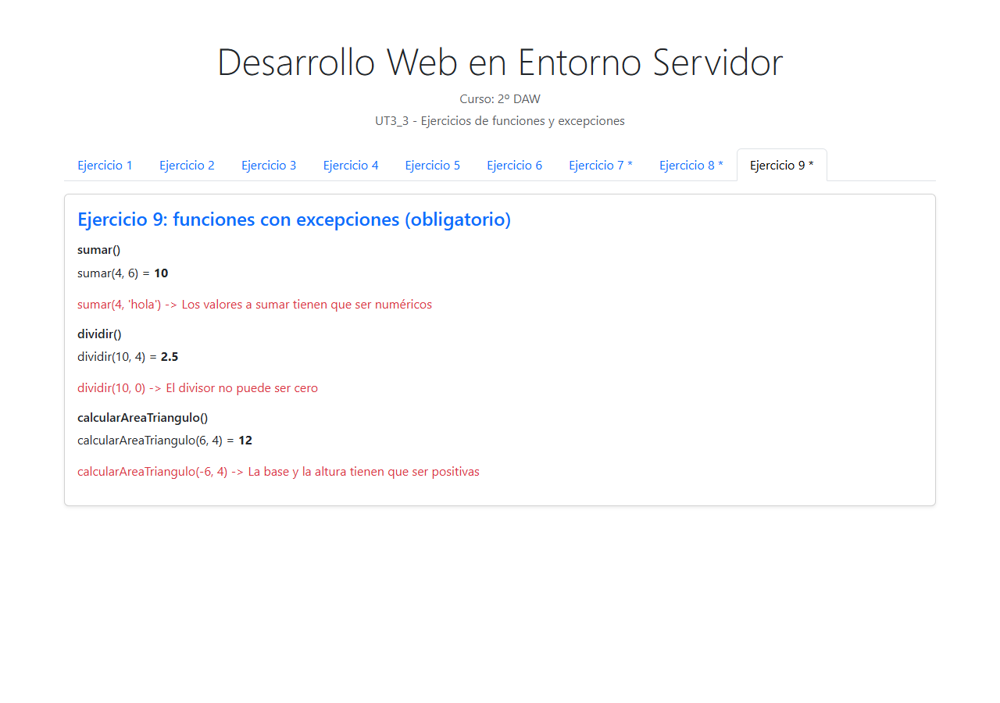
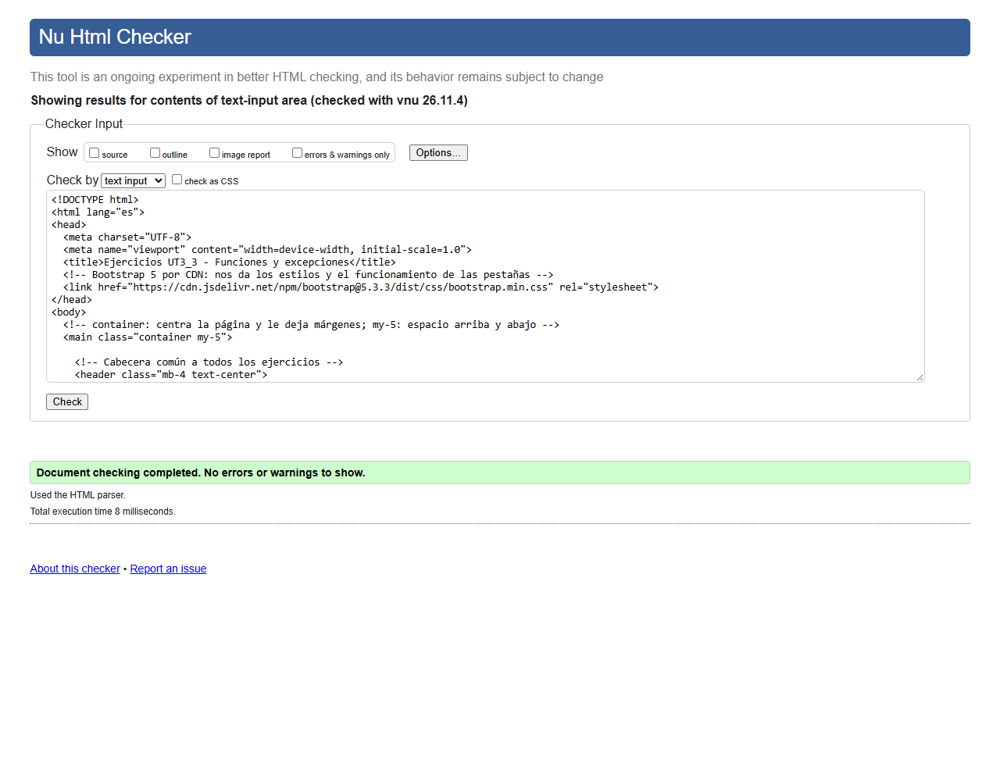
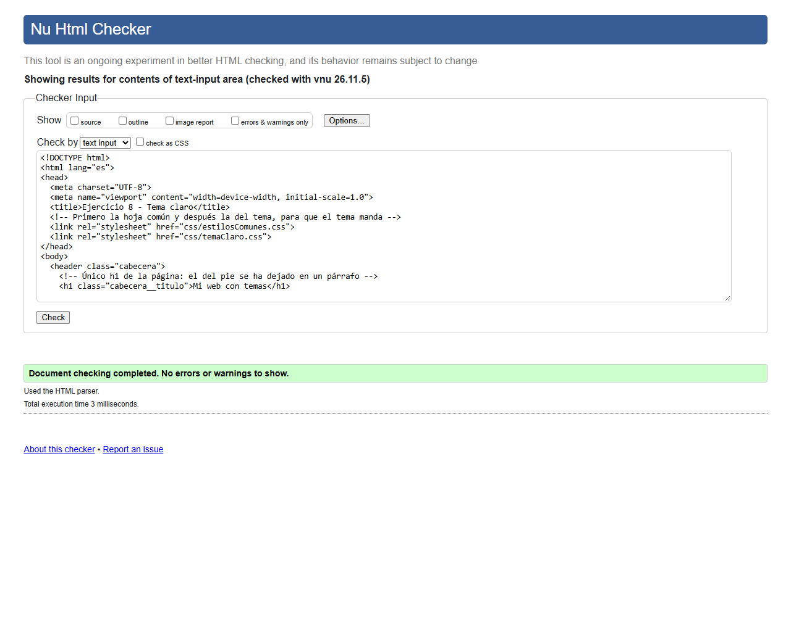

<!-- Cada apartado empieza en una página nueva: el div con class="pagebreak" lo
     convierte en salto de página al generar el PDF (ver .moodle/md2pdf.mjs). -->

# Ejercicio 1

En el apartado a) la función `sumarCinco()` recibe los cinco enteros y escribe
la suma; no devuelve nada, para comprobar la diferencia entre una función que
pinta y otra que devuelve un valor.

En el apartado b) se generan cinco números aleatorios entre 0 y 9, se pasan a
`dividirDosDeCinco()` y el resultado se guarda en `$tmp`. La división del
primero entre el segundo puede fallar si el segundo número sale 0, así que la
función lanza una excepción y la llamada va dentro de un `try/catch`: en vez de
romperse la página, se muestra el mensaje del error.

En el apartado c) `volumenCilindro()` recibe el radio y la altura y devuelve
`3.1416 * radio * radio * altura`.

# Ejercicio 2

`inicializar_array($numero_de_elementos, $min, $max)` crea un array vacío y le
añade tantos valores como se le piden con `rand($min, $max)` dentro de un `for`.
Se llama dos veces con valores distintos para que se vea que no está escrito
para un caso concreto. `mostrar_array()` recorre el array con `foreach` y pinta
cada valor como una etiqueta.

# Ejercicio 3

`calcular_media()` suma todos los elementos con `array_sum()` y divide entre el
número de elementos que da `count()`, que es exactamente la fórmula de la media.

# Ejercicio 4

`calcular_maximo()` arranca con el primer elemento del array como candidato y lo
va comparando con todos los demás. Arranco con `$datos[0]` y no con 0 porque, si
todos los números fueran negativos, el 0 sería un máximo falso. En la captura se
ve que la temperatura más alta es 21 y no 0.

# Ejercicio 5

`calcular_minimo()` funciona igual que el máximo pero con el signo de la
comparación al revés. Aquí todos los precios son positivos, así que el mínimo
tiene que ser 4, no 0: eso confirma que el valor inicial es el primer elemento.

# Ejercicio 6

`imprimir_array()` recorre el array con `foreach ($datos as $posicion => $valor)`
y pinta una fila por elemento. La clave del `foreach` es la posición real dentro
del array, no un contador que hayamos puesto nosotros.

# Ejercicio 7

Es el ejercicio de UT3_2 resuelto otra vez, pero usando las funciones del
archivo `funciones.php`, que se carga una sola vez desde `index.php` con
`require_once`. El array se crea con `inicializar_array(10, 1, 30)`, se muestra
con `mostrar_array()`, la media se calcula con `calcular_media()` y el máximo y
el mínimo con `calcular_maximo()` y `calcular_minimo()`.

Para los tres valores mayores y los tres menores añado `tresMayores()` y
`tresMenores()`: copian el array, ordenan la copia con `rsort()` o `sort()` y se
quedan con los tres primeros con `array_slice()`. La copia es necesaria porque
esas funciones de ordenación modifican el array original.

# Ejercicio 8

La web del ejercicio 8 está en la carpeta `ejercicio8/` porque es una página
completa y no se puede pegar dentro de una pestaña. La pestaña la muestra con un
`iframe`, y hay un botón para abrirla en otra pestaña.

Por defecto se carga el tema claro. Los dos enlaces de la cabecera recargan
`index.php` añadiendo `?tema=claro` o `?tema=oscuro`; en `index.php` se recoge
ese valor con `$_GET`, se comprueba que sea exactamente `oscuro` y se construye
el nombre de la hoja de estilo. El HTML es el mismo en los dos temas: solo
cambia el `<link>` del CSS.

El pie de página está en `footer.php`, como pide el enunciado, y se incluye con
`require`. Al archivo que nos dieron solo le he cambiado dos cosas: el `<h1>` de
`footer__logo` pasa a `
`, porque la página ya tiene su `h1` en la cabecera y
no debe haber dos, y se ha quitado la línea «Hecho ♥ remotamente por 2ª DAW»,
que no aporta nada a la web. El aspecto es el mismo porque el tamaño y la
tipografía los sigue dando la clase.

La hoja `css/estilosComunes.css` es la única que he añadido. Las dos hojas del
tema solo estilan `body` y `.footer`, así que la cabecera y los enlaces del
contenido se quedaban sin estilo, y en el tema oscuro los enlaces salían en azul
oscuro sobre negro. En esa hoja solo hay cabecera, enlaces y márgenes; los
colores de cada tema siguen en `temaClaro.css` y `temaOscuro.css`.

# Ejercicio 9

Las tres funciones comprueban los datos antes de operar y lanzan una excepción
con un mensaje claro cuando algo no es válido:

- `sumar()` comprueba con `is_numeric()` que los dos valores sean números. Si
  alguno no lo es, lanza la excepción con el mensaje exacto que pide el
  enunciado: "Los valores a sumar tienen que ser numéricos".
- `dividir()` comprueba además que el divisor no sea 0, porque el cero sí es un
  número y `is_numeric()` no lo detecta como error.
- `calcularAreaTriangulo()` comprueba que los valores sean numéricos y positivos,
  porque una base o una altura negativa no describen un triángulo.

Cada llamada va dentro de su propio `try/catch`, y se prueban las dos caras:
una llamada correcta y otra incorrecta de cada función. Cuando todo está bien se
muestra el resultado y cuando hay un error se muestra el mensaje en rojo, sin
que la página se detenga.

# Validación del HTML generado

El HTML que realmente recibe el navegador (el que genera PHP, no el código
fuente) se ha pegado en el validador Nu de W3C. El resultado es "Document
checking completed. No errors or warnings to show.".

La web del ejercicio 8 se ha validado aparte, porque el enunciado pide
expresamente que pase el validador sin errores ni warnings; también sale limpia.
El resultado de las dos validaciones está guardado en `validacion-w3c.json` y en
`validacion-w3c-ejercicio8.json`.

# ¿Cómo se ha realizado la actividad?

El proyecto tiene un único `index.php` en la raíz con nueve pestañas de Bootstrap
5. Cada pestaña incluye con `include` el archivo del ejercicio que está en
`ejercicios/`, de forma que el código de cada uno se puede leer por separado.
Todas las funciones están en `ejercicios/funciones.php`, que `index.php` carga
una sola vez con `require_once`; así el ejercicio 7 puede usarlas sin volver a
definirlas. Cada función lleva encima tres líneas de comentario con su nombre,
sus parámetros y lo que devuelve, que es lo que pide el enunciado.

Las funciones de los ejercicios 2 a 6 están escritas a mano, sin usar `max()` ni
`min()`, para practicar el recorrido de arrays con `foreach`. Solo se usan
funciones predefinidas cuando la teoría ya las ha explicado: `rand()`,
`array_sum()`, `count()`, `sort()`, `rsort()` y `array_slice()`. Antes de
ordenar se copia el array, porque las funciones de ordenación lo modifican y en
el ejercicio 7 hace falta el array original para calcular la media y el máximo.

El ejercicio 8 se ha separado en su propia carpeta porque es una página
completa. `index.php` decide el tema, `header.php` pinta la cabecera con los dos
enlaces y `footer.php` el pie. El tema viaja en la URL y se valida antes de
usarlo para construir la ruta del CSS, para que no se pueda pedir cualquier
archivo desde la dirección.

Para comprobar el funcionamiento se ha levantado el servidor embebido de PHP con
`php -S` y se ha abierto la página con `display_errors` activado, revisando que
no apareciera ningún `Warning`, `Notice` o `Deprecated`. Después se han hecho las
capturas de cada pestaña y se ha validado el HTML generado con el Nu Html
Checker de W3C.

# ¿Qué se ha aprendido?

- Funciones: distinguir entre una función que devuelve un valor con `return` y
  otra que solo escribe en la página, y entender que los parámetros son datos
  que se pasan en cada llamada.
- Librerías propias: guardar las funciones en un archivo y cargarlo con
  `require_once` para no repetir código ni volver a definirlo.
- Excepciones: comprobar los datos dentro de la función, lanzar el error con
  `throw new Exception(...)` y capturarlo con `try/catch` para que el programa
  siga funcionando.
- Validación de datos: `is_numeric()` sirve para los números, pero hay casos
  (el divisor 0 o una medida negativa) que hay que comprobar aparte.
- Arrays: recorrerlos con `foreach`, copiarlos antes de ordenarlos y quedarse con
  una parte con `array_slice()`.
- `$_GET`: pasar datos sencillos de una página a otra por la URL y comprobar
  siempre que el valor recibido es uno de los permitidos antes de usarlo.
- Estructura de un proyecto: separar la cabecera, el pie y las hojas de estilo
  para no repetir el mismo HTML en cada página.
- Validación HTML: el validador revisa el HTML que genera PHP, no el código PHP,
  y conviene validar también las páginas que no son el `index`.
