<!-- Cada apartado empieza en una página nueva: el div con class="pagebreak" lo
     convierte en salto de página al generar el PDF (ver .moodle/md2pdf.mjs). -->

# Ejercicio 1 (opcional): cálculo del salario

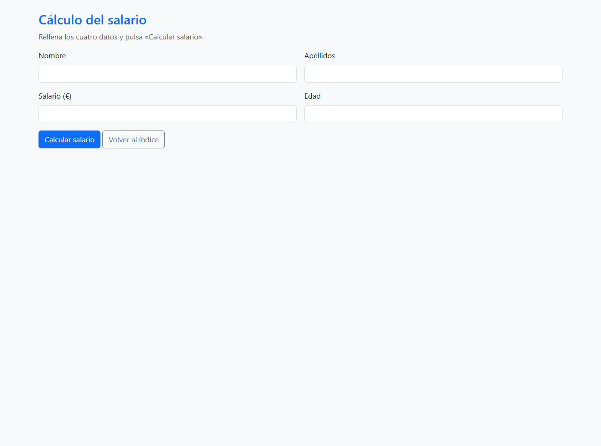

El formulario es un `index.php` con cuatro campos: nombre, apellidos, salario y
edad. Los datos se envían por POST a `salario.php`, que es el que hace el
cálculo.

A los campos no les he puesto el atributo `required` a propósito. El enunciado
pide que sea PHP el que compruebe los datos, así que `salario.php` mira primero
que los cuatro campos tengan algo y que el salario y la edad sean números. Si
falta algo, vuelve a `index.php` con `header('Location: index.php?error=1')` y
allí se muestra el aviso **FALTAN DATOS**:

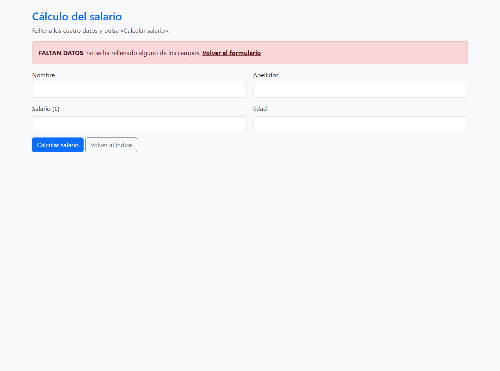

La función `calcular_salario($salario, $edad)` aplica la tabla del enunciado:

- si el salario es mayor que 2000 €, se queda igual;
- si está entre 1000 € y 2000 € (los dos incluidos), sube un 3 % cuando la edad
  es mayor de 45 años y un 10 % cuando es 45 o menos;
- si es menor de 1000 €, los menores de 30 años pasan a cobrar 1100 €, los que
  tienen entre 30 y 45 años suben un 3 % y los mayores de 45 un 15 %.

El campo del salario admite decimales (`step="0.01"`); la edad es un número
entero, porque las condiciones del enunciado son `>45` o `<=45` y no hace falta
más precisión.

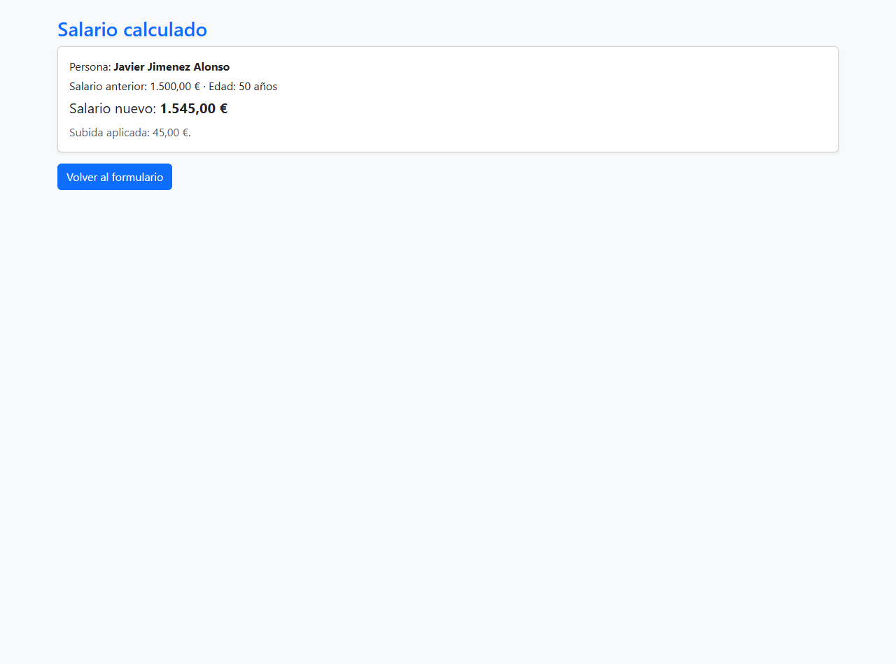

Con 1500 € y 50 años se aplica el 3 %: 1545 €. El resultado se muestra con
`number_format($cantidad, 2, ',', '.')`, que pone la coma decimal y el punto de
miles como se escribe en España.

<div class="pagebreak"></div>

# Ejercicio 2 (obligatorio): viviendas

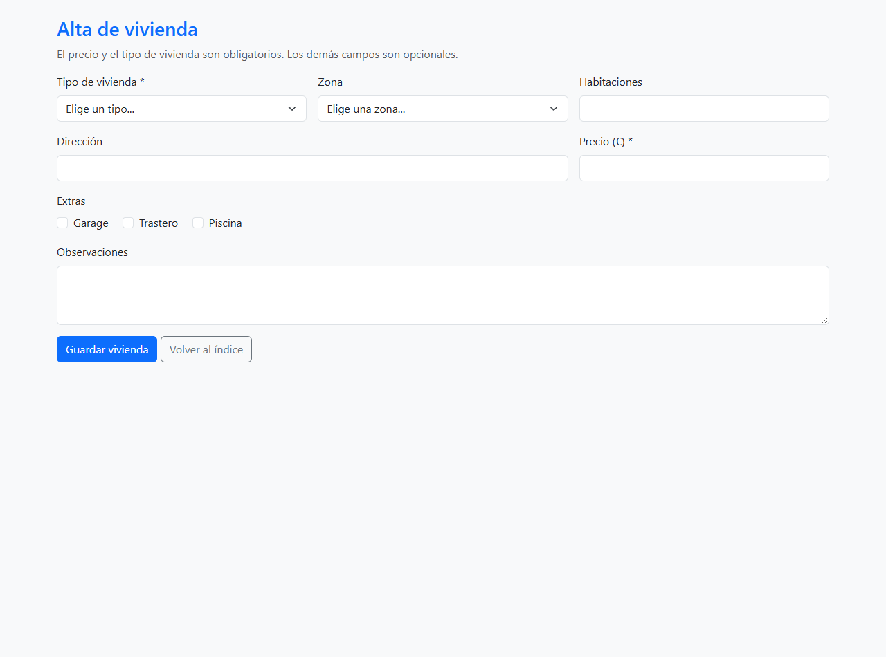

El formulario de `index.php` tiene los campos del enunciado: tipo de vivienda
(Adosado, Unifamiliar o Piso), zona (Centro, Norte, Sur, Este y Oeste), dirección,
habitaciones, precio, extras (Garage, Trastero y Piscina) y observaciones.

Los extras van con `name="extras[]"`. Los corchetes son los que hacen que PHP
reciba un array con todos los extras marcados en vez de quedarse solo con el
último. Si no se marca ninguno, `$_POST['extras']` no existe, así que se
comprueba con `isset()` antes de usarlo.

`insertarVivienda.php` valida los dos campos obligatorios: el tipo y el precio.
El precio, además de no estar vacío, tiene que ser un número mayor que 0. El
tipo se comprueba contra la lista de `tipos_validos()`, porque desde el navegador
se puede cambiar el HTML y enviar un valor que no esté en el `select`.

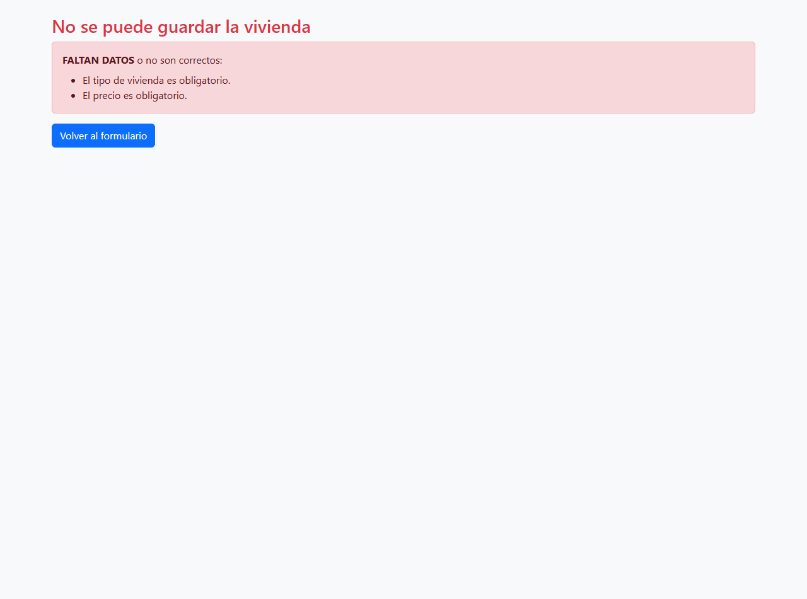

Los errores se van guardando en un array y se pintan todos juntos, no solo el
primero. Así el usuario sabe de una vez todo lo que le falta.

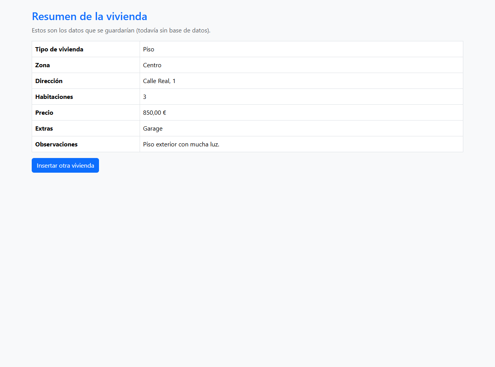

Si todo está bien se muestra una tabla con los datos que se guardarían. Todavía
no hay base de datos, y el enunciado lo dice expresamente: de momento solo se
resume lo introducido. Los campos opcionales que se dejan vacíos se muestran
como «No indicada», «Ninguno» o «Sin observaciones» en lugar de dejar la celda
en blanco.

<div class="pagebreak"></div>

# Ejercicio 3 (reto): alquiler de viviendas


La aplicación tiene tres páginas y una librería:

- `index.php`: formulario de alta con tipo de vivienda, zona, dirección, número
  de dormitorios, precio, extras, foto y observaciones.
- `fotos.php`: galería con las fotos disponibles para elegir una.
- `gestionarViviendas.php`: listado y todas las acciones de gestión.
- `funciones.php`: las funciones comunes y el arranque de la sesión.

## Dónde se guardan las viviendas

El enunciado no permite usar una base de datos, pero el listado tiene que
seguir ahí cuando se cambia de página. Una variable normal se pierde al acabar
la petición, así que las viviendas se guardan en `$_SESSION`.

La sesión se abre una sola vez en `funciones.php` con
`if (!isset($_SESSION)) { session_start(); }`. Se hace ahí y no en cada página
porque tiene que ocurrir antes de escribir HTML: si se llamara después de un
`echo`, PHP avisaría de que las cabeceras ya se han enviado.

Cada vivienda es un array asociativo con sus campos y un `id` que asigna
`guardar_vivienda()`. Los ids permiten luego buscar, modificar y borrar una
vivienda concreta sin confundirla con otra.

## Galería de fotos

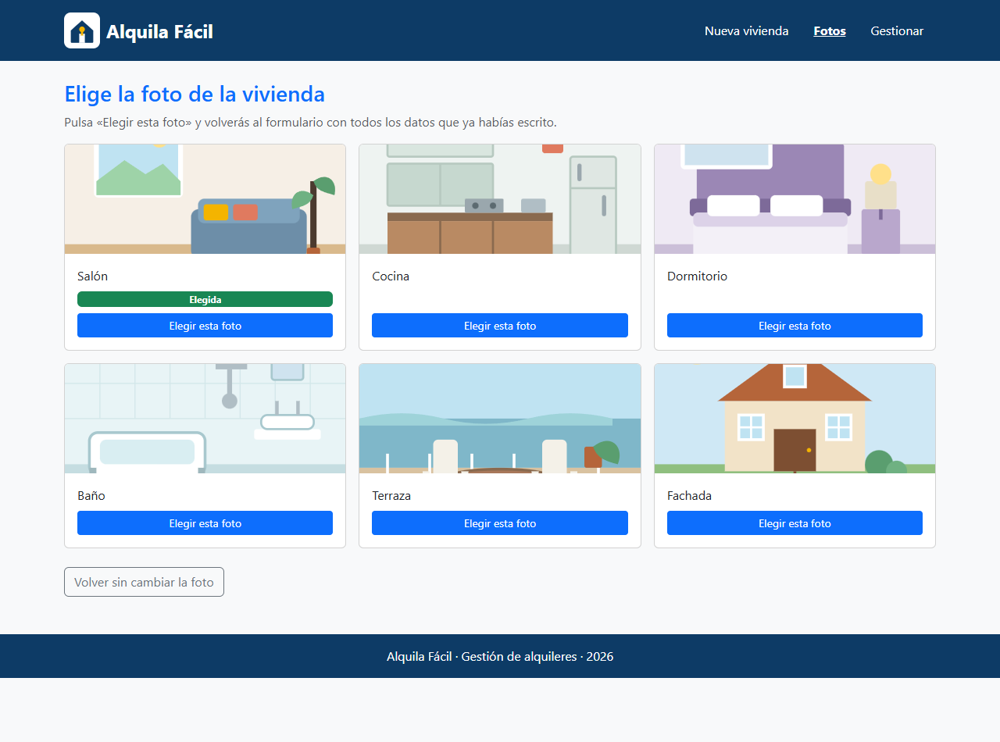

El botón «Elegir foto» no envía el formulario a guardar: lleva al usuario a
`fotos.php` con el atributo `formaction`. Antes de salir, los datos escritos se
guardan en la sesión como borrador. Al pulsar una foto se apunta cuál se ha
elegido y se vuelve a `index.php`, que recupera el borrador: el usuario no
pierde nada de lo que ya había rellenado.

Las fotos son seis dibujos SVG hechos para la práctica (salón, cocina,
dormitorio, baño, terraza y fachada). No hacen falta imágenes de fuera ni con
derechos de autor.

## Listado y gestión

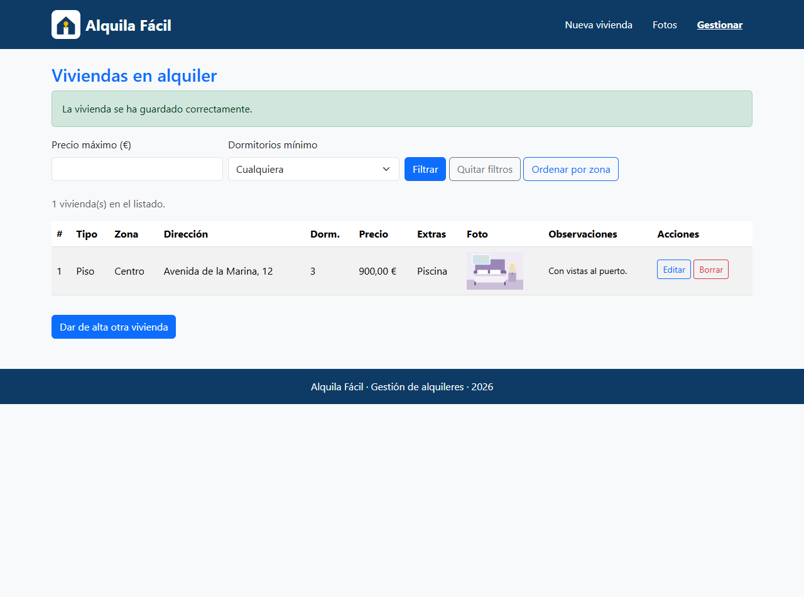

`gestionarViviendas.php` hace las cinco acciones que pide el enunciado:

1. **Ver el listado**: una tabla con todos los datos y una miniatura de la foto.
2. **Ordenar por zonas**: con el enlace «Ordenar por zona». La función
   `ordenar_por_zona()` usa el método de la burbuja sobre una copia del array, de
   modo que el orden guardado en la sesión no cambia.
3. **Filtrar**: por precio máximo y por número mínimo de dormitorios. Si un
   filtro se deja vacío, no se aplica. Los dos filtros se pueden combinar.
4. **Eliminar**: cada fila tiene un botón «Borrar» dentro de un formulario POST.
   No es un enlace GET porque un enlace se puede abrir sin querer y borraría la
   vivienda.
5. **Modificar zona y precio**: el botón «Editar» abre un formulario con la zona
   y el precio de esa vivienda. El resto de campos no se tocan.

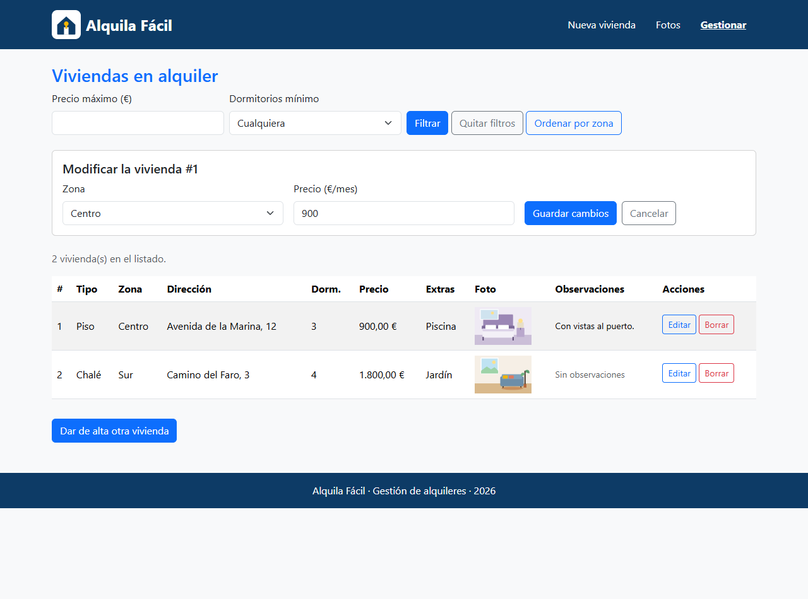

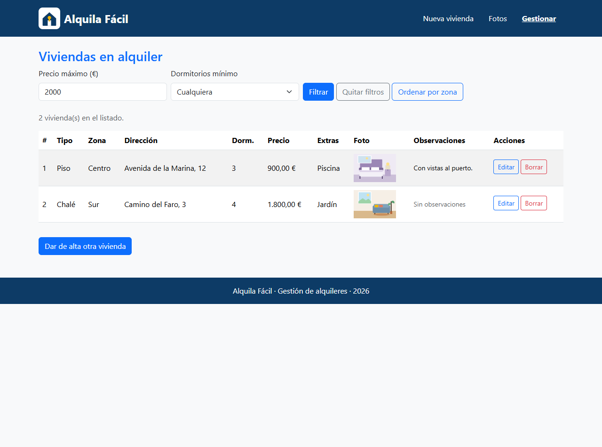

Todas las acciones que cambian datos se procesan antes de escribir el HTML y
terminan con `header('Location: ...')` y `exit`. Después de guardar, borrar o
modificar se redirige al listado con un mensaje por la URL. Si no se hiciera
así, al recargar la página se repetiría la acción: se guardaría dos veces la
misma vivienda o se intentaría borrar una que ya no existe.

## Cabeceras y pies según la hora

El enunciado pide dos cabeceras y dos pies, y cargar unos u otros según la hora
actual sea par o impar. La comprobación está en `hora_par()`:

```php
return date('H') % 2 == 0;
```

`date('H')` devuelve la hora en formato de 24 horas, de 0 a 23. El operador `%`
da el resto de dividir entre 2: si es 0, la hora es par. Con esa misma función
se eligen `cabecera1.php`/`footer1.php` o `cabecera2.php`/`footer2.php` en las
tres páginas.

Las dos cabeceras tienen la misma navegación, pero cambian de color y de
distribución: la 1 lleva el logotipo a la izquierda y el menú a la derecha; la 2
centra el bloque y añade una franja con la fecha.

<div class="pagebreak"></div>

# Validación del HTML generado

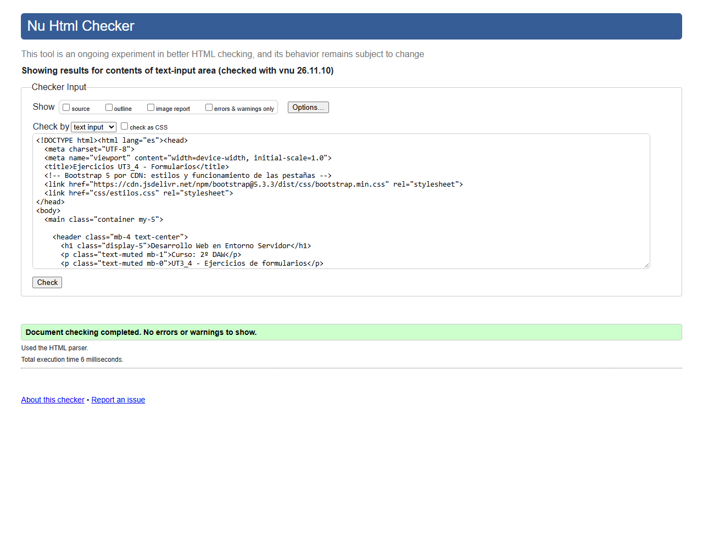

El HTML que recibe el navegador (el que genera PHP, no el código fuente) se ha
pegado en el validador Nu de W3C. El `index.php` principal sale sin errores ni
avisos.

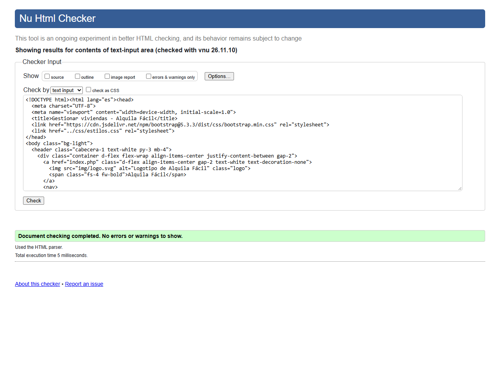

También se han validado las páginas de los tres ejercicios, incluida la de
gestión con dos viviendas en el listado. El resultado de cada validación está
guardado en los archivos `validacion-w3c-*.json`.

En el `index.php` principal, el validador avisaba de que las pestañas tenían
`role="tab"` sin un `role="tabpanel"` que les correspondiera. Se han añadido los
roles y el `aria-controls` que documenta Bootstrap, y desde entonces valida
limpio.

<div class="pagebreak"></div>

# ¿Cómo se ha realizado la actividad?

La entrega tiene un `index.php` en la raíz con tres pestañas de Bootstrap 5, una
por ejercicio. Como los tres ejercicios son aplicaciones completas (formulario
más página de respuesta), no se pueden pegar dentro de una pestaña: la pestaña
los muestra con un `iframe` y deja un botón para abrirlos en otra pestaña.

Cada ejercicio está en su propia carpeta para no mezclar archivos. Los nombres
son los que pide el enunciado: `index.php` y `salario.php` en el 1,
`index.php` e `insertarVivienda.php` en el 2, y `index.php`, `fotos.php` y
`gestionarViviendas.php` en el 3.

No se ha escrito JavaScript: el enunciado lo prohíbe en los ejercicios 1 y 2, y
en el 3 tampoco hace falta. El único JavaScript que se carga es el de Bootstrap,
y solo en el `index.php` principal, porque es el que cambia de pestaña.

La validación de los datos se hace siempre en PHP y antes de usar los valores:
`isset()` para saber si el campo ha llegado, `trim()` para que un espacio no
cuente como dato, `is_numeric()` para los números y `in_array()` para comprobar
que un valor está en la lista permitida. Al imprimir datos del usuario se usa
`htmlspecialchars()`, para que un `<` o una comilla no rompan el HTML.

Para comprobar el funcionamiento se ha levantado el servidor embebido de PHP con
`php -S` y `display_errors` activado, y se han recorrido los tres ejercicios
probando los casos correctos y los incorrectos: formulario vacío, datos válidos,
elegir foto, guardar dos viviendas, filtrar, ordenar, modificar y borrar. En
ningún momento ha aparecido un `Warning`, un `Notice` o un `Deprecated`.

<div class="pagebreak"></div>

# ¿Qué se ha aprendido?

- Formularios: la diferencia entre GET y POST, para qué sirve el atributo
  `name`, y que los datos llegan en `$_GET` o en `$_POST` según el método.
- Validación en el servidor: no basta con lo que se ve en el navegador; hay que
  comprobar en PHP que los campos obligatorios están y que los valores son los
  permitidos.
- Respuestas y redirecciones: `header('Location: ...')` tiene que ejecutarse
  antes de cualquier salida, y detrás va `exit` para que no se siga ejecutando
  la página.
- Persistencia sin base de datos: `$_SESSION` mantiene los datos entre páginas,
  y `session_start()` se llama antes de escribir HTML.
- Organización: separar las funciones comunes, las cabeceras y los pies en
  archivos que se cargan con `require` evita repetir código en cada página.
- Arrays: recorrerlos con `foreach`, unirlos con `implode()`, comprobar valores
  con `in_array()` y ordenarlos a mano con el método de la burbuja.
- Detalles de interfaz: conservar lo que el usuario ha escrito cuando hay un
  error, marcar el valor seleccionado en un `select` y no perder datos al
  cambiar de página.
- Validación HTML: el validador revisa el HTML generado, no el código PHP, y
  conviene validar también las páginas que no son el `index`.
