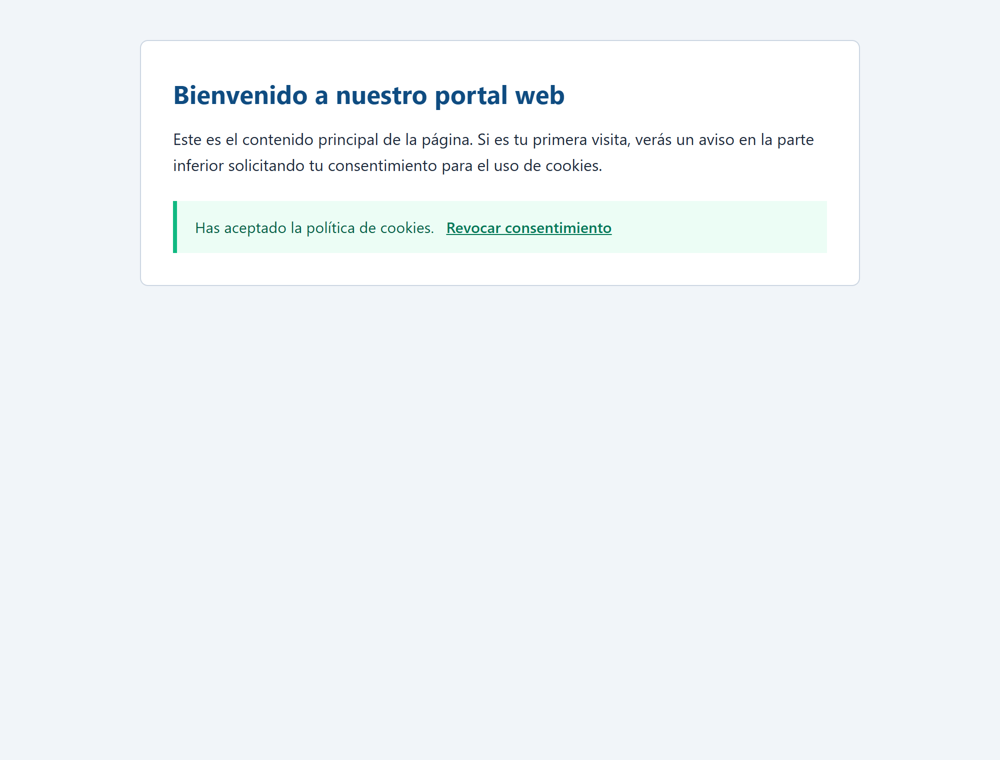
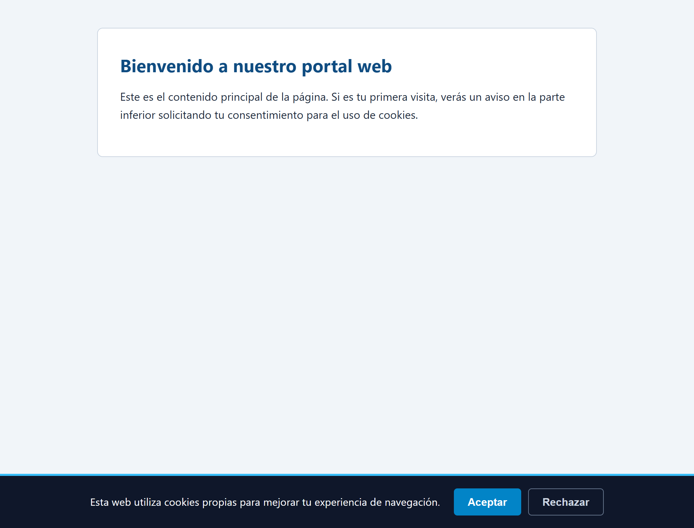
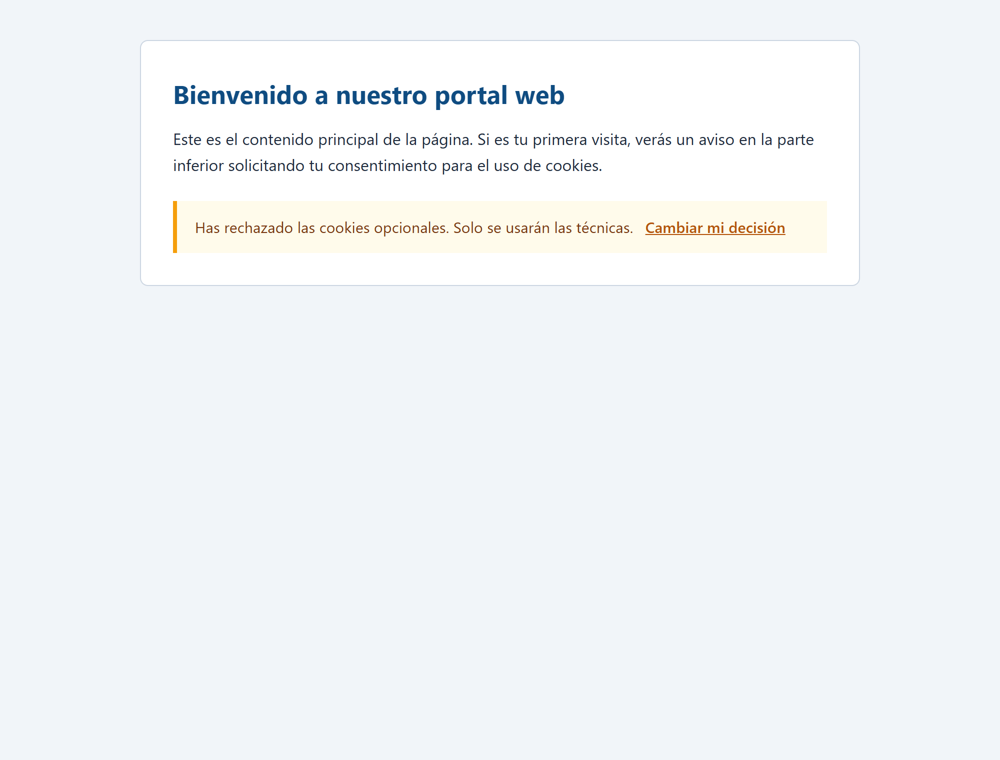

## Qué hace la página

`politica_cookies.php` muestra el contenido de un portal y, si el navegador no
tiene ninguna decisión guardada, un banner abajo con el aviso de cookies y dos
botones. Si el usuario acepta, el banner desaparece, aparece un mensaje de
confirmación y la decisión se guarda 30 días. Si rechaza, se guarda 1 día y el
mensaje lo dice. En los dos casos se puede deshacer con el enlace de revocar.

Todo se resuelve en un solo archivo: el formulario se envía por POST a sí mismo y
la revocación llega por GET con `?revocar=1`.

## Cómo está resuelto

He dejado el código en tres bloques, que se corresponden con los tres TODO de la
plantilla.

**1. Revocar (GET).** Si llega `?revocar=1`, se llama a `borrar_consentimiento()`,
que crea la cookie con una fecha pasada (`time() - 3600`). Al recibirla, el
navegador la borra. Después redirige a la página limpia, para que la URL no se
quede con el `?revocar=1` y al refrescar no se repita la operación.

```php
setcookie('cookies_aceptadas', '', time() - 3600, '/');
header('Location: politica_cookies.php');
exit;
```

**2. Guardar la decisión (POST).** Si la petición es POST, se mira qué botón se ha
pulsado. Aceptar guarda `'si'` y rechazar guarda `'no'`. La duración cambia según
el valor: 30 días para el sí, 1 día para el no. La ruta es `/`, así que la cookie
vale para todo el sitio y no solo para la carpeta del archivo.

```php
$duracion = ($valor === 'si') ? 30 * 24 * 60 * 60 : 24 * 60 * 60;
setcookie('cookies_aceptadas', $valor, time() + $duracion, '/');
```

**3. Decidir qué se pinta.** `leer_consentimiento()` devuelve `'si'`, `'no'` o una
cadena vacía. Con eso el HTML muestra el mensaje verde, el ámbar o el banner. No
hay ninguna variable de sesión: la cookie es el único estado.

```php
$consentimiento = leer_consentimiento();
$aceptadas = ($consentimiento === 'si');
$rechazadas = ($consentimiento === 'no');
```

El `header()` de redirección va antes de cualquier salida HTML. Si se imprimiera
antes una etiqueta, PHP daría el aviso de «headers already sent» y la redirección
no funcionaría.

## Los cuatro estados

**Primera visita.** No hay cookie, así que se ve el banner con el texto que pide el
enunciado y los dos botones.


**Tras aceptar.** La cookie se ha creado y el banner ya no se pinta. En su lugar
aparece el mensaje de confirmación con el enlace para revocar.



**Persistencia.** Al cerrar la pestaña y abrir la página en otra nueva, la cookie
sigue ahí y el aviso continúa oculto. Lo comprobé también con una petición
aparte, mirando las cabeceras que devuelve el servidor.


**Tras revocar.** La cookie se ha borrado (`Max-Age=0`), así que el banner vuelve
a salir como en la primera visita.



## Cabeceras que devuelve el servidor

Estas son las respuestas reales, copiadas de la prueba con peticiones HTTP:

```
Aceptar  → 302  cookies_aceptadas=si; expires=Wed, 23 Dec 2026 18:51:46 GMT; Max-Age=2592000; path=/
Revocar  → 302  cookies_aceptadas=deleted; expires=Thu, 01 Jan 1970 00:00:01 GMT; Max-Age=0; path=/
Rechazar → 302  cookies_aceptadas=no; expires=Tue, 24 Nov 2026 18:51:56 GMT; Max-Age=86400; path=/
```

`Max-Age=2592000` son 30 días en segundos, y `Max-Age=86400`, uno. En la
revocación, la fecha de 1970 es la forma de decirle al navegador que la borre.

Desde las herramientas del navegador (F12 → Aplicación → Cookies) se ven los
mismos datos: el nombre `cookies_aceptadas`, el valor y la fecha de caducidad.

## Ampliación: botón Rechazar

Añadí el segundo botón de la ampliación opcional. Guarda la cookie con valor `'no'`
y duración de un día, y el mensaje superior cambia a un tono ámbar para que se
distinga del aceptado. El enlace pone «Cambiar mi decisión» y hace lo mismo que
revocar: borra la cookie y devuelve el banner.



Para distinguir los dos mensajes no hacía falta duplicar el bloque: la clase
`.estado-consentimiento` lleva el verde y `.estado-rechazado` solo cambia los
colores.

## Comprobaciones

- Sin cookie se ve el banner y no hay mensaje.
- Al aceptar, la respuesta es 302 y la cookie sale con `Max-Age=2592000`.
- Con la cookie puesta el banner no se pinta y aparece el mensaje de aceptación.
- Al abrir una pestaña nueva se mantiene la decisión.
- Al revocar, la cookie se borra y vuelve el banner.
- Al rechazar, la cookie vale `no` y dura un día.
- La página no genera avisos de PHP ni errores en consola.
