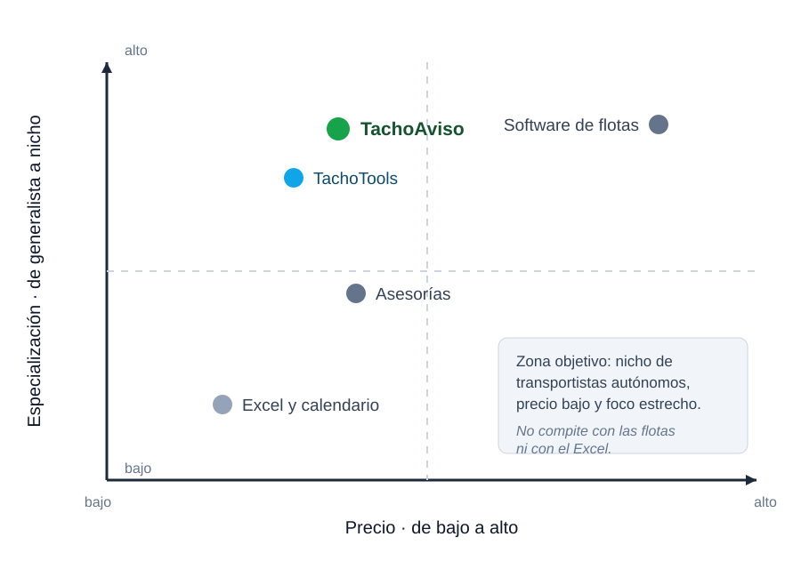

# Tarea 1: El marketing

- **Curso:** Itinerario Personal para la Empleabilidad II - DAW
- **Unidad:** 6 · El marketing
- **Estado:** respuesta completa, con el caso de TachoAviso
- **Enunciado:** seis preguntas de la libreta (marketing, marketing digital, estratégico y operativo, experiencial, océanos azules y mapa de posicionamiento)

---

## 1. ¿Qué es el marketing?

El marketing es el conjunto de actividades con las que una empresa **detecta una
necesidad**, **crea valor** para cubrirla y **comunica** ese valor para conseguir
y mantener clientes. No es sinónimo de publicidad ni de vender a toda costa: la
publicidad es solo una parte, la de comunicación. El marketing empieza antes,
cuando se decide a quién se va a servir y con qué producto, y termina después de
la venta, cuidando que el cliente repita.

Un marketing bien hecho se apoya en cuatro ideas:

1. **Orientación al cliente**, no al producto: primero se estudia qué necesita
   la gente y después se fabrica.
2. **Intercambio voluntario**: el cliente paga porque cree que recibe más valor
   del que entrega.
3. **Segmentación**: no se puede gustar a todo el mundo; se elige a quién se
   sirve.
4. **Relación a largo plazo**: es más barato conservar un cliente que captar uno
   nuevo.

**En TachoAviso:** el producto no es «una app de tacógrafos», es «no volver a
olvidar un plazo y no comerte una multa». La necesidad que se detecta es el miedo
a la sanción por la tarjeta del conductor, la descarga del tacógrafo, la ITV o el
seguro. Todo lo que hago (nombre, precio, avisos por correo, lenguaje sencillo)
está pensado para ese miedo concreto, no para «digitalizar el transporte» en
general.

---

## 2. El marketing digital: SEO, SEM y SMO

El marketing digital es la parte del marketing que usa canales y soportes
digitales: buscadores, redes sociales, correo electrónico, webs y aplicaciones.

- **SEO** (*Search Engine Optimization*): conseguir que la web aparezca en los
  primeros resultados **sin pagar** por el clic. Se trabaja con palabras clave,
  contenido útil, estructura de la página, velocidad, enlaces desde otros sitios
  y ficha de empresa local. Da resultados lentos, pero el tráfico que llega es
  gratis y suele convertir mejor porque el usuario ya estaba buscando eso.
- **SEM** (*Search Engine Marketing*): anuncios **pagados** en buscadores
  (Google Ads). Se puja por palabras clave y se paga por clic. Aparece en
  minutos, pero en cuanto se deja de pagar desaparece.
- **SMO** (*Social Media Optimization*): trabajo de presencia y optimización en
  redes sociales, tanto orgánico (publicar contenido que se comparta) como
  pagado (anuncios segmentados dentro de la red social).

La diferencia clave: **SEO y SMO orgánico son tráfico ganado con tiempo; SEM y
la publicidad en redes son tráfico comprado**.

**Marketing propio, sin pagar a un tercero:** son los llamados *medios propios*
(*owned media*). No se paga a una plataforma por aparecer; se paga con trabajo:

1. **Web y blog propios**: artículos que respondan a dudas reales.
2. **SEO**: posicionar esa web en Google sin anuncios.
3. **Correo electrónico**: newsletter y avisos a los clientes ya registrados.
4. **Redes sociales orgánicas**: publicar sin invertir en publicidad.
5. **Contenido en vídeo o guías descargables** hechos por mí.
6. **Ficha de Google Business** y directorios sectoriales gratuitos.
7. **Boca a boca y referidos**: pedir a un cliente satisfecho que lo cuente.

**En TachoAviso:** como el presupuesto es mínimo (objetivo de 120–200 €/mes), casi
todo el esfuerzo iría a medios propios. Por ejemplo, artículos del tipo «cada
cuánto se descarga el tacógrafo» o «qué pasa si caduca la tarjeta del conductor»
posicionados en SEO local para la Bahía de Algeciras; el correo de aviso a 30, 15
y 7 días ya es en sí una herramienta de fidelización; y los grupos de
transportistas de Facebook servirían de SMO orgánico. El SEM quedaría para una
campaña puntual, con presupuesto cerrado y midiendo el coste por cuenta creada.

---

## 3. Marketing estratégico y marketing operativo

**Marketing estratégico** es el de largo plazo: analiza el mercado, decide a qué
segmento se dirige la empresa, cómo quiere ser percibida y con qué ventaja
competitiva va a competir. Su herramienta clásica es el **STP**: segmentación,
elección del público objetivo (*targeting*) y posicionamiento. Responde a «¿dónde
jugamos y cómo ganamos?».

**Marketing operativo** (o *marketing mix*) es el de corto plazo: pone en marcha
la decisión anterior con acciones concretas de producto, precio, distribución y
comunicación. Responde a «¿qué hacemos el mes que viene?».

### El posicionamiento

Es el **lugar que la marca ocupa en la cabeza del cliente** comparada con las
alternativas. No es lo que la empresa dice de sí misma, sino lo que el cliente
recuerda cuando piensa en ese problema. Se construye con una idea sencilla,
repetida de forma coherente.

Las **dos estrategias principales** para posicionarse son:

1. **Posicionamiento por diferenciación**: ofrecer algo que los demás no tienen
   o que el cliente valora y no encuentra. Se lleva a cabo identificando un
   atributo relevante, siendo creíble y comunicándolo siempre igual. Ejemplo:
   «TachoAviso solo avisa de plazos y no te obliga a subir los ficheros del
   tacógrafo».
2. **Posicionamiento por precio (liderazgo en costes)**: ser la opción más
   barata del mercado, lo que exige una estructura de costes muy ajustada. Se
   lleva a cabo recortando lo que no aporta valor y comunicando el ahorro de
   forma clara. Ejemplo: «4–6 €/mes, sin permanencia».

Hay una tercera vía, el **posicionamiento por enfoque o especialización**:
renunciar a todo el mercado y ser el mejor en un nicho pequeño. TachoAviso
combina las tres: foco en autónomos y microflotas, diferenciación (preventivo,
minimiza datos) y precio bajo.

### Herramientas del marketing operativo: las 4P

| Herramienta | En qué consiste | En TachoAviso |
|---|---|---|
| **Producto** | Qué se ofrece, con sus características, calidad, garantía y servicios añadidos. | Plugin de WordPress con alta de vehículos y conductores por alias, cálculo del siguiente vencimiento, panel con semáforo y avisos configurables. |
| **Precio** | Cuánto se cobra y con qué condiciones: tarifas, descuentos, permanencia, forma de pago. | Suscripción de 4–6 €/mes sin permanencia, con dos límites según número de vehículos. |
| **Plaza (distribución)** | Cómo llega el producto al cliente: canal, puntos de venta, logística. | 100 % online: alta desde la web, sin instalación ni visita. |
| **Promoción (comunicación)** | Cómo se da a conocer: publicidad, promociones, relaciones públicas, venta personal. | SEO local, contenido útil, correo, presencia en grupos de transportistas y demostración personal en la primera visita. |

En servicios conviene añadir tres más (**7P**): **personas** (quién atiende),
**procesos** (cómo se presta el servicio) y **evidencia física** (lo que el
cliente ve y le da confianza, aquí el propio panel y los correos).

---

## 4. ¿Qué es el marketing experiencial?

Es la estrategia que, en lugar de describir las características del producto,
**hace vivir una experiencia** al cliente para que la recuerde y la asocie a la
marca. Se apoya en los cinco módulos de Schmitt:

- **Sentir** (*sense*): estimular los sentidos.
- **Sentir emocional** (*feel*): provocar emociones positivas.
- **Pensar** (*think*): hacer reflexionar o resolver un reto.
- **Actuar** (*act*): proponer una forma de comportarse o un estilo de vida.
- **Relacionarse** (*relate*): conectar al cliente con un grupo al que quiere
  pertenecer.

Funciona porque el recuerdo emocional pesa más que una lista de funciones, y
porque genera contenido que el cliente comparte sin que se le pague.

**En TachoAviso:** la experiencia puede empezar en el momento del alta. En vez de
un formulario frío, un alta guiada de tres pasos que acabe mostrando el panel con
el semáforo ya en verde y un mensaje del tipo «todo al día». El correo de aviso
no debería ser un robot: un asunto claro, en segunda persona y con el enlace
directo al vehículo concreto. Y para el sector, una demostración en persona
(feria, asociación de transportistas, bar de la estación) donde se vea el panel
funcionando con datos reales de ejemplo vale más que cualquier folleto.

---

## 5. La teoría de los océanos azules y el Circo del Sol

La **teoría de los océanos azules** (Kim y Mauborgne) dice que competir en un
mercado saturado —un «océano rojo»— acaba en guerra de precios y márgenes
mínimos. La alternativa es **crear un espacio de mercado nuevo** donde la
competencia deja de ser relevante, mediante la **innovación en valor**: subir
el valor para el cliente y bajar los costes a la vez.

Para conseguirlo se usa la **matriz ERRC** (eliminar, reducir, aumentar, crear):

| Acción | Qué se hace |
|---|---|
| **Eliminar** | Quitar elementos que el sector da por obligatorios pero que el cliente no valora. |
| **Reducir** | Bajar por debajo del estándar lo que está sobredimensionado. |
| **Aumentar** | Subir por encima del estándar lo que sí se valora. |
| **Crear** | Añadir algo que el sector nunca ha ofrecido. |

**El Circo del Sol** es el ejemplo clásico. El circo tradicional competía por
tener los mejores domadores y payasos, con costes altísimos de animales, viajes y
estrellas. El Circo del Sol hizo lo contrario:

- **Eliminó** los animales y las estrellas individuales, que eran el mayor coste.
- **Redujo** el tono de espectáculo infantil y el número de funciones por ciudad.
- **Aumentó** la calidad artística, la música en directo, el confort y el precio
  de la entrada.
- **Creó** un espectáculo con hilo argumental, como una obra de teatro, y una
  oferta paralela para empresas.

El resultado no fue «un circo mejor», sino un público distinto: adultos y
empresas que nunca iban al circo, dispuestos a pagar más. Dejó de competir con
los circos y empezó a competir con el ocio cultural.

**En TachoAviso**, la misma rejilla explicaría su hueco:

- **Elimina** la subida de ficheros del tacógrafo y la petición de datos
  personales de los conductores (solo alias, matrícula y fechas).
- **Reduce** la potencia: no analiza tacógrafos ni hace informes de flota; solo
  vigila plazos.
- **Aumenta** la cobertura (tarjeta, tacógrafo, ITV y seguro en un solo panel) y
  la antelación del aviso.
- **Crea** un panel con semáforo que se entiende en dos segundos desde el móvil.

---

## 6. ¿Qué es el mapa de posicionamiento?

Es una representación gráfica en dos ejes que sitúa las marcas o productos de un
mercado según **dos atributos que el cliente valora**. Sirve para ver de un
vistazo dónde está el hueco, dónde está la competencia y si mi posicionamiento
deseado es creíble.

**Cómo se construye:**

1. Se eligen dos atributos importantes para el cliente y que se puedan
   representar como opuestos (precio alto/bajo, especializado/generalista,
   sencillo/complejo).
2. Se colocan los competidores según cómo los percibe el cliente, no según lo que
   ellos dicen ser.
3. Se marca el punto donde quiero estar y se comprueba si está libre o ya
   ocupado.
4. Se repite cada cierto tiempo: el mapa cambia cuando entra un competidor nuevo.

**Mapa de TachoAviso** (precio frente a especialización):

**Lectura del mapa:**

- **Excel y calendario** (abajo a la izquierda): baratísimos y generalistas, pero
  no avisan solos. Es el competidor real de la mayoría de autónomos, no el
  software.
- **Asesorías** (centro): precio medio y servicio amplio; gestionan plazos de
  varios clientes, pero no son una herramienta y dependen de una persona.
- **TachoTools** (arriba a la izquierda): mismo nicho y precio bajo, pero analiza
  ficheros ya pasados. Es complementario, no sustituto.
- **Software de flotas** (arriba a la derecha): muy completo y muy caro; está
  pensado para empresas grandes, no para dos camiones.
- **TachoAviso** (arriba a la izquierda, junto a TachoTools): nicho muy concreto y
  precio bajo. Su hueco es la zona de «especializado y barato»: lo que un
  autónomo puede pagar y entender sin formación.

La conclusión es que TachoAviso no debe pelear por ser el más completo ni el más
barato del mercado en general, sino el más claro para un nicho pequeño. Ese es su
posicionamiento y, a la vez, su ventaja frente a las alternativas.
