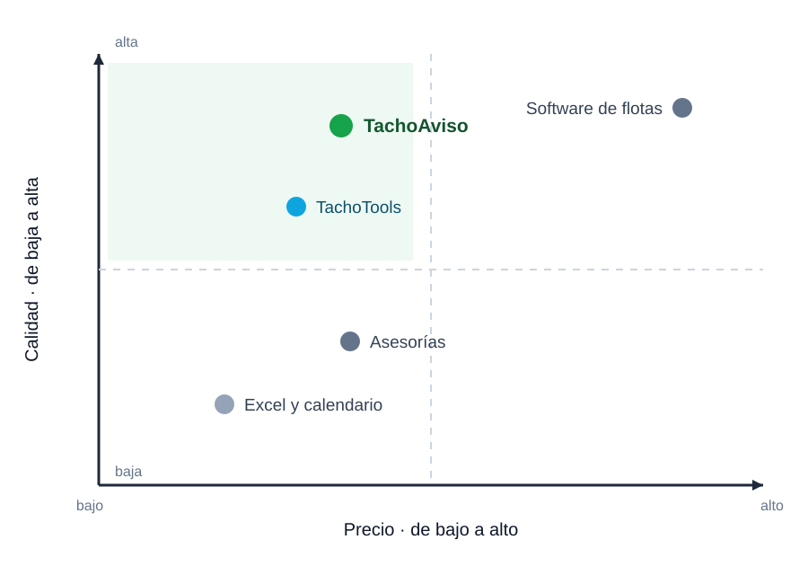
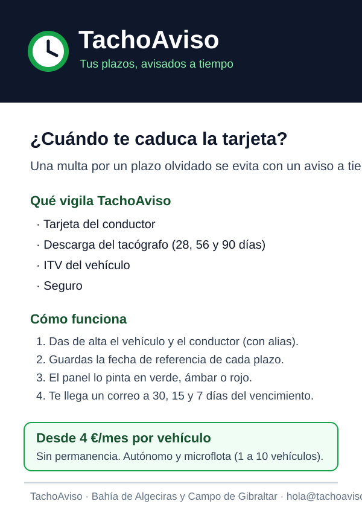
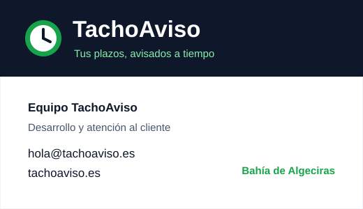

# Tarea 4: El marketing

- **Curso:** Itinerario Personal para la Empleabilidad II - DAW
- **Unidad:** Plan de empresa
- **Estado:** respuesta completa, con el caso de TachoAviso
- **Enunciado:** posicionamiento, producto, precios, promoción, distribución y atención al cliente, y redacción del epígrafe «El marketing» del plan de empresa

---

## Actividad 1: posicionamiento calidad-precio

### 1. ¿Qué calidad va a tener el producto?

**Calidad alta**, pero entendida como calidad de servicio, no como lujo. La app
tiene que funcionar siempre, calcular bien las fechas y no fallar en el aviso de
los 30, 15 y 7 días, porque si se salta un aviso el cliente pierde la confianza
y con ella la suscripción. No hablo de una app con animaciones ni con un diseño
espectacular: hablo de que el dato esté bien, el semáforo diga la verdad y el
correo llegue.

### 2. ¿A qué precio se va a vender?

**Precio medio-bajo**: entre 4 y 6 € al mes por vehículo, sin permanencia. Es un
precio de herramienta, del mismo orden que una suscripción de música, porque el
cliente lo compara con el coste de una multa (que puede ser de cientos de euros)
y no con un software de gestión de flotas.

### 3. ¿Qué valor queremos que perciban los clientes?

Quiero que perciban **tranquilidad y control**: abrir el panel y ver de un
vistazo que todo está en verde, sin tener que revisar una libreta. La calidad
real es la que yo pongo; la **calidad percibida** depende de cómo lo comunique.
Por eso importan el semáforo (se entiende sin leer nada), los correos en
lenguaje sencillo («te caduca la ITV en 15 días») y no prometer cosas que no
hago, como analizar ficheros del tacógrafo. Si prometo de más, la calidad
percibida baja aunque el producto sea bueno.

### 4. ¿Qué otros productos existen como el mío?

- **TachoTools**: mismo nicho, cobra 3–5 €/mes y analiza ficheros ya
  descargados. Es competencia directa, aunque en realidad es complementaria
  porque él mira el pasado y yo aviso del futuro.
- **Software de flotas**: muy completo, con GPS y mantenimiento, pero caro y
  complicado para dos camiones.
- **Excel y calendario del móvil**: gratis, pero no avisan solos. Es el
  sustitutivo real de la mayoría de autónomos.
- **Asesorías**: llevan los papeles de varios clientes, pero el plazo del
  tacógrafo se les puede escapar entre tantas gestiones.

### 5. Mapa de posicionamiento

TachoAviso se coloca en la zona de **calidad alta y precio contenido**, por
debajo en precio del software de flotas y por encima en especialización de Excel
y de las asesorías. TachoTools queda cerca en precio, pero por debajo en la
percepción de calidad porque su enfoque es otro.

---

## Actividad 2: los elementos del producto

### 1. Producto básico, formal y ampliado

**a) Producto básico: la necesidad.**
La necesidad es *no perder un plazo legal por olvido*. El transportista
autónomo lleva a la vez la tarjeta del conductor, la descarga del tacógrafo, la
ITV y el seguro, normalmente en una libreta o en un Excel con alarmas que un día
deja de sonar. Lo que compra no es una web: es no tener que acordarse.

**b) Producto formal: las características.**

1. **Cantidad y calidad.** Es un servicio, no hay unidades. La calidad es alta:
   cálculo del siguiente vencimiento y avisos fiables.
2. **Diseño y envase.** El «envase» es la propia interfaz: panel con semáforo
   (verde, ámbar, rojo) y formularios cortos. Nada de menús escondidos.
3. **Marca.** TachoAviso (la desarrollo en el punto 4).
4. **Características técnicas.** Aplicación web como plugin de WordPress en PHP
   y JavaScript, accesible desde móvil y ordenador. Los datos que guarda son
   alias del conductor, matrícula y fechas: ni ficheros del tacógrafo ni datos
   personales. No caduca; la suscripción se renueva cada mes.
5. **Servicios incluidos.** Configuración inicial de la cuenta, plantillas de
   aviso ya escritas y soporte por correo.

**c) Producto ampliado: ventajas adicionales.**

- **Configuración acompañada:** el cliente me dice sus fechas por teléfono y yo
  las dejo dadas de alta. Para alguien que no es de tecnología, esto es lo que
  marca la diferencia el primer día.
- **Avisos configurables:** 30, 15 y 7 días por defecto, pero se pueden cambiar.
- **Sin instalación:** no hay que descargar nada ni dar datos de tarjeta para
  probar.
- **Exportación sencilla:** poder pasar el listado a PDF o imprimirlo para
  llevarlo en la cabina.

### 2. Bienes sustitutivos y complementarios

**Sustitutivos:** cubren la misma necesidad, así que si el cliente usa uno no usa
el mío.

- **Excel o libreta con alarmas**: el más usado y el más difícil de batir,
  porque es gratis y ya lo tiene.
- **TachoTools**: mismo nicho, con otra función.
- **Software de flotas**: cubre el plazo y mucho más, pero a otro precio.

**Complementarios:** se usan junto con TachoAviso y lo hacen más útil.

- **La asesoría laboral**: si ya le lleva los papeles, mi app le sirve de
  recordatorio para no depender de una llamada.
- **El taller**: le avisa de la ITV y de la revisión; yo le aviso del plazo
  administrativo.
- **El propio tacógrafo y su software de descarga**: yo no lo sustituyo, le
  pongo fecha a la descarga.

### 3. Fase del ciclo de vida

Está en **introducción**. El producto es nuevo, casi nadie lo conoce y las
ventas son cero o muy pocas.

**a) Producto incógnita.** Es incógnita porque el mercado del nicho crece, pero
mi cuota todavía no existe: no sé si el transportista pagará por esto hasta que
lo pruebe. La estrategia es **penetración**: mes de prueba gratis, precio bajo y
configuración acompañada. El riesgo que asumo es gastar tiempo en dar de alta
cuentas que luego no se conviertan en suscripción.

**b) Producto estrella (crecimiento).** Cuando las ventas empiecen a subir, la
estrategia sería ampliar el número de plazos vigilados y entrar en asesorías,
que gestionan varios clientes a la vez. Ahí el producto pasa a estrella y hay
que defender la cuota antes de que aparezca un imitador.

**c) Producto vaca (madurez).** Si el mercado se satura, la estrategia es
mantener: fidelizar con avisos útiles, no subir el precio y cuidar el soporte.
El producto ya se paga solo y financia lo siguiente.

**d) Producto perro (declive).** Solo tendría sentido seguir vendiéndolo si
sigue habiendo clientes que lo usan. La salida sería **alargar la vida**:
convertirlo en un recordatorio de más plazos del negocio (autorizaciones,
revisiones de la flota) para que vuelva a ser útil.

### 4. Estrategias sobre el producto

**a) Diferenciación.** Me diferencio en tres cosas: soy **preventivo** (aviso de
lo que viene, no analizo lo pasado), **pido los mínimos datos** (alias,
matrícula y fechas, sin ficheros del tacógrafo ni datos personales de los
conductores) y **cubro varios plazos a la vez** (tarjeta, descarga, ITV y
seguro). TachoTools y el Excel no cubren las tres cosas juntas.

**b) Marca.**

- **Nombre:** TachoAviso. Se entiende sin explicación: tacógrafo + aviso.
- **Logotipo:** un reloj dentro de un círculo verde, con una carretera debajo.
  El reloj representa el aviso antes del plazo y el verde el semáforo del panel.

- **Eslogan:** «Tus plazos, avisados a tiempo». Dice exactamente lo que hace y
  no promete nada que no sea cierto.

**c) Servicios adicionales.** La configuración inicial acompañada. Es un
servicio barato de prestar (una llamada de diez minutos) y evita el abandono en
la primera semana, que es donde se pierden casi todos los clientes de una
suscripción.

**d) Alargamiento de la vida del producto.** Añadir plazos que el transportista
también lleva a mano: autorizaciones de transporte, revisiones del vehículo o
caducidad de la tarjeta de transporte. La app no cambia, solo se amplía la lista
de vencimientos.

---

## Actividad 3: estrategia de precios

### 1. ¿Qué criterio de fijación de precios será preferente?

El **valor percibido por el cliente**, con el coste como suelo. El cliente
compara el precio con el coste de una multa o con lo que le cobra la asesoría,
así que 4,90 € al mes le parece barato si le evita el susto. Pero por debajo del
coste no puedo bajar: hosting, correo y soporte tienen un mínimo. La competencia
sirve de referencia, no de regla: no quiero ser el más barato, quiero ser el que
resuelve.

### 2. Estrategia gancho y de penetración

- **Precio gancho:** el **mes de prueba gratuito** es el gancho. También lo es
  la configuración inicial sin coste: entra, ve su panel con sus fechas y ya no
  lo deja.
- **Penetración:** al ser una empresa nueva, el precio de salida es bajo,
  4,90 € al mes para autónomos de 1 a 3 vehículos y 5,90 € para microflotas de
  hasta 10. La idea es ganar cuota y aprender del uso real antes de plantear
  subidas.

### 3. Precios descremados

No es mi caso. El descremado consiste en lanzar caro para los primeros clientes
y bajar poco a poco, y funciona con tecnología muy deseada y sin competencia.
Aquí hay alternativas gratis (Excel) y competencia barata (TachoTools), así que
empezar caro sería quedarme sin nadie.

### 4. Precios psicológicos

Se usan cifras impares: **4,90 €** y **5,90 €** en lugar de 5 € y 6 €. La
diferencia real es de céntimos, pero el cliente lee «cuatro y algo» y no «cinco».

### 5. Discriminación de precios

Sí, con dos colectivos claramente distintos:

- **Autónomo con 1–3 vehículos:** 4,90 € al mes.
- **Microflota de 4–10 vehículos:** 5,90 € al mes por vehículo, con panel
  conjunto y varios conductores.
- **Asesorías:** precio por cliente gestionado, más bajo, porque traen varios de
  golpe y el coste de atención se reparte.

Nunca sería discriminación por datos personales ni por ubicación; es por volumen
y tipo de uso, que es lo que cambia el coste del servicio.

### 6. Precio de prestigio

No lo uso. El precio de prestigio sirve para productos donde un precio alto
comunica calidad (un reloj, un coche). Aquí un precio alto comunicaría
«demasiado caro para dos camiones» y me dejaría fuera del nicho. La calidad la
comunico con el semáforo y con el ahorro frente a la multa, no con el precio.

### 7. Descuentos

- **Pago anual:** dos meses gratis (10 meses por 12).
- **Por volumen:** a partir del cuarto vehículo, el precio por vehículo baja.
- **Pronto pago:** no aplica, porque el cobro es por suscripción mensual.
- **Fechas de rebajas:** no aplican; el servicio no es estacional y rebajar en
  enero no traería más clientes.

### 8. Precio paquete y en dos partes

Sí, en dos partes: **una cuota fija por cuenta** (mantenimiento y soporte) y
**un precio por vehículo**. Así el que empieza con un camión paga poco y el que
crece paga en proporción. También se puede vender en **pack de flota** para
asesorías que gestionan varios clientes.

---

## Actividad 4: promoción

### 1. La publicidad

**a) Medios adecuados.** No usaría medios masivos (televisión, radio, prensa):
son caros y llegan a todo el mundo, cuando mi cliente es un nicho muy concreto
de la Bahía de Algeciras. Los que sí tienen sentido:

- **Internet y SEO local:** artículos del tipo «cada cuánto se descarga el
  tacógrafo» o «qué pasa si caduca la tarjeta del conductor», buscando que
  aparezcan cuando el transportista tiene la duda.
- **Redes sociales del sector:** grupos de transportistas en Facebook y
  LinkedIn, publicando sin pagar anuncios.
- **Mailing:** a las cuentas que han hecho la prueba gratuita.
- **Boca a boca:** el canal más creíble en un gremio pequeño, donde todos se
  conocen.

**b) Folleto de una página.**

**c) Tarjeta de visita.**

### 2. El merchandising

No tengo tienda ni local, así que el merchandising clásico (escaparate,
estanterías) no aplica. Lo que sí puedo cuidar es el «escaparate digital»: la
página de inicio, que debe dejar claro en diez segundos qué hace y cuánto
cuesta, y el correo de aviso, que es lo que el cliente ve cada mes. También
tiene sentido un detalle físico barato para ferias o visitas: una pegatina para
la cabina con el teléfono de soporte.

### 3. Promoción de ventas

Sí, de corta duración y con coste controlado:

- **Mes gratis** para nuevos clientes.
- **Configuración inicial sin coste** durante el primer año.
- **Dos meses gratis** si se pasa al pago anual.
- **Sorteo o regalo puntual** en ferias del transporte (por ejemplo, una
  revisión de fechas gratis para quien se apunte).

Nada de 2x1 ni muestras físicas, porque el producto es digital y el coste
marginal de una cuenta más es casi cero, pero regalar meses sin límite
devaluaría el servicio.

### 4. Fidelización

- **Avisos útiles, no publicidad:** el correo que recibe cada mes es el propio
  aviso, y eso ya lo mantiene dentro.
- **Panel siempre accesible** y sin tener que volver a configurarlo.
- **Precio estable:** no subir la cuota al cliente antiguo.
- **Trato directo:** si escribe un correo, contesta una persona, no un
  formulario.
- **Descuento por antigüedad** a partir del segundo año, como agradecimiento.

### 5. Relaciones públicas

Patrocinar algo pequeño y del sector genera más confianza que un anuncio.
Pienso en colaborar con una asociación de transportistas de la comarca o
aparecer en una jornada técnica explicando los plazos del tacógrafo. También
publicar una guía gratuita de plazos legales: me posiciona como alguien que sabe
del tema y no como alguien que solo vende.

### 6. Venta directa

En una empresa de una persona, el que vende soy yo. Las actividades son:

- **Informar:** explicar en cinco minutos qué plazos vigila y cómo se ve el
  panel.
- **Persuadir:** enseñar el cálculo del ahorro frente a una multa, sin
  exagerar.
- **Recoger información:** apuntar por qué no contrata quien no contrata (precio,
  desconfianza, ya lo lleva la asesoría) para corregir el producto.

La venta sería por teléfono, correo y visita a talleres o asociaciones, no por
tienda.

---

## Actividad 5: distribución y atención al cliente

### El canal de distribución

**a) Canal directo.** Sí: soy el que desarrolla y el que vende, sin
intermediarios. El cliente contrata en la propia web y recibe el servicio por
internet. Es el canal lógico para un producto digital de una persona.

**b) Canal indirecto.** No de momento. No hay mayoristas ni minoristas, porque
el producto no se almacena ni se transporta. Si algún día crece, el intermediario
natural sería la asesoría que lo revende a sus clientes.

**c) Nuevas formas de distribución.** La franquicia no tiene sentido con este
tamaño. Sí tendría sentido la **venta por correo electrónico** (campañas a
listas del sector) y la **venta telefónica** a asociaciones. También acuerdos de
recomendación con talleres y asesorías, pagando una comisión por cuenta que
traigan.

### El plan de atención al cliente

**a) Organización.** Atiendo yo, por correo a `hola@tachoaviso.es` y por
teléfono en horario de oficina (de 9:00 a 18:00, de lunes a viernes). Las
consultas quedan registradas en una hoja de cálculo con fecha, cliente y
asunto, para no perder el hilo. La web tiene una sección de contacto y un
formulario de sugerencias.

**b) Reclamaciones y sugerencias.** La reclamación la recoge el formulario o el
correo, la leo yo y respondo en menos de 48 horas laborables explicando qué ha
pasado y qué voy a hacer. Las sugerencias se apuntan en la misma hoja y se
revisan una vez al mes; las que se repiten pasan a la lista de mejoras.

**c) Servicio postventa y garantía.** Al ser un servicio digital, la
«devolución» es la baja: si no funciona, se cancela sin permanencia. Si hay un
error en un cálculo, lo corrijo y, si ha provocado un aviso perdido, compenso
con meses gratis. El soporte postventa incluye dudas de uso y ayuda para
cambiar fechas.

**d) Encuestas de satisfacción.** Una encuesta corta al mes de alta y otra al
año, con cuatro preguntas: facilidad de uso, utilidad de los avisos, si lo
recomendaría y qué echas en falta. La envío yo por correo a todos los clientes
activos y dejo una voluntaria en la web.

**e) Orientación hacia el cliente.** La filosofía se transmite con el ejemplo y
con normas escritas: responder siempre, no prometer lo que no hay, y tratar cada
correo como si fuera el único cliente. Si algún día entra alguien más en el
equipo, lo primero que le enseño es esa norma, porque en un nicho tan pequeño un
cliente enfadado se lo cuenta a veinte.

---

## Epígrafe del plan de empresa: El marketing

### Estrategia de posicionamiento calidad-precio

TachoAviso se posiciona como una herramienta **de calidad alta y precio
contenido** para el transportista autónomo y la microflota de la Bahía de
Algeciras. La calidad se apoya en tres cosas verificables: los avisos llegan a
tiempo, los cálculos son correctos y los datos que se piden son los mínimos. El
precio se mantiene entre 4,90 y 5,90 € al mes por vehículo para que la decisión
de compra sea fácil. Frente a Excel y al calendario, la diferencia es que avisa
solo; frente a TachoTools, que mira el pasado; frente al software de flotas, el
precio y la sencillez.

### El producto

El producto básico es no perder un plazo legal. El formal es una aplicación web
que guarda la fecha de referencia de cada plazo, calcula el siguiente
vencimiento y lo muestra en un panel con semáforo. El ampliado incluye la
configuración inicial acompañada, los avisos configurables a 30, 15 y 7 días, el
soporte por correo y la exportación del listado. Es un servicio en fase de
introducción, con los sustitutivos claros (Excel, TachoTools, software de flotas)
y los complementarios naturales (asesoría, taller, software del tacógrafo). La
marca es única, TachoAviso, con el reloj verde como logotipo y el eslogan «Tus
plazos, avisados a tiempo».

### Estrategia de precios

El criterio preferente es el valor percibido, con el coste como suelo. Precio de
penetración de 4,90 € al mes para autónomos y 5,90 € para microflotas, con mes
gratuito y configuración incluida. Cifras impares (4,90 y 5,90), descuento del
pago anual (dos meses gratis) y precio por tramos: cuota de cuenta más precio
por vehículo. No se usa precio de prestigio ni descremado, porque el nicho
compara con una alternativa gratuita.

### Distribución

Canal directo: la web propia, sin intermediarios, con contratación y pago en
línea. Como vías de crecimiento, acuerdos de recomendación con talleres y
asesorías, venta telefónica a asociaciones y campañas de correo al sector. No
hay franquicia ni distribución física porque el producto es un servicio digital.

### Atención al cliente

Una sola persona atiende por correo y teléfono en horario de oficina, con
registro de cada consulta. Las reclamaciones se responden en menos de 48 horas
laborables; las sugerencias se revisan una vez al mes. La baja es inmediata y sin
permanencia, y si un fallo provoca un aviso perdido se compensa con meses
gratis. Hay encuestas al mes y al año, y una norma escrita que resume la
filosofía: responder siempre y no prometer lo que no se puede cumplir.
