# Práctica UD2 — Configuración del panel de administración y gestión de usuarios en WordPress

**Alumno:** Javier Jiménez Alonso  
**Curso:** 2.º DAW · Optativa — Gestores de contenido  
**Fecha:** 13/11/2026  
**Sitio:** `http://www.jjidaw.com.mialias.net` (plataforma de pruebas CDMON, WordPress 7.1 + tema Astra 4.14 + Elementor)  
**Temática elegida:** blog personal técnico de desarrollo web («Javier Jiménez — DAW»), con páginas de portfolio y contacto.

> **Estado de esta memoria.** Todas las tareas se han ejecutado sobre la instalación real de CDMON y cada apartado se acompaña de la captura correspondiente, tomada del panel y recortada a la información relevante. Las capturas están en la carpeta `capturas/` y se listan en el apartado 7.

---

## 1. Configuración general del sitio (Ajustes → Generales)

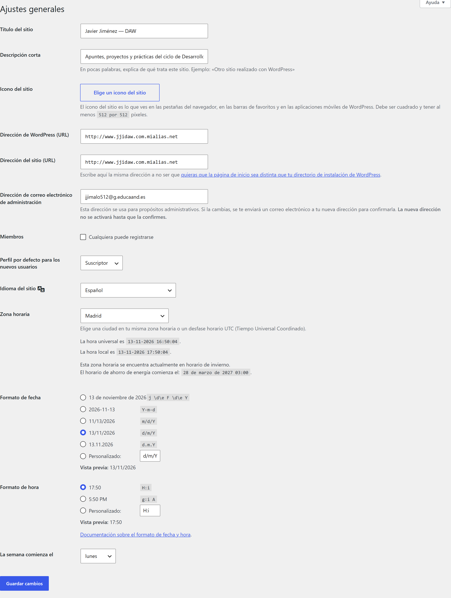

| Ajuste | Valor aplicado | Motivo |
|---|---|---|
| **Título del sitio** | `Javier Jiménez — DAW` | Identifica al autor y el ámbito (Desarrollo de Aplicaciones Web). |
| **Descripción corta** | `Apuntes, proyectos y prácticas del ciclo de Desarrollo de Aplicaciones Web: HTML, CSS, JavaScript, PHP y WordPress.` (112 caracteres) | Menos de 150 caracteres, actúa como *meta description* en los resultados de búsqueda. |
| **Dirección de WordPress (URL)** | `http://www.jjidaw.com.mialias.net` | Donde están instalados los ficheros y el panel. |
| **Dirección del sitio (URL)** | `http://www.jjidaw.com.mialias.net` | La dirección pública que ve el visitante. |
| **Zona horaria** | `Madrid` | Coherencia con el alumnado y el calendario español. |
| **Formato de fecha** | `d/m/Y` (31/12/2026) | Formato habitual en España. |
| **Formato de hora** | `H:i` (18:30) | Formato de 24 horas. |
| **Idioma del sitio** | `Español` | Todo el contenido y el panel están en español. |
| **Cualquiera puede registrarse** | **Desmarcado** | Ver justificación. |

**Justificación: deshabilitar el registro libre.** Un blog personal no necesita que nadie se cree una cuenta: los lectores pueden comentar como invitados (si se permite) sin registrarse. Dejar el registro abierto convierte el sitio en una puerta de entrada para *spam* y para cuentas automatizadas, y en WordPress el rol por defecto de esos registros es **Suscriptor**, que aunque tiene pocos permisos sí puede acceder al panel y generar contenido basura. Aplico así el **principio de menor privilegio**: si nadie necesita registrarse, no se ofrece la posibilidad. Los usuarios del equipo los creo yo, uno a uno, desde Usuarios → Añadir nuevo.

**Diferencia entre «Dirección de WordPress (URL)» y «Dirección del sitio (URL)».**

- La **Dirección de WordPress** es la carpeta donde están instalados los ficheros del CMS: es la ruta del panel (`/wp-admin`) y de los recursos internos.
- La **Dirección del sitio** es la URL pública que se muestra en el navegador y la que se usa para generar los enlaces.

Normalmente coinciden. Pueden ser **distintas** cuando WordPress está instalado en una subcarpeta pero se quiere servir desde la raíz: por ejemplo, la instalación está en `https://midominio.com/wordpress/` (Dirección de WordPress) y el sitio se publica en `https://midominio.com/` (Dirección del sitio), con el `index.php` y el `.htaccess` copiados en la raíz. También ocurre al pasar de un entorno de pruebas a producción: se mantiene la instalación en un subdirectorio y se cambia solo la URL pública.

---

## 2. Configuración de escritura y lectura

### 2.1. Ajustes → Escritura

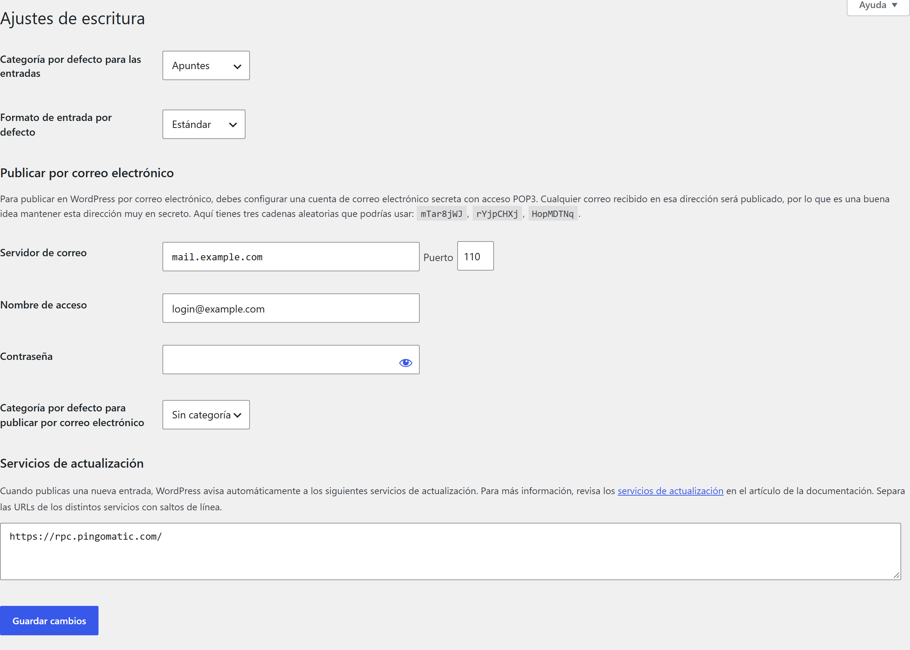

- **Categoría predeterminada de las entradas:** `Apuntes` (ID 3). Es coherente con la temática: todo lo que publique sin categoría cae en el bloque de apuntes técnicos.
- Resto de opciones, por defecto.

**¿Para qué sirve `rpc.pingomatic.com`?** Es el servicio de *ping* que WordPress usa para **avisar a los agregadores de blogs** de que se ha publicado una entrada nueva. En el momento de publicar, WordPress envía una notificación (XML-RPC ping) a ese servicio y Ping-O-Matic la redistribuye a buscadores y directorios de blogs, que así pueden indexar el contenido antes. Hoy tiene menos peso que el `sitemap` y Google Search Console, pero no molesta y ayuda a la difusión.

### 2.2. Ajustes → Lectura

**Páginas creadas previamente** (Páginas → Añadir nueva, contenido genérico):

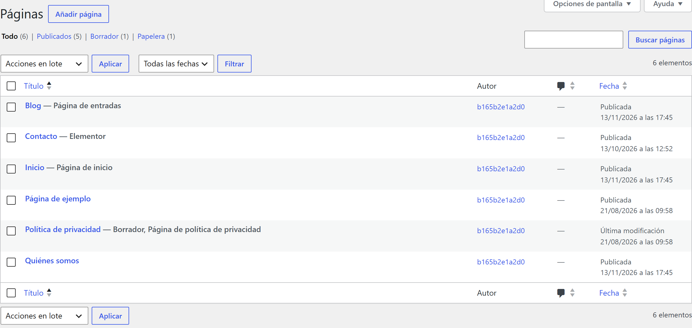

| Página | ID | Contenido | Función |
|---|---|---|---|
| **Inicio** | 35 | Texto breve de bienvenida («Bienvenido a mi blog de DAW…») | Portada estática. |
| **Blog** | 36 | Vacía | Contenedor de las entradas. |
| **Quiénes somos** | 37 | Presentación del autor y del ciclo | Página corporativa. |
| **Contacto** | 25 | Formulario de contacto (WPForms, ya instalado en la UD1) | Comunicación con el lector. |

**Configuración aplicada:**

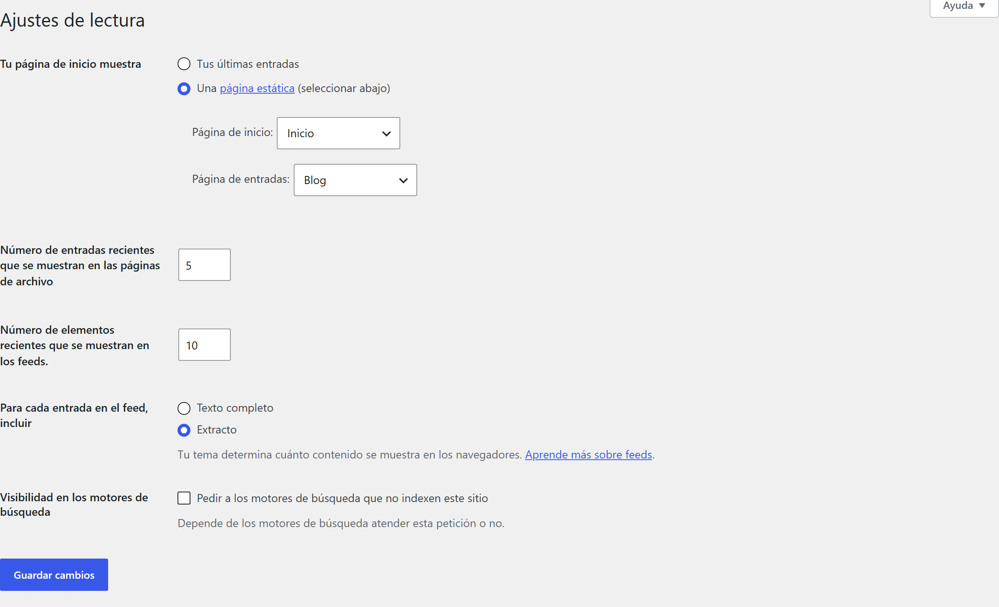

- **La página de inicio muestra:** *Una página estática* → Página de inicio: **Inicio**; Página de entradas: **Blog**.
- **Entradas del blog como máximo:** `5`.
- **Entradas en el feed RSS:** `10`.
- **Para cada entrada del feed, mostrar:** `Resumen`.
- **Disuadir a los motores de búsqueda de indexar este sitio:** **desmarcado**.

**Por qué debe estar desmarcada en producción.** Esa casilla añade la etiqueta `noindex` y la cabecera `X-Robots-Tag: noindex` a todo el sitio: los buscadores dejan de indexarlo y la web desaparece de Google. Se marca solo en entornos de pruebas para que un sitio a medio hacer no aparezca en los resultados; en producción, dejarla marcada es un error silencioso muy habitual: la web «existe», pero nadie la encuentra.

---

## 3. Personalización del escritorio

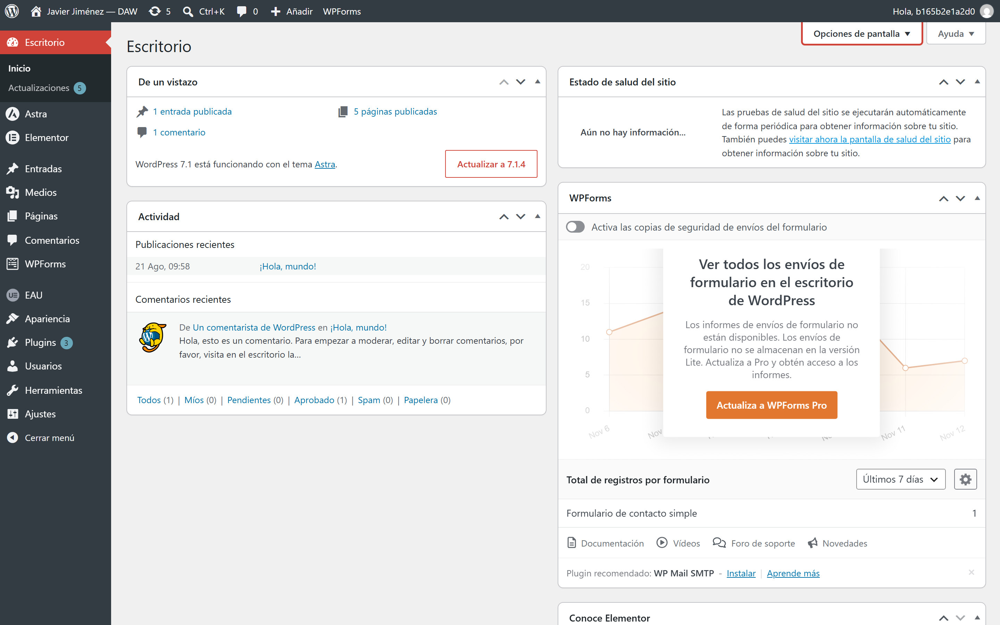

1. **Widgets ocultos:** en *Opciones de pantalla* (esquina superior derecha del Escritorio) desmarqué **«Eventos y noticias de WordPress»** y **«Borrador rápido»**. Motivo: no aportan nada al trabajo diario y ocupan la primera pantalla.
2. **Esquema de color:** en *Usuarios → Tu perfil → Esquema de color* elegí **Medianoche**, distinto del predeterminado. Sirve para distinguir de un vistazo en qué cuenta estás: útil cuando se trabaja con varios roles en la misma sesión.
3. **Widgets en 2 columnas:** el escritorio queda en dos bloques (izquierda: *De un vistazo* y *Actividad*; derecha: *Estado de salud del sitio*, *WPForms* y *Elementor*). En WordPress 7.1 el selector de columnas ya no aparece en *Opciones de pantalla*, así que el número de columnas se fija con el valor `page_columns` que guarda el propio JavaScript del escritorio (`postbox.js`) junto con el orden de los widgets.
4. **Atajos de teclado del escritorio:**

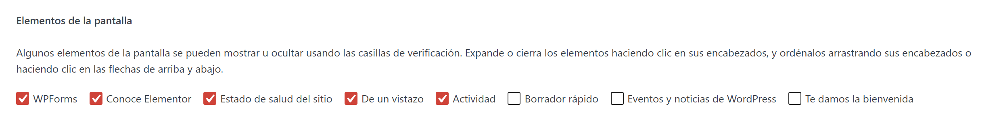

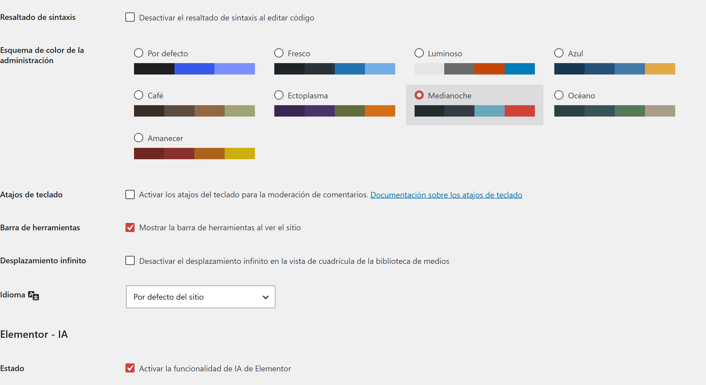

| Atajo | Acción |
|---|---|
| `Shift` + `Alt` + `C` | Abre el panel de **comentarios** (moderación). |
| `Shift` + `Alt` + `M` | Abre el panel de **medios** (biblioteca). |
| `Shift` + `Alt` + `P` | Abre el panel para **crear una entrada nueva**. |

---

## 4. Gestión de usuarios y roles

**Patrón de nombres de usuario:** `rol.nombre` (sin usar nunca `admin` a secas).  
**Contraseñas:** mínimo 12 caracteres, con mayúsculas, minúsculas, números y símbolos; generadas y guardadas en el gestor de contraseñas (no se anotan en el documento entregado).  
**Correos:** direcciones de prueba válidas del tipo `rol.nombre@jjidaw.local` (si CDMON las rechaza, se usan alias del correo del centro).

| Rol | Nombre de usuario | Nombre a mostrar | Justificación |
|---|---|---|---|
| **Administrador** | `admin.javier` | Javier Jiménez | Responsable TI y dirección: única cuenta con acceso a Ajustes, Plugins y Usuarios. No se usa a diario. |
| **Editor** | `editor.marta` | Marta Ruiz | Responsable de contenidos: publica, edita y modera entradas y comentarios de todo el sitio, pero no toca la configuración. |
| **Autor** | `autor.diego` | Diego Serrano | Redactor de la sección de prácticas: publica y gestiona **sus propias** entradas. |
| **Colaborador** | `colaborador.lucia` | Lucía Pardo | Colaboradora esporádica: escribe borradores y los envía a revisión, pero no puede publicar. |
| **Suscriptor** | `suscriptor.ana` | Ana Moreno | Lectora registrada: solo puede comentar; no entra al panel para crear contenido. |

**Buenas prácticas aplicadas:**

- **Principio de menor privilegio:** cada persona tiene el rol mínimo necesario para su función.
- **Nombre público distinto del login:** el nombre a mostrar es el nombre real, nunca el nombre de usuario, para no revelar credenciales.
- **Biografía rellena** (al menos Editor y Autor): una línea con su función en el proyecto, porque aparece publicada junto a sus entradas.
- **La cuenta administradora no se usa para redactar:** el día a día se hace con Editor o Autor.

**Biografías redactadas** (se ven en el perfil de cada usuario y junto a sus entradas):

- *Editora* (Marta Ruiz): «Editora de contenidos. Reviso y publico las entradas del blog, modero los comentarios y organizo las categorías y etiquetas del sitio.»
- *Autor* (Diego Serrano): «Autor de apuntes técnicos. Escribo entradas sobre HTML, CSS y JavaScript y las publico en el blog del ciclo DAW.»

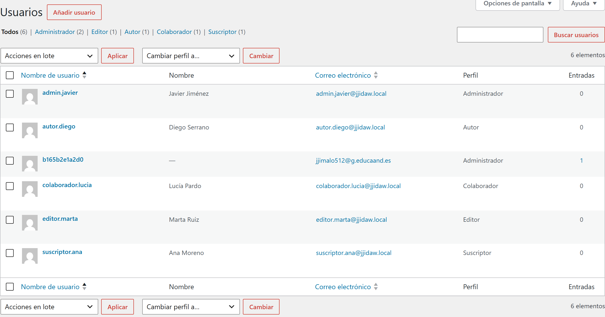

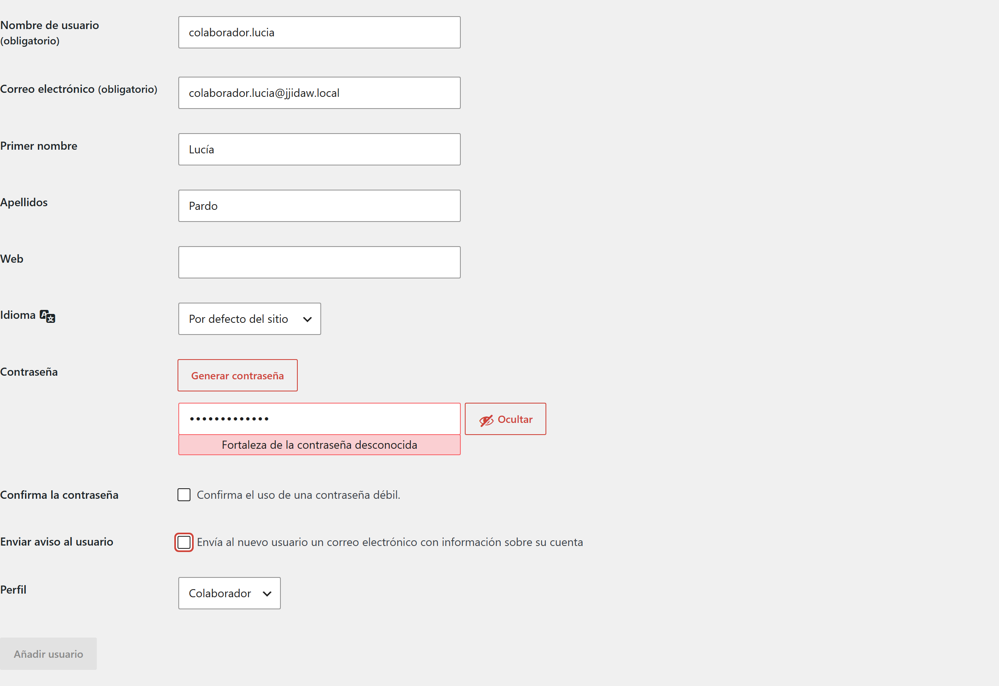

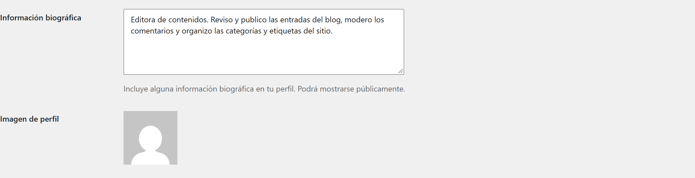

---

## 5. Verificación de permisos (experimento práctico)

| Acción | Administrador | Editor | Autor | Colaborador | Suscriptor |
|---|---|---|---|---|---|
| Crear entrada | ✅ | ✅ | ✅ | ✅ | ❌ |
| **Publicar** entrada propia | ✅ | ✅ | ✅ | ❌ (solo enviar a revisión) | ❌ |
| Editar entradas de otros | ✅ | ✅ | ❌ (solo las suyas) | ❌ | ❌ |
| Borrar entradas de otros | ✅ | ✅ | ❌ | ❌ | ❌ |
| Moderar comentarios | ✅ | ✅ | ❌ | ❌ | ❌ |
| Subir medios | ✅ | ✅ | ✅ | ✅ | ❌ |
| Crear categorías / etiquetas | ✅ | ✅ | ✅ | ❌ | ❌ |
| Acceder a **Ajustes** | ✅ | ❌ | ❌ | ❌ | ❌ |
| Acceder a **Usuarios** | ✅ | ❌ | ❌ | ❌ | ❌ |
| Instalar plugins o temas | ✅ | ❌ | ❌ | ❌ | ❌ |
| Escribir un comentario | ✅ | ✅ | ✅ | ✅ | ✅ |

**Resultado del experimento (lo observado en el panel, entrando con cada cuenta):**

1. **Colaborador** (`colaborador.lucia`): en el menú solo aparecen *Escritorio, Entradas, Comentarios, Plantillas, Perfil y Herramientas*; **no** hay Ajustes, Usuarios, Apariencia ni Plugins. En el editor el botón principal es **«Enviar para revisión»**; al pulsarlo la entrada queda en estado **Pendiente** (entrada 43). Una vez que el Editor la publica, la colaboradora ya no puede abrirla: el editor responde *«Lo siento, no tienes permisos para editar este elemento»*, que es exactamente el comportamiento esperado.
2. **Autor** (`autor.diego`): el menú añade *Medios* y el botón principal es **«Publicar»**. Publica su entrada (46) directamente, pero en *Entradas* solo ve las suyas: no puede editar ni borrar las de otros.
3. **Editor** (`editor.marta`): ve y edita las entradas de todos los autores (incluida la de la colaboradora), publica y modera comentarios; **Ajustes, Usuarios, Apariencia y Plugins no aparecen** en su menú.
4. **Suscriptor** (`suscriptor.ana`): el panel se reduce a *Escritorio* y *Perfil*. Su participación es en el sitio público, donde puede comentar.

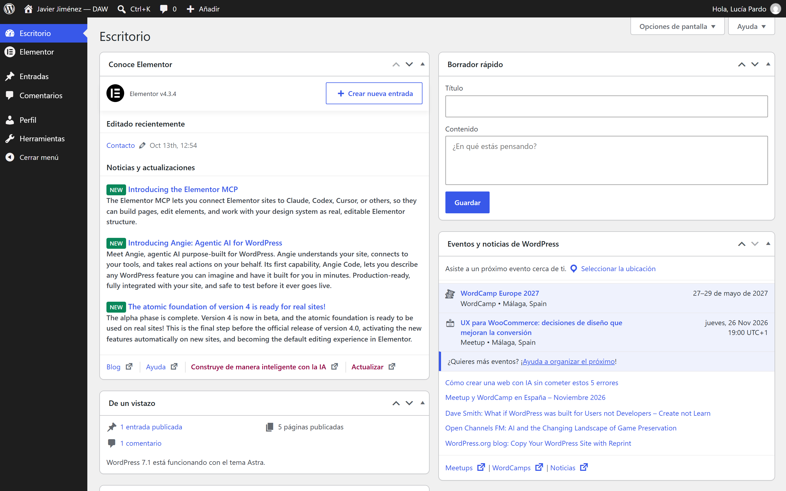

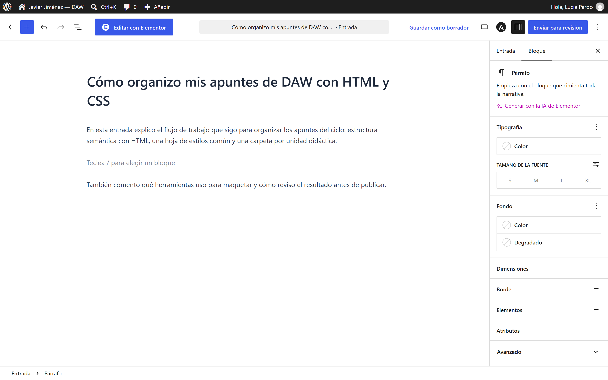

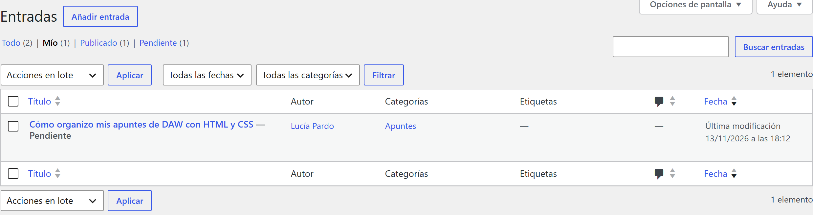

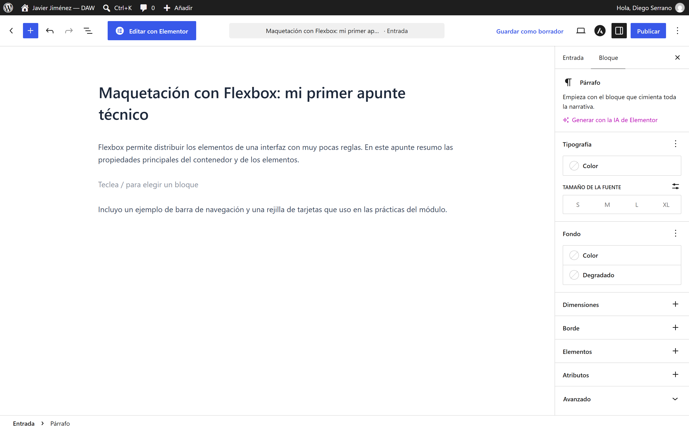

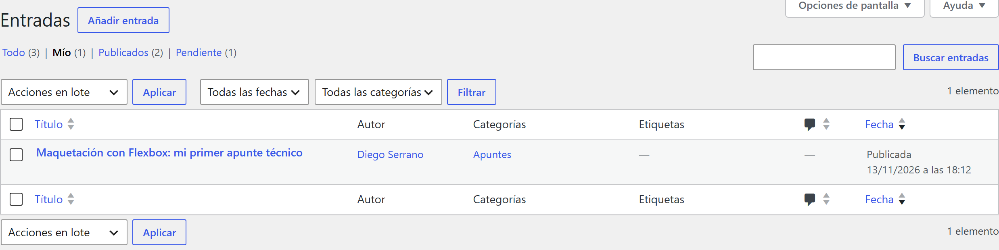

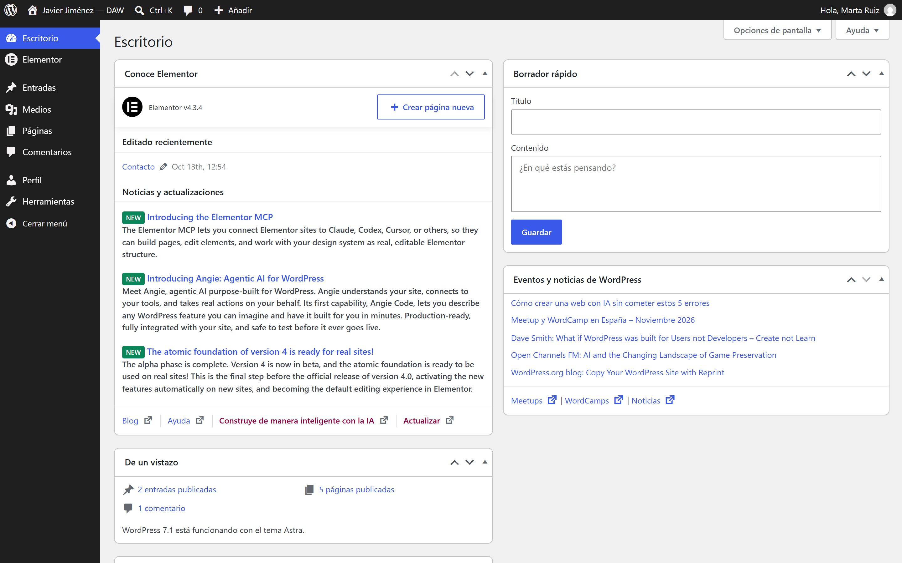

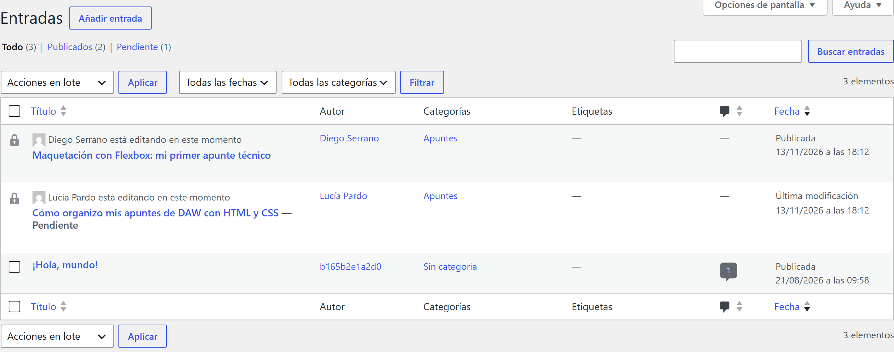

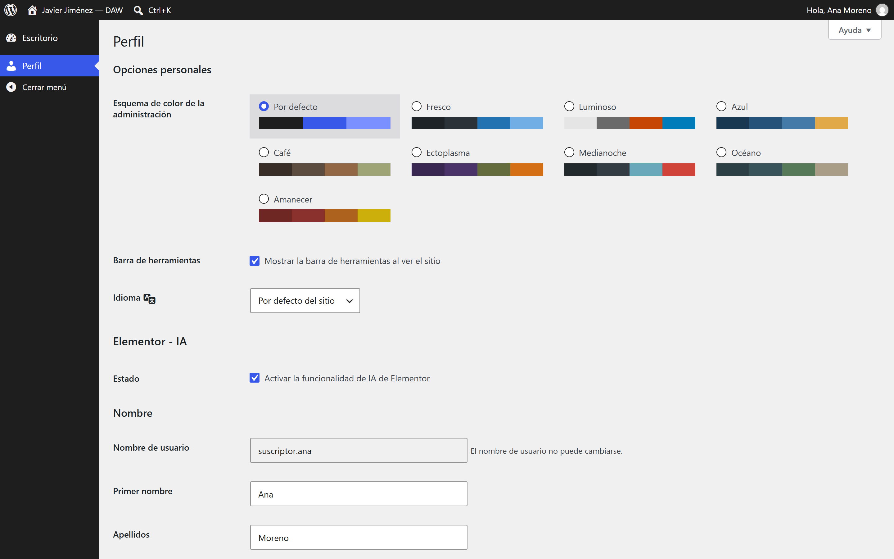

**Comparación con la matriz de permisos del PDF (pág. 12):** lo observado coincide con la matriz: los permisos crecen de Suscriptor a Administrador y las diferencias clave están en **publicar** (el Colaborador no puede, solo enviar a revisión) y en **editar contenido ajeno** (el Autor no puede). La única matización es que el Editor también puede **borrar** entradas de otros, algo que la matriz resume en la columna de gestión de contenido.

---

## 6. Flujo de trabajo editorial (realizado)

Temática de la entrada de prueba: *«Cómo organizo mis apuntes de DAW con HTML y CSS»* (entrada 43).

| Paso | Quién | Acción realizada | Resultado obtenido | Captura |
|---|---|---|---|---|
| 1 | **Colaborador** (`colaborador.lucia`) | Entradas → Añadir nueva, escribe título y texto y pulsa **Enviar para revisión** | Entrada en estado **Pendiente**; no se publica | `06b-colaborador-enviar-revision.png` |
| 2 | **Colaborador** | Entradas → Todas las entradas | La entrada aparece como **Pendiente**, sin enlace para publicar | `06c-colaborador-pendiente.png` |
| 3 | **Editor** (`editor.marta`) | Abre la entrada pendiente, revisa el texto, comprueba la **categoría** `Apuntes` y añade la **etiqueta** `HTML` | La entrada queda lista para publicar | `07b-flujo-02-editor-revisa.png` |
| 4 | **Editor** | Pulsa **Publicar** | Entrada **publicada**, visible en el blog | `07c-flujo-03-publicada.png` |
| 5 | **Suscriptor** (`suscriptor.ana`) | Abre la entrada en el sitio y escribe un comentario | El comentario queda **pendiente de moderación** | `07d-flujo-04-comentario.png` |
| 6 | **Suscriptor** | Envía el comentario | Aviso *«Tu comentario está pendiente de moderación»* | `07e-flujo-05-comentario-pendiente.png` |
| 7 | **Editor** | Comentarios → Pendiente → **Aprobar** | El comentario pasa a aprobado | `07f-flujo-06-editor-moderacion.png` |
| 8 | **Editor** | Comentarios → Aprobado | El comentario aparece en la lista de aprobados | `07g-flujo-07-comentario-aprobado.png` |
| 9 | **Visitante** (sin sesión) | Abre la entrada publicada | Entrada y comentario visibles para cualquiera | `07h-flujo-08-entrada-final.png` |

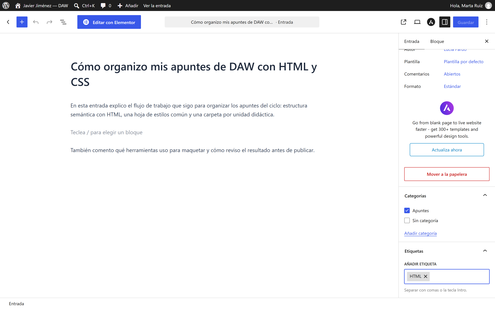

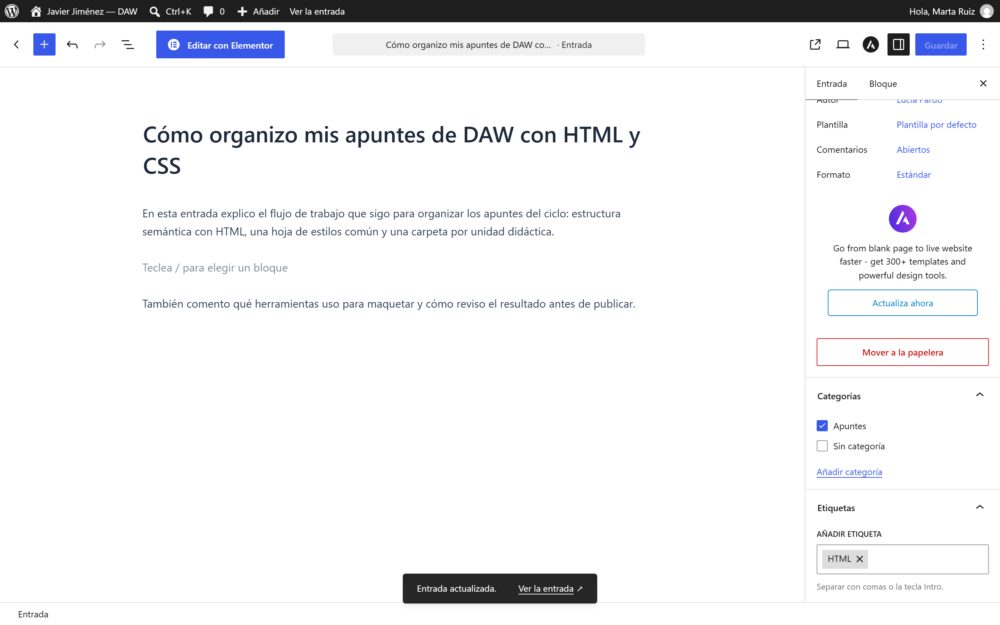

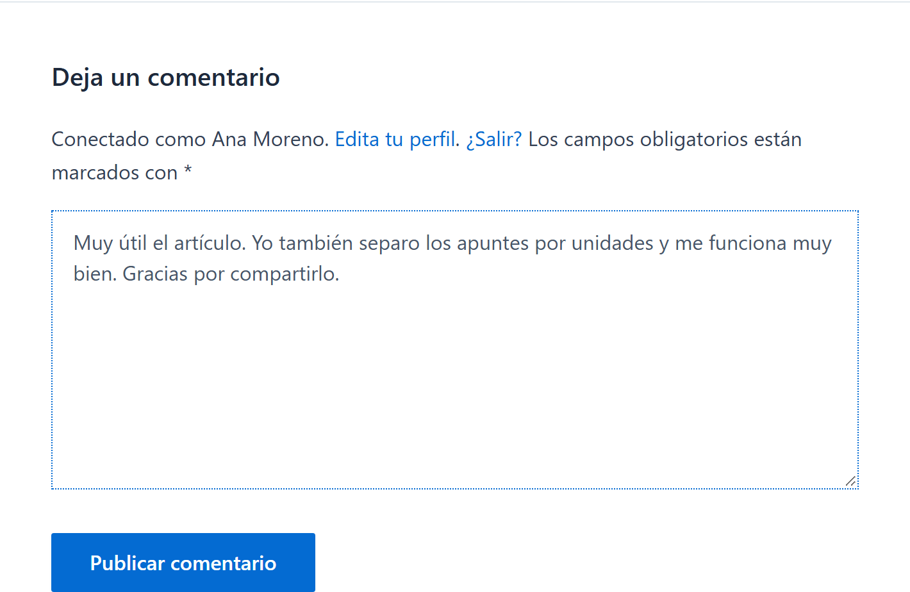

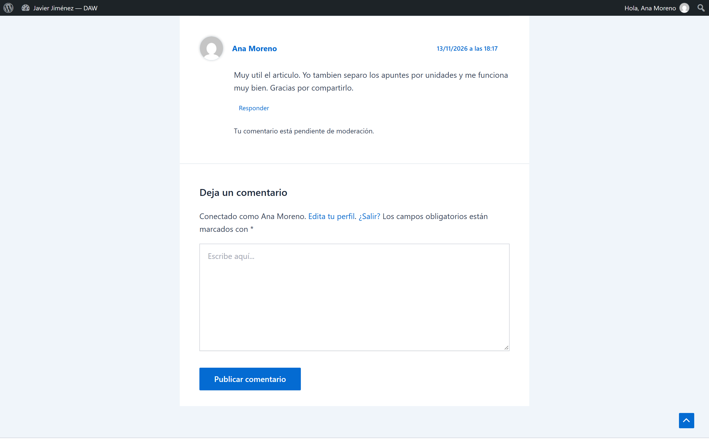

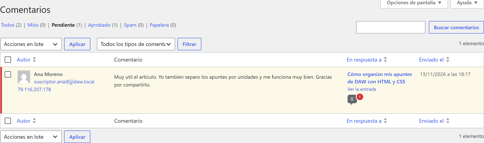

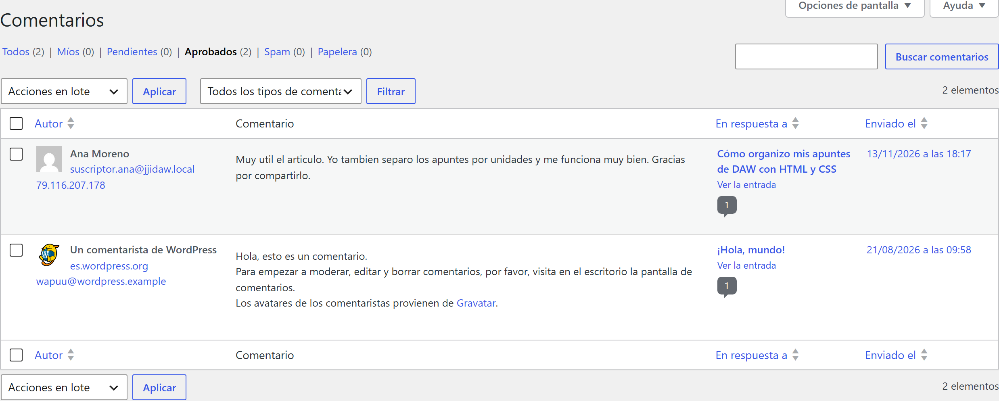

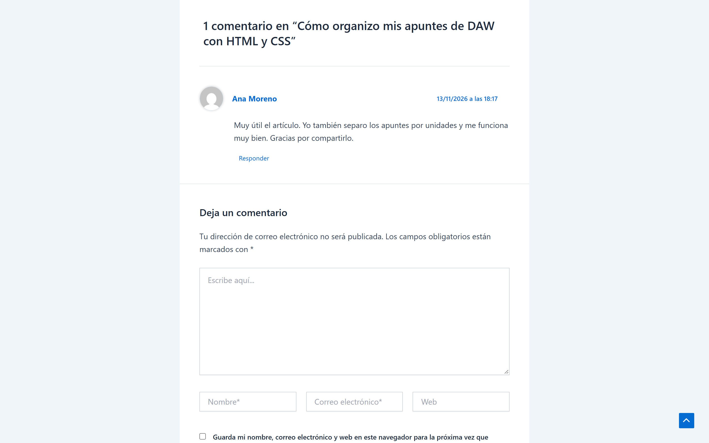

**Observaciones del flujo.** El circuito funciona como está diseñado: el Colaborador **propone**, el Editor **decide y publica** y el Suscriptor **participa** sin poder escribir contenido. La entrada conserva como autora a la colaboradora aunque la publique el Editor, de modo que el crédito no se pierde; y el comentario no aparece publicado hasta que el Editor lo aprueba, porque la opción *«El autor de un comentario debe tener un comentario previamente aprobado»* está activa por defecto. Es el mismo esquema de una redacción real y demuestra por qué no se debe dar rol de Editor a todo el mundo: quien redacta no debería ser quien aprueba su propio texto.

---

## 7. Relación de capturas

Todas las capturas están recortadas a la zona relevante y se han tomado a 1440 px de ancho con escala 2×, de modo que el texto se lee con nitidez al imprimir.

| Archivo | Contenido |
|---|---|
| `01-ajustes-generales.png` | Ajustes → Generales: título, descripción, URLs, zona horaria, formatos, idioma y registro desmarcado. |
| `02-ajustes-escritura.png` | Ajustes → Escritura con la categoría predeterminada `Apuntes`. |
| `02b-paginas-creadas.png` | Listado de páginas: Inicio, Blog, Quiénes somos y Contacto. |
| `03-ajustes-lectura.png` | Ajustes → Lectura: portada estática, página de entradas, 5 entradas, 10 en el feed y `noindex` desmarcado. |
| `04-escritorio.png` | Escritorio con el esquema Medianoche y los widgets en dos columnas. |
| `04a-perfil-esquema-color.png` | Perfil con el esquema de color Medianoche seleccionado. |
| `04b-opciones-pantalla.png` | Opciones de pantalla con los widgets desmarcados. |
| `05-usuarios-lista.png` | Usuarios → Todos los usuarios con los cinco roles. |
| `05b-usuario-nuevo.png` | Formulario de alta de un usuario nuevo, con rol y contraseña. |
| `05c-perfil-biografia.png` | Perfil de la editora con la biografía rellena. |
| `06a`…`06h` | Comprobación de permisos entrando con cada rol (menús y botones disponibles). |
| `07b`…`07h` | Flujo editorial completo: revisión, publicación, comentario, moderación y resultado final. |

**Cómo se entra al sitio.** El panel está en `http://www.jjidaw.com.mialias.net/wp-admin` y el acceso está protegido además por autenticación básica de la plataforma. Por `https` el certificado de pruebas de CDMON no coincide con el dominio (`ERR_CERT_COMMON_NAME_INVALID`), así que se trabaja por `http`.

---

## 8. Conclusión

La práctica demuestra que WordPress no es solo un editor de textos: el panel permite separar **quién escribe**, **quién decide** y **quién administra**, y esa separación es la que evita que un error de contenido o de configuración tumbe el sitio. Las decisiones con más impacto son tres: **desactivar el registro libre** (cierra la puerta al spam), **aplicar el principio de menor privilegio** con cinco roles reales y **comprobar los permisos en la práctica**, no solo en la teoría. La configuración de lectura y la indexación son igual de importantes: un sitio perfecto con `noindex` activado es un sitio invisible.
